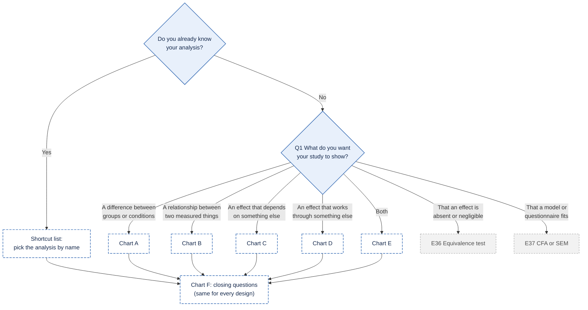
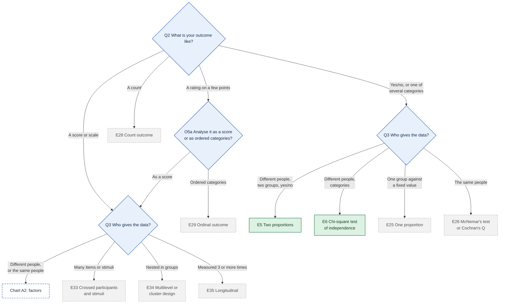
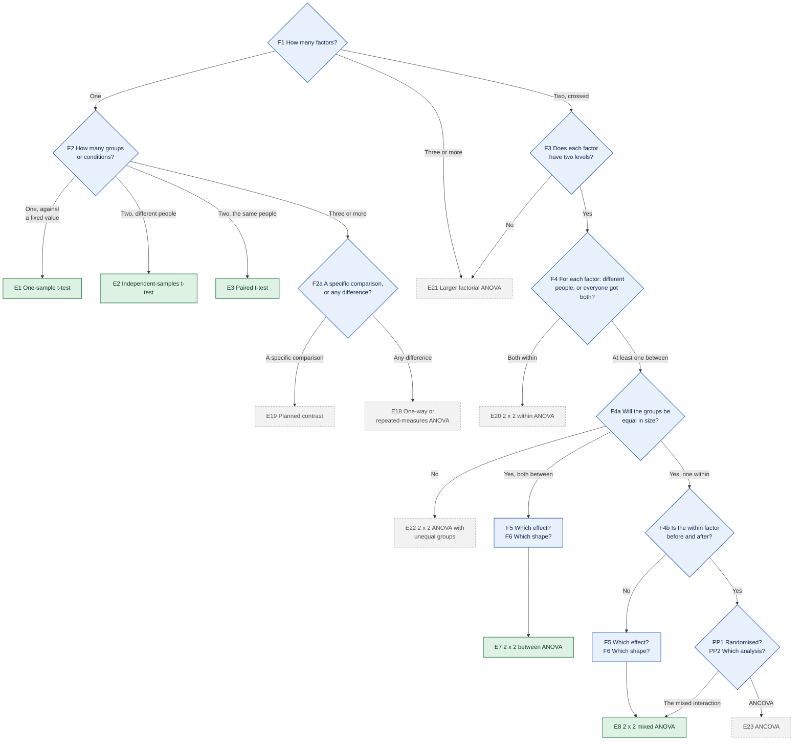
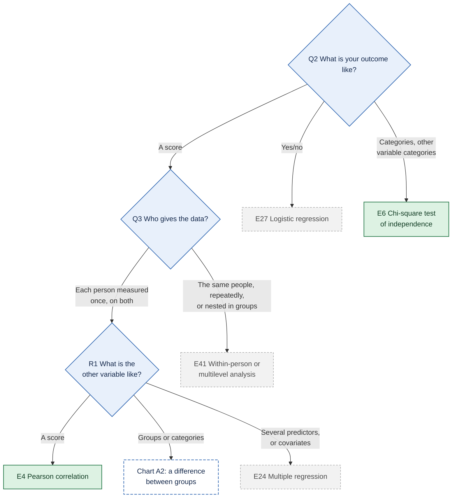
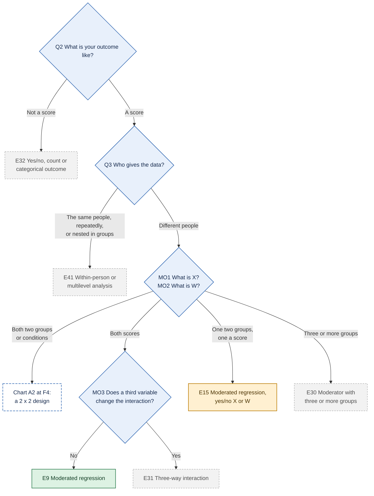
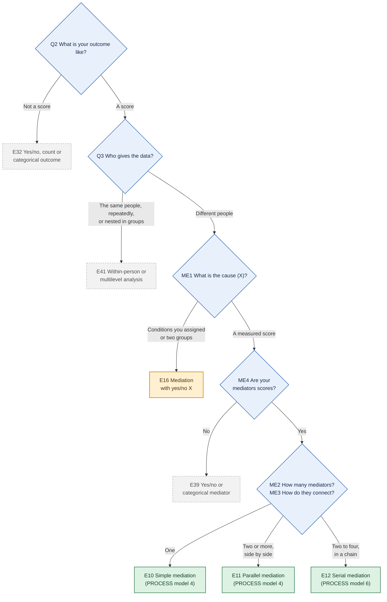
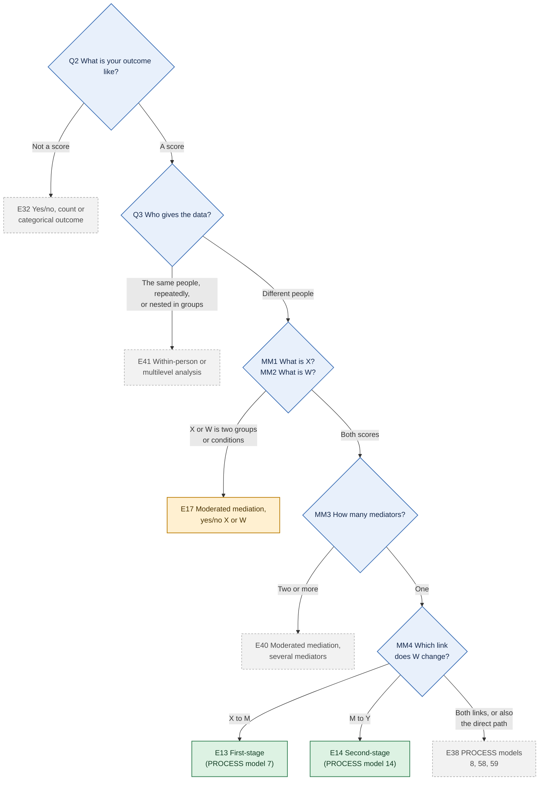
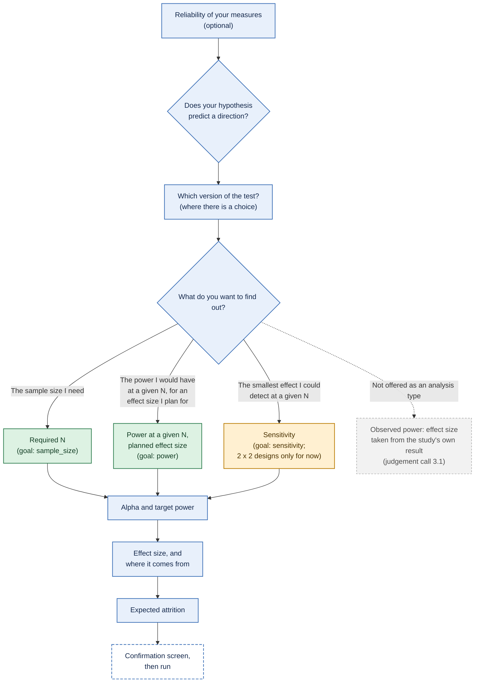

# Decision tree: from a study to a power analysis

*Draft, 15 October 2026. **Everything in this document is a proposal for the
maintainer to confirm.***

This is a draft specification of how a psychologist using the powerkit app
gets from their study to the right power analysis. It will guide the phase 5
app. It sits above [`design-finder.md`](design-finder.md), which already
gives the card wording, "Not sure?" text and maintainer decisions (D1–D9,
N1–N3) for most questions. This document:

1. summarises how established tools route users (precedent);
2. gives the tree, with every question mapped to the spec schema
   (`engine/inst/schema/design.schema.json`), and every end point mapped to
   a backend function, an effect-size form, a validation status and a tier;
3. lists the judgement calls where methodologists disagree, without
   deciding them;
4. ends with open questions.

Where this document and `design-finder.md` overlap, the question IDs (Q1,
F4a, MO1, ...) are the finder's, and the finder's decisions stand. This
document doesn't change them.

## 1. Precedent: how established tools route users

### G\*Power 3.1

From the G\*Power 3.1 manual (edition of 1 June 2023, provided by the
maintainer; *read directly: section 1, pp. 2–6, and chapter 11,
pp. 26–28; the rest of the manual was not read for this document*),
section 1.2, "Program handling":

- **Three steps.** "1. Select the statistical test appropriate for your
  problem. 2. Choose one of the five types of power analysis available. 3.
  Provide the input parameters required for the analysis and click
  'Calculate'" (manual, p. 2).
- **Two ways to choose the test.**
  - *Distribution-based:* first the **test family** (exact, F, t, χ², z),
    then the **statistical test** from a list that adapts to the family.
  - *Design-based:* the Tests menu, first by the **parameter class**
    (correlations and regression coefficients, means, proportions,
    variances, generic), then by the **design of the study** (for example
    number of groups, independent vs dependent samples). The manual notes
    that this keeps tests about the same parameter "in close proximity",
    whereas the distribution route scatters them across families (p. 2).
- **Five types of analysis** (section 1.1, p. 2):
  - a priori (N from power, α and effect size);
  - compromise (α and power from effect size, N and the ratio q = β/α);
  - criterion (α from power, effect size and N);
  - "post hoc" (power from α, effect size and N). This is G\*Power's own
    label. powerkit calls the same calculation with a **planned** effect
    size "power at a given N" and doesn't use "post hoc" for it, because
    the label is often read as *observed* power (see 2.2 and judgement
    call 3.1).
  - sensitivity (effect size from α, power and N).
- **Inputs** (section 1.2.3, p. 4): the number of tails, the effect size,
  α, power, and for two groups the allocation ratio n2/n1. A "Determine"
  button opens an effect-size calculator (for example, Cohen's d from two
  means and an SD). Cohen's (1988) small / medium / large conventions
  appear as tooltips. The manual adds that "these conventions may have
  different meanings for different tests".
- **Factorial ANOVA** (chapter 11, pp. 26–28): the user enters the effect
  size f (directly, from partial η², or from the variance explained and
  the error variance), the numerator df and the number of groups. The
  design itself (which factors, between or within) is not described to
  the program; the user works out f and the df. The manual's worked
  example applies its "post hoc" analysis to the effect sizes observed in
  a data set and reproduces SPSS's "Observed Power" column (pp. 27–28).
  That is observed power, which bears on judgement call 3.1 below.

The 2007 paper describing G\*Power 3 (Faul, Erdfelder, Lang & Buchner,
2007, *Behavior Research Methods*, 39, 175–191, doi:10.3758/BF03193146)
*(seen second-hand, to verify)* describes the same distribution-based and
design-based input modes.

### Superpower

From Superpower 0.2.4.1 (`ANOVA_design()` help and the
`intro_to_superpower` vignette):

- **No routing questions.** The user writes the design as a string, one
  term per factor: number of levels plus `b` (between) or `w` (within),
  for example `"2b*2w"`. Up to three factors.
- **Then the population:** cell means (`mu`), SD (`sd`), the correlation
  between repeated measures (`r`), and n per cell.
- **Then the function:** `ANOVA_exact()` or `ANOVA_power()` returns power
  for **every** main effect and interaction (and, optionally, emmeans
  contrasts) at once.
- **Required n** is found by changing n, or across a range with
  `plot_power()`. The vignette's example raises n step by step towards a
  target power.
- **The effect size** is entered as means, SDs and correlations, not as f
  or partial η².

### Spower

From Spower 0.6.4 (`SpowerIntro` vignette, "Types of power analyses to
evaluate"):

- **The test comes first:** the user picks an experiment function
  (`p_t.test()`, `p_r()`, `p_anova.test()`, `p_mediation()`, ...) or
  writes their own.
- **The type of analysis** is set by which argument is left as `NA`:
  - `n = NA` for a priori;
  - the effect size `NA` for sensitivity;
  - `sig.level = NA` for criterion;
  - `beta_alpha` for compromise;
  - nothing missing for what the vignette calls "prospective/post-hoc"
    power (Spower's wording; with a planned effect size this is powerkit's
    "power at a given N").

  The vignette says "specific naming conventions for the type of analysis
  being performed is not particularly important".
- **The same four quantities as G\*Power** (α, power, effect size, n):
  given three, the fourth is solved by simulation.

### power4mome

From power4mome 0.2.1 (vignette `power4mome`) and its website articles
(GitHub, development version):

- **The workflow:** specify the population model in lavaan syntax and its
  values (`pop_es`); call `power4test()` to check the model; call it again
  with a test function (`test_indirect_effect()`, `test_moderation()`,
  `test_index_of_mome()`, ...); compute power; then find n with
  `n_region_from_power()`, `power4test_by_n()` or `x_from_power()`.
- **"Quick Template" articles are organised by model family, then model
  form, then observed or latent variables:**
  - simple, parallel or serial mediation;
  - simple moderation, or moderation with two moderators;
  - moderated mediation with the a path or the b path moderated.
- **"Quick Functions"** (`q_power_mediation_simple()`, `_parallel()`,
  `_serial()`) take path sizes, including `"s"`/`"m"`/`"l"` labels, and a
  mode: power, region or n.

### InteractionPoweR

From InteractionPoweR 0.2.4 (help files, website articles, README):

- **The function chooses the analysis:**
  - `power_interaction_r2()` for analytic two-way power;
  - `power_interaction()` for simulated two-way power, with binary or
    ordinal variables (`k.x1`, `k.x2`, `k.y`);
  - `power_interaction_3way_r2()` for three-way interactions;
  - `power_interaction_r2_covs()` for interactions with covariates.
- **The population** is entered as correlations (r.x1.y, r.x2.y,
  r.x1x2.y, r.x1.x2), plus reliabilities.
- **Required N** comes from giving a vector of N (a power curve) and
  reading it, or from `power_estimate()`.
- **Two Shiny apps**, one simulation and one analytic, follow the same
  order.

### PAMLj (jamovi)

From PAMLj 1.2.0 (its analysis definitions `jamovi/*.a.yaml` and
`*.u.yaml`, and its README):

- **Menu by analysis family:** Correlation, T-Test, Proportions, General
  Linear Model, Factorial Designs, Generalized Linear Model, Mediation,
  Structural Equation Models, Mixed Models.
- **Then the "aim":** calculate N, power or the effect size. The README
  also lists required alpha.
- **Then a mode within the family:**
  - the design, for example independent, paired or one-sample t-test;
  - or how the effect is entered, for example factorial designs "from
    partial eta-squared" or "from means and SDs".
- **Then parameters:** power, α, alternative. Optional panels hold
  equivalence testing, sensitivity plots, power-parameter plots and
  effect-size conversion (for example, from a reported t to d, or from d
  to d_z).

### What the precedent suggests, and where the tree departs from it

| Established routing | This tree | Departure? Why |
| --- | --- | --- |
| Start from the **test** (G\*Power, Spower, PAMLj menus) or the **model** (Superpower, power4mome, InteractionPoweR) | Starts from the **hypothesis** (design finder Q1: difference, relationship, mediation, moderation, ...), then the outcome and who gives the data | **Departure.** powerkit is for users who may not know the test's name (build guide, section 7). Kept from precedent: an "I already know my analysis" shortcut lists tests by name, as G\*Power's and PAMLj's menus do. The design-based order (parameter, then design) is closest to G\*Power's design-based route |
| Type of analysis chosen **after** the test (G\*Power step 2, Spower's `NA`) | Asked **after** the design (Q-goal below) | Follows G\*Power's order |
| Type of analysis chosen **before** the design (PAMLj's "aim" comes first) | — | Not followed: the available analysis types depend on the design (sensitivity is 2x2-only today) |
| Five analysis types (G\*Power), the same four in Spower | Three: required n; power at a given n, for a planned effect size; smallest detectable effect. Observed power is not offered as an analysis type (2.2, 3.1) | **Departure for now.** The engine's `goal.type` has three values. Compromise and criterion are planned later ([coverage](coverage.md), Analysis types) |
| Effect size as a single standardised number (f, d, partial η²), with a calculator (G\*Power, PAMLj) | The **backend's** parametrisation: cell means and SDs for ANOVA (Superpower), correlations for interactions (InteractionPoweR), standardised paths for mediation (power4mome), d / d_z / r / proportions for basic tests (Spower) | Follows each backend. A converter from reported statistics is planned (build guide section 7) |
| Small / medium / large defaults offered (G\*Power tooltips; power4mome labels) | No defaults; a justification is required (`effect_justification`) | **Departure,** recorded in the build guide (section 4: it "stops 'medium effect' defaults"). See judgement call 3.2 |
| One analysis reported per run (G\*Power, Spower) or all effects at once (Superpower) | One **target** effect per run (F5, `target_test.effect`) | Follows G\*Power and Spower. Superpower's all-effects output could be shown as secondary information. See judgement call 3.5 |
| No contested choices asked (all tools) | Contested choices are asked, never made silently (design finder, principle P1) | **Departure,** by maintainer decision P1 |

## 2. The tree

### 2.1 Flowcharts

The tree is drawn as an overview (chart 0), one chart per goal (A to E)
and one chart for the closing questions every design shares (F). End
points are numbered E1 to E41; the table in 2.3 gives the details.

**Colours:**
- **blue:** a question;
- **green:** runs in powerkit now;
- **amber:** in the spec, but the engine refuses it until phase 3b (a
  yes/no X or W);
- **grey, dashed:** not in powerkit yet; the card points to another
  tool;
- **white, dashed:** continues in another chart.

**For presentations:** all the goals in one picture, with a key, is in
[`figures/decision-tree/full-presentation.png`](figures/decision-tree/full-presentation.png)
(also `.svg`). Every chart below is also rendered as `.png` (3x) and
`.svg` in [`figures/decision-tree/`](figures/decision-tree/). The `.mmd`
files there are the sources. To regenerate an image after editing its
source:

```
npx -p @mermaid-js/mermaid-cli@11.4.2 mmdc -c docs/figures/decision-tree/theme.json \
  -b white -s 3 -i docs/figures/decision-tree/<chart>.mmd -o docs/figures/decision-tree/<chart>.png
```

#### Chart 0: overview



#### Chart A1: a difference (the outcome and who gives the data)



#### Chart A2: a difference with a score outcome (the factors)



#### Chart B: a relationship



#### Chart C: moderation (an effect that depends on something else)



#### Chart D: mediation (an effect that works through something else)



#### Chart E: moderated mediation



#### Chart F: closing questions (every design)



### 2.2 Questions and their spec fields

Wording for most cards is in `design-finder.md`. The table gives the
question as the user sees it, the spec fields it sets, and whether the
engine can use the answer today.

**Engine can use it?**
- **Yes:** the answer sets a field the engine reads.
- **Routing only:** the answer chooses the path but isn't stored in the
  spec.
- **No (flag):** the engine has no field or feature for it yet.

| ID | Question (as the user sees it) | Options | Spec fields | Engine can use it? |
| --- | --- | --- | --- | --- |
| S0 | Do you already know which analysis you want? | Yes (searchable list) / No | `design`, `template` directly | Yes |
| Q1 | What do you want your study to show? | A difference; a relationship; works through something (mediation); depends on something (moderation); both; an effect is absent; a model fits | `design`: `basic_test` or `factorial_anova`, `regression_interaction`, `mediation`, `moderated_mediation` | Yes, except "absent" and "model fits": **no (flag)**, not in spec |
| Q2 | What is your outcome like? | Score; yes/no; one of several categories; a count; a rating on a few points | `variables.Y.type`: `continuous`, `binary`, `categorical` | Yes for score, yes/no and categories. **No (flag)** for count and ordinal |
| O5a | How will you analyse this rating? | As a score / as ordered categories (decision D1) | Score → `continuous` | Score: yes. Ordered: **no (flag)**. The choice and the note for the write-up aren't stored: **flag**, see open question 4 |
| Q3 | Who gives the data? | Different people; the same people; many items or stimuli; nested in groups; measured over time (T1: twice / three or more) | `variables.*.type` (`between_factor`, `within_factor`, `binary`); `template` (`independent_t` vs `paired_t`; `2x2_between` vs `2x2_mixed`) | Different and same people: yes. Stimuli, nesting, three or more times: **no (flag)** |
| F1–F3 | How many factors? How many groups? Two levels each? | (design finder) | `template`; `variables.A/B/X.levels` | Yes for the templates that exist |
| F2a | Specific comparison or any difference? | (decision D8) | — | **No (flag):** neither contrasts nor one-way ANOVA are in the spec |
| F4 | For each factor: different people, or everyone got both? | (design finder) | `variables.A.type`, `variables.B.type` (A is the between factor in `2x2_mixed`) | Yes |
| F4a | Will the groups be equal in size? | Yes / no (decisions D5, N1–N3) | 2x2: none (equal cells assumed). Two groups: `options.allocation_ratio` | 2x2: routing only (unequal → not available). Two-group tests: yes |
| F4b, PP1, PP2 | Before and after? Randomised? ANCOVA or mixed interaction? | (decision D2) | `factorial_anova / 2x2_mixed`, `target_test.effect = interaction` | Routing only. Randomisation and the reason for the choice aren't stored for the write-up: **flag** (open question 4). ANCOVA: **no (flag)** |
| F5 | Which result matters most for your study? | Effect of A; effect of B; the interaction | `target_test.effect`: `main_effect_A`, `main_effect_B`, `interaction` | Yes |
| F6 | Which picture matches your prediction? (interaction) | Lines cross; one effect shrinks; one disappears (decision D6) | — | **No (flag):** the shape is used only for a warning on the form. It isn't stored, so the write-up can't mention it (open question 4) |
| R1 | What is the other variable like? | Score; groups; several predictors | `variables.X.type` | Score / groups: yes. Several predictors: **no (flag)** |
| MO1, MO2 | What is X? What does the effect depend on (W)? | Two conditions you assigned; two groups that exist; a score; three or more groups | `variables.X.type`, `variables.W.type`: `binary` or `continuous` | Score × score: yes. Binary: the spec accepts it but `run_spec()` refuses it until phase 3b. Three or more groups: **no (flag)**. "Assigned vs existing" isn't stored (only used for wording): **flag** |
| MO3 | Does a third variable change the interaction again? | No / yes | — | Yes → **no (flag)**, three-way not in spec |
| ME1, MM1 | What is the cause (X)? | Conditions you assigned / a measured score | `variables.X.type` | Score: yes. Binary: refused until phase 3b. "Manipulated vs measured" (decision D9 notes) isn't stored: **flag** |
| ME2, ME3 | How many mediators? Side by side or in a chain? | One; two or more side by side; two to four in a chain | `template`: `process_4` (mediator `M`, or `M1`–`M9`) or `process_6` (`M1`–`M4`); `variables.M*` | Yes. Parallel mediation is validated with two mediators only |
| ME4 | Are your mediators scores? | Yes / no | `variables.M*.type = continuous` | No → **no (flag)** |
| (form) | Which indirect path is your hypothesis about? | e.g. X → M1 → M2 → Y | `target_test.path` | Yes |
| MM2 | What does part of the process depend on (W)? | Two groups / a score | `variables.W.type` | As MO2 |
| MM3, MM4 | How many mediators? Which link does W change? | One / more; X → M; M → Y; both; X → M and X → Y | `template`: `process_7` or `process_14` | Yes for 7 and 14. Others: **no (flag)** |
| Every design: Q-rel | Do you know how reliable your measures are? (optional) | A reliability per variable, or "assume perfect" | `variables.*.reliability` | Regression interactions: yes. Mediation: refused ("not available yet"). Other designs: rejected by the validator |
| Every design: Q-dir | Does your hypothesis predict a direction? | Two-sided / one-sided, with the direction | `target_test.alternative`: `two_sided`, `greater`, `less` | Basic tests except chi-square: yes. Other designs: two-sided only. See judgement call 3.3 |
| Every design: Q-test | Which version of the test? (where there is a choice) | Student or Welch (decision D7); exact or simulation (2x2) | `target_test.method`; `options.method` | Yes |
| Every design: Q-goal | What do you want to find out? | The sample size I need / the power I would have at a given sample size, for an effect size I plan for / the smallest effect I could detect at a given sample size | `goal.type`: `sample_size` (+ `goal.power`), `power` (+ `goal.n`), `sensitivity` (+ `goal.n`, `goal.power`) | Yes. Sensitivity only for the 2x2 designs; elsewhere the option is shown as not available yet: **flag** |
| Every design: Q-alpha | Which significance level (alpha)? | A number | `target_test.alpha` | Yes. The default is a judgement call (3.6) |
| Every design: Q-power | What power do you want? | A number | `goal.power` | Yes. The default is a judgement call (3.6) |
| Every design: Q-effect | What effect do you expect, and where does that number come from? | The design's effect-size form (table 2.3), plus the source: smallest effect of interest; meta-analysis; prior study (with an adjustment); pilot study | `population.*`; `effect_justification.type`, `.source`, `.adjustment` | Yes. Bias-corrected planning (e.g. BUCSS) has no field or backend: **flag** (judgement call 3.2) |
| Every design: Q-attr | How many participants do you expect to lose? | A proportion | `options.attrition` | Yes |
| Every design: Q-multi | Does your study test more than one hypothesis that this power analysis should cover? | No / yes | — | **No (flag):** one target effect per spec (judgement call 3.5) |
| Every design: Q-bayes | Will you test your hypothesis with p-values or with Bayes factors? | p-values / Bayes factors / not sure | — | **No (flag):** frequentist only. Bayes factors → E-bayes row in 2.3 |
| Every design: run settings | (advanced) replications, seed, CI draws | — | `options.nrep`, `options.seed`, `options.ci_draws` | Yes |

**Power at a given N (planned effect size) is not observed power.** They
are different analyses, and the app keeps them apart:

- **Power at a given N, for a planned effect size** (`goal.type =
  "power"`). This is the power for an effect size the user plans for and
  justifies (a smallest effect of interest, a meta-analysis, a
  bias-corrected prior study, ...), at a sample size they expect to have.
  It is prospective: "is this N enough for the effect I care about?" The
  app labels it **"power at a given N"** and never "post hoc".
- **Observed power** (the effect size taken from the study's own result).
  This is power computed after the study, from the effect it found. It
  follows directly from the study's p-value (judgement call 3.1). powerkit
  doesn't offer it as an analysis type. Whether the form should block,
  warn about, or allow an effect size that comes from the same study's
  result is open question 5.
- **Why not "post hoc":** G\*Power (manual, section 1.1) and Spower
  (vignette, "prospective/post-hoc") use "post hoc" for the calculation
  itself, whichever effect size goes in. Many readers take "post hoc" to
  mean observed power. Using "power at a given N" for the planned case
  keeps the two apart. Where this document quotes another tool's label,
  it says so.

### 2.3 End points

Validation status is from [`coverage.md`](coverage.md) and
[`validation-log.md`](validation-log.md). Test files are in
`engine/tests/testthat/`.

**Status today:**
- **Runs:** `run_spec()` runs it.
- **Spec only:** the spec accepts it, but the engine refuses it with a
  plain-English message.
- **Not in spec:** neither the spec nor the engine has it.

Tiers for rows that run are MVP (build guide section 2). Other tiers are
taken from coverage.md, where they are proposals.

| ID | End point (analysis name shown) | powerkit design / template | Backend function | Default method | Effect size the user enters | Validated? | Tier | Status today |
| --- | --- | --- | --- | --- | --- | --- | --- | --- |
| E1 | One-sample t-test | `basic_test / one_sample_t` | `Spower::Spower(Spower::p_t.test())` (one-sided: Spower's generator with `stats::t.test(alternative)`, Departure 4) | Simulation | Cohen's d: (mean − test value) / SD | Yes: `test-validation-basic-tests.R` (full run passed; G\*Power published values TODO) | MVP | Runs |
| E2 | Independent-samples t-test (Student's; Welch's as an option) | `basic_test / independent_t` | As E1 | Simulation | Cohen's d (group 2 − group 1) / pooled SD; allocation ratio | Yes: `test-validation-basic-tests.R` | MVP | Runs |
| E3 | Paired-samples t-test | `basic_test / paired_t` | As E1 | Simulation | d_z: mean difference / SD of differences (second minus first) | Yes: `test-validation-basic-tests.R` | MVP | Runs |
| E4 | Pearson correlation | `basic_test / correlation` | `Spower::p_r()` | Simulation | r | Yes: `test-validation-basic-tests.R` | MVP | Runs |
| E5 | Test of two proportions (z test) | `basic_test / two_proportions` | `Spower::p_prop.test()` (no continuity correction, Departure 5) | Simulation | p1, p2; allocation ratio | Yes: `test-validation-basic-tests.R` | MVP | Runs |
| E6 | Chi-square test of independence | `basic_test / chi_square_independence` | `Spower::p_chisq.test()` | Simulation | Cell probabilities (rows = X, columns = Y, summing to 1) | Yes: `test-validation-basic-tests.R` | MVP | Runs |
| E7 | 2 x 2 between-participants ANOVA (main effect or interaction) | `factorial_anova / 2x2_between` | `Superpower::ANOVA_exact()`; `ANOVA_power()` if simulation is chosen | Exact (analytic) | Four cell means (raw or in SD units) and the SD (one, or one per cell) | Yes: `test-validation-anova-2x2-between.R` (full run passed) | MVP | Runs; sensitivity available |
| E8 | 2 x 2 mixed ANOVA (incl. group × time) | `factorial_anova / 2x2_mixed` | As E7 (`ANOVA_exact()`, not `ANOVA_exact2()`, Departure 2) | Exact (analytic) | Four cell means, SD, correlation between the repeated measures | Yes: `test-validation-anova-2x2-mixed.R` (full run passed) | MVP | Runs; sensitivity available |
| E9 | Moderated regression (continuous × continuous) | `regression_interaction / two_way` | `InteractionPoweR::power_interaction()`; `power_interaction_r2()` only brackets n | Simulation | Correlations r_X_Y, r_W_Y, r_XW_Y (the interaction), r_X_W; optional reliabilities | Tests written, full run not recorded: `test-validation-regression-interaction.R` | MVP | Runs |
| E10 | Simple mediation (PROCESS model 4) | `mediation / process_4`, mediator `M` | `power4mome::power4test()` with `test_indirect_effect()`, Monte Carlo CI, batches of ≤ 200 | Simulation | Standardised paths X→M, M→Y, X→Y | Tests written, full run not recorded: `test-validation-mediation-simple.R` | MVP | Runs |
| E11 | Parallel mediation (PROCESS model 4) | `mediation / process_4`, `M1`–`M9` | As E10 | Simulation | Standardised paths; residual correlations between mediators (free, Departure 7) | Tests written, full run not recorded: `test-validation-mediation-parallel.R` (two mediators) | MVP (two); v2 for three or more ([coverage](coverage.md)) | Runs |
| E12 | Serial mediation (PROCESS model 6) | `mediation / process_6`, `M1`–`M4` | As E10 | Simulation | Standardised paths, every forward path | The process_6 chunk's full run on GitHub finished on 15 October 2026 with the workflow marked as succeeded ([run 38802624184](https://github.com/JoelThornton/Powerkit/actions/runs/38802624184)). Its test results are not yet recorded in the validation log: `test-validation-mediation-serial.R` | MVP | Runs |
| E13 | First-stage moderated mediation (PROCESS model 7), index of moderated mediation | `moderated_mediation / process_7` | `power4mome::power4test()` with `test_index_of_mome()` | Simulation | Standardised paths, including XW→M | Tests written, full run not recorded: `test-validation-modmed-process7.R` | MVP | Runs |
| E14 | Second-stage moderated mediation (PROCESS model 14) | `moderated_mediation / process_14` | As E13 | Simulation | Standardised paths, including MW→Y | Tests written, full run not recorded: `test-validation-modmed-process14.R` | MVP | Runs |
| E15 | Moderated regression with a yes/no X or W | `regression_interaction / two_way`, `type = binary` | `InteractionPoweR::power_interaction(k.x1 / k.x2 = 2)` (planned) | Simulation | Fully standardised correlations; groups 50/50 (maintainer decision) | No | MVP: phase 3b | Spec only |
| E16 | Mediation with a yes/no X | `mediation / process_4` or `process_6`, X `binary` | `power4test()` with `x_fun` = `rbinary_rs()` (planned) | Simulation | Fully standardised paths; group split via `p1` | No | MVP: phase 3b | Spec only |
| E17 | Moderated mediation with a yes/no X or W | `moderated_mediation / process_7` or `process_14` | As E16 | Simulation | As E16; X or W uncorrelated with the other predictors (maintainer decision) | No | MVP: phase 3b | Spec only |
| E18 | One-way ANOVA (different people) or repeated-measures ANOVA (same people), omnibus | — | Candidates: Superpower `"kb"` / `"kw"`; Spower `p_anova.test()` | — | (Superpower: means, SD, r) | No | v2 | Not in spec |
| E19 | Planned contrast | — | Candidates: Superpower emmeans contrasts; pwranova `pwrcontrast()` | — | Contrast weights and means | No | v2 | Not in spec |
| E20 | 2 x 2 within-participants ANOVA | — | Candidate: Superpower `"2w*2w"` | — | Means, SD, correlation matrix | No | v2 | Not in spec |
| E21 | Larger factorial ANOVA (2 x 3, 3 x 3, 2 x 2 x 2, ...) | — | Candidates: Superpower (up to three factors); pwranova (more, from partial η²) | — | Means, SDs, correlations | No | v2 for 2x3, 3x3, 2x2x2; later for the rest | Not in spec |
| E22 | 2 x 2 ANOVA with unequal group sizes | — | None validated (decision N3: needs an independent reference) | — | — | No | v2 | Not in spec |
| E23 | ANCOVA (incl. pre–post with a baseline covariate) | — | Candidates: Superpower `ANCOVA_analytic()`; pwrss `power.f.ancova()` | — | Means, SD, covariate R² | No | v2 | Not in spec |
| E24 | Multiple regression (R² or one coefficient) | — | Candidates: Spower `p_lm.R2()`, `p_glm()`; pwrss | — | R², or R² change | No | v2 | Not in spec |
| E25 | One proportion against a fixed value | — | Candidate: Spower `p_prop.test()` (binomial) | — | Proportion and test value | No | v2 | Not in spec |
| E26 | McNemar's test (same people, yes/no); Cochran's Q | — | Candidate: Spower `p_mcnemar.test()`. Cochran's Q: none found → R script export | — | Discordant proportions | No | v2 | Not in spec |
| E27 | Logistic regression (yes/no outcome) | — | Candidates: Spower `p_glm(family = binomial())`; pwrss; PAMLj | — | Odds ratio or coefficients | No | v2 | Not in spec |
| E28 | Count outcome (Poisson or negative binomial) | — | Candidates: Spower `p_glm(family = poisson())`; pwrss; WebPower | — | Rate ratio | No | v2 | Not in spec |
| E29 | Ordinal outcome (ordered categories) | — | Candidates: Hmisc `popower()`; powertools `propodds()`; PAMLj | — | Category proportions and odds ratio | No | v2 | Not in spec |
| E30 | Moderator with three or more groups | — | None in the backends' templates; power4mome as a general lavaan model → R script export | — | — | No | later | Not in spec |
| E31 | Three-way interaction | — | Candidate: InteractionPoweR `power_interaction_3way_r2()` (analytic only) | — | Correlations among x1, x2, x3, products and y | No | v2 | Not in spec |
| E32 | Moderation or mediation with a yes/no, count or categorical outcome | — | None found as a template → R script export | — | — | No | later | Not in spec |
| E33 | Crossed participants and stimuli | — | Candidates: simr; mixpower | — | Fixed effects and variance components | No | v2 | Not in spec |
| E34 | Multilevel or cluster design | — | Candidates: mlmpower; PowerUpR; clusterPower; PAMLj; WebPower. A design-effect approximation is a decided option for later (decision D4) | — | ICC, cluster size, effect | No | v2 | Not in spec |
| E35 | Longitudinal: three or more occasions (growth curves, cross-lagged panels, experience sampling) | — | Candidates: longpower; powRICLPM; semPower; PowerAnalysisIL | — | Model-specific | No | later | Not in spec |
| E36 | Equivalence test (TOST) or minimum-effect test | — | Candidate: TOSTER (`power_t_TOST()` and others) | — | Equivalence bounds and the expected effect | No | v2 | Not in spec |
| E37 | CFA, SEM model fit, measurement invariance | — | Candidates: semPower; simsem; pwrSEM | — | RMSEA or model parameters | No | later | Not in spec |
| E38 | PROCESS models 8, 58, 59 | — | Candidate: power4mome as a general lavaan model (no template); WebPower `wp.modmed.m8()`, `m58()` | — | Standardised paths | No | v2 (build guide) | Not in spec |
| E39 | Mediation with a yes/no or categorical mediator | — | None found → R script export | — | — | No | later | Not in spec |
| E40 | Moderated mediation with two or more mediators | — | power4mome as a general lavaan model → R script export | — | Standardised paths | No | later | Not in spec |
| E41 | Within-person, repeated-measures or multilevel correlation, moderation or mediation | — | Moderation: mlmpower; simr. Mediation: none found (within-person mediation has no ready-made tool; [coverage](coverage.md)) | — | Model-specific | No | later | Not in spec |
| E-bayes | Bayes factor design (any design) | — | Candidates: BFDA; bfpwr; Spower with a user-written criterion | — | Prior and expected effect | No | later | Not in spec |

**For "not in spec" end points the card says so plainly.** It names the
analysis, the tool from [coverage.md](coverage.md) that covers it, and
whether the R script export can help. A proposed wording: *"powerkit
doesn't cover [analysis name] yet. [Tool] does: see [link]. powerkit
can't check results from other tools."* The finder never routes such a
design to a simpler test as a stand-in (decision N2's principle,
generalised; see open question 6).

**The R script export** (phase 4) writes code for designs powerkit runs. For
designs it doesn't run, nothing exists to export. Rows that say "R script
export" mean the full-model builder plus a hand-written script, which is a
phase 4–5 question (open question 7).

## 3. Judgement calls (no decisions made here)

These are the points where psychologists or statisticians disagree. For
each one, the main positions are listed with sources. Following principle
P1, where a call changes the analysis, the app asks the user and the
write-up states the choice. **This section decides nothing.**

**How sources are tagged.** *(read in full)*: the source itself was read.
*(seen second-hand, to verify)*: known only from web search results,
abstracts, package documentation or other papers that cite it, so the
claim needs checking against the source before anything depends on it.
Unless a source is tagged *read in full*, it is second-hand.

### 3.1 Observed power (effect size taken from the study's own result)

This is about **observed power**: power computed after a study from the
effect size that study found. It is not "power at a given N" for a
planned effect size (2.2), which is prospective. Some tools call both
"post hoc".

- **Against:** observed power is a direct function of the study's
  p-value, so it adds no information, and using it to interpret a
  non-significant result is fallacious (Hoenig & Heisey, 2001, *The
  American Statistician*, 55(1), 19–24,
  doi:10.1198/000313001300339897) *(seen second-hand, to verify)*.
- **Narrower reading:** that argument concerns power for a single test,
  computed from that test's own result. Power computed from observed
  effects can still describe a body of research. Perugini, Gallucci and
  Costantini (2014, p. 319) write that "the post hoc calculation of power
  can also be useful for characterizing entire domains of research"
  *(read in full)*. A blog post argues the same against broad readings of
  Hoenig and Heisey (Replication Index, "The abuse of Hoenig and Heisey",
  2016; not peer-reviewed) *(seen second-hand, to verify)*.
- **Common practice:** statistics packages report observed power (SPSS's
  "Observed Power" column). G\*Power's manual reproduces that column by
  applying its "post hoc" analysis to the observed effect sizes (G\*Power
  manual, 2023, pp. 27–28; read directly). Reviewers sometimes request it.
- **What this means for powerkit:** powerkit doesn't offer observed power
  as an analysis type (2.2). Whether the form should block, warn about, or
  allow an effect size that comes from the same study's result is open
  (open question 5). `effect_justification.type` has no "this study's own
  result" option today.

### 3.2 Where effect sizes come from

- **Smallest effect size of interest (SESOI):** power the study for the
  smallest effect that would matter, rather than the expected one. Lakens
  (2022, "Sample size justification", *Collabra: Psychology*) *(seen second-hand, to verify)* sets out
  this and other justifications: an a priori power analysis, planning for
  accuracy, resource constraints, heuristics, or no justification.
- **Published studies and meta-analyses:** published effects tend to be
  inflated by publication bias. Two responses:
  - **Bias and uncertainty correction.** BUCSS implements Anderson,
    Kelley and Maxwell (2017, *Psychological Science*,
    doi:10.1177/0956797617723724) *(seen second-hand, to verify)* and its extension to replications
    (Anderson & Kelley, 2024, *Psychological Methods*,
    doi:10.1037/met0000520) *(seen second-hand, to verify)*. Both are known from BUCSS's own
    documentation.
  - **Safeguard power** (Perugini, Gallucci & Costantini, 2014,
    *Perspectives on Psychological Science*, 9(3), 319–332,
    doi:10.1177/1745691614528519) *(read in full)*. Plan with the lower
    bound of a two-tailed confidence interval around the published
    effect: the 60% interval (its 20th percentile) gives 80% protection
    against overestimating the effect, and the 90% interval gives 95%.
    In their simulations, safeguard power at 80% gave actual power above
    the nominal .80 under most conditions typical of psychology, where
    standard power analysis fell short (pp. 320–321). They also propose a
    "safeguard sample ratio" to judge how strong an original study's
    evidence is (pp. 325–326), and compare the method with the "2.5 rule"
    (pp. 325–329).
    mixpower implements it as `mp_safeguard_effect()`.
- **Pilot studies:** effect sizes from small pilots are imprecise. Going
  ahead only with pilots that look promising causes "follow-up bias" that
  leaves main studies underpowered. Albers and Lakens (2018, *Journal of
  Experimental Social Psychology*, 74, 187–195,
  doi:10.1016/j.jesp.2017.09.004) *(seen second-hand, to verify)* also advise against η² for this
  purpose. powerkit already warns about pilot estimates
  (`spec_advice()`).
- **Conventional benchmarks** (small / medium / large; Cohen, 1988 *(seen second-hand, to verify)*):
  G\*Power offers them as tooltips, with the caution that "these
  conventions may have different meanings for different tests" (manual,
  p. 4; read directly). powerkit's build guide rules out "medium effect"
  defaults (section 4). Whether the app should show benchmarks at all,
  even as context, is open.
- **Replications:** the "small telescopes" approach plans a replication
  around the effect the original study had 33% power to detect, which
  takes about 2.5 times the original sample for 80% power (Simonsohn,
  2015, *Psychological Science*, doi:10.1177/0956797614567341 *(seen second-hand, to verify)*;
  implemented in RSmallTelescopes). Perugini et al. (2014, pp. 325–329)
  *(read in full)* compare it with safeguard power. The 2.5 rule depends
  only on the original sample size, while safeguard power depends on both
  the size and the precision of the original estimate. In their examples the
  2.5 rule can ask for much more or much less than safeguard power,
  depending on the original sample size and effect size.

### 3.3 One-tailed tests

- **For, when justified:** a directional research hypothesis can be tested
  one-tailed. Two-tailed tests are often used because people wrongly
  believe they are more conservative, and because the research hypothesis
  isn't kept apart from the statistical one (Cho & Abe, 2013, *Journal of
  Business Research*, 66(9), 1261–1266) *(seen second-hand, to verify)*.
- **With conditions:** use a one-tailed test only when the researcher can
  explain why only one direction matters, and say in advance how a large
  effect in the other direction would be treated (Ruxton & Neuhäuser,
  2010, *Methods in Ecology and Evolution*, 1(2), 114–117) *(seen second-hand, to verify)*.
- **Against by default:** many journals and reviewers treat two-tailed
  testing as the norm. A one-tailed test that isn't preregistered invites
  suspicion.
- **Already decided in powerkit:** a one-sided test counts only effects in
  the stated direction (Departure 4). It is allowed only for directional
  basic tests (`two_sided_only` elsewhere). G\*Power asks for the number
  of tails as an input (manual, p. 4; read directly). Open: whether the
  app should require a preregistration note before allowing one-sided,
  and whether to offer it for more designs.

### 3.4 Powering an interaction versus its simple effects

- **Interactions need large samples:** attenuated interactions, where a
  moderator shrinks an effect, need far more participants than the main
  effect they modify:
  - Blake and Gangestad (2020, *Personality and Social Psychology
    Bulletin*) *(seen second-hand, to verify)*;
  - Simonsohn, "No-way interactions" (Data Colada [17], 2014) *(seen second-hand, to verify)*;
  - Giner-Sorolla (2018, blog post "Powering your interaction") *(seen second-hand, to verify)*, with
    rules of thumb for reversal, knockout and attenuation;
  - Sommet, Weissman, Cheutin and Elliot (2023, *AMPPS*) *(seen second-hand, to verify)*, already a
    benchmark source in the build guide, with required sizes by
    interaction shape.
- **Which test matches the hypothesis:** some argue the hypothesis is
  often really about the simple effects (for example "praise helps on
  hard tasks"), so the power analysis should target them. Others say the
  interaction is the test that licenses the claim that an effect differs,
  so it must be powered.
- **Existing powerkit design:** the finder asks which effect matters (F5)
  and records the expected shape (F6, decision D6). There is no
  simple-effect target in the spec. Superpower can give power for simple
  effects through emmeans ([coverage](coverage.md)).

### 3.5 Power for one test versus all the tests in a study

- **One test:** standard practice (G\*Power, Spower, and powerkit's single
  `target_test`) powers the main hypothesis test.
- **All tests:** a study that needs several tests to all succeed has lower
  power for the whole set than for any one test. The "curse of
  multiplicities" affects power as well as Type I error, and has largely
  been ignored (Maxwell, 2004, *Psychological Methods*, 9(2),
  147–163) *(seen second-hand, to verify)*.
- **Whether to correct alpha:** Rubin (2021, *Synthese*, 199,
  10969–11000, doi:10.1007/s11229-021-03276-4) *(seen second-hand, to verify)* distinguishes three
  cases:
  - *disjunction* testing (any one significant result supports the
    claim): alpha needs adjusting;
  - *conjunction* testing (all results must be significant): no
    adjustment needed;
  - *individual* testing (each claim stands alone): no adjustment
    needed.

  Rubin argues adjustment shouldn't be automatic.
- **Tools:** powertools (`coprimary.t()` for all, `altprimary()` for any),
  power4mome (`rejection_rates(collapse = "all_sig")`) and Superpower
  (`p_adjust`) support parts of this ([coverage](coverage.md)).

### 3.6 Defaults for alpha and target power

- **Power .80:** Cohen proposed .80 as a convention for when the
  researcher has no other basis. He reasoned that a Type I error is about
  four times as serious as a Type II error (.20 / .05) (Cohen, 1988,
  *Statistical Power Analysis for the Behavioral Sciences*, 2nd ed.) *(seen second-hand, to verify)*.
  Perugini et al. (2014, p. 319) *(read in full)* also report that "Cohen
  (1988) suggested .80 as a desirable threshold of power", which is still
  second-hand for Cohen's own wording.
- **Power .90 or .95:** many Registered Report formats ask for higher
  power. The exact requirement varies by journal and isn't checked here.
- **Alpha .05:** the convention. Benjamin et al. (2018, "Redefine
  statistical significance", *Nature Human Behaviour*) *(seen second-hand, to verify)* proposed .005
  for claims of new discoveries.
- **Justify, don't default:** Lakens et al. (2018, "Justify your alpha",
  *Nature Human Behaviour*, doi:10.1038/s41562-018-0311-x) *(seen second-hand, to verify)* argue that
  every design choice, alpha included, should be justified rather than
  set by convention. Superpower's `optimal_alpha()` and Spower's
  compromise analysis put this into practice ([coverage](coverage.md)).
- **What the form needs:** pre-filled values (and which ones), blank
  fields, or pre-filled values plus a required reason.

## 4. Open questions for the maintainer

1. **Starting point.** Should the tree start from the hypothesis (as here
   and in `design-finder.md`), or offer G\*Power's design-based order
   (parameter class, then design) as an alternative route alongside the
   shortcut list?
2. **Analysis types.** Offer only the three `goal.type` values for now? Show
   compromise and criterion as "coming later", or leave them out? Should
   "smallest detectable effect" appear for designs where the engine can't
   do it yet, greyed out, or be hidden?
3. **Order of the closing questions.** The tree asks what you want to find
   out after the design (G\*Power's order). PAMLj asks first. Confirm.
4. **Answers the spec can't store.** Several answers matter for the
   write-up but have no spec field:
   - O5a: rating analysed as a score;
   - PP1: randomised or not;
   - PP2: why ANCOVA or the mixed interaction was chosen;
   - F6: the expected shape;
   - MO1, ME1: manipulated or measured.

   Add a spec field (for example `design_notes`), put them in
   `effect_justification.notes`, or keep them in the app only? A new field
   is a schema change (spec version).
5. **Judgement calls (section 3).** For each: ask the user, set a default
   with a recorded reason, or leave it to the user without comment?
   Specifically:
   - 3.1: should an effect size from the study's own result be blocked,
     warned about, or allowed?
   - 3.2: should benchmarks be shown, and should BUCSS-style correction
     be offered (no backend yet)?
   - 3.3: should one-sided tests require a preregistration note?
   - 3.4: should simple effects become a target?
   - 3.5: should the app ask about several hypotheses?
   - 3.6: which defaults, if any, should alpha and power have?
6. **"Not in spec" end points.** Confirm the wording for pointing users to
   another tool, and the rule that powerkit never routes to a simpler
   stand-in test. This rule generalises decision N2 beyond 2x2 main
   effects.
7. **R script export for uncovered designs.** The export (phase 4) writes
   code for designs powerkit runs. For uncovered designs (E30, E32, E39,
   E40), should the full-model builder generate a power4mome or Spower
   script the user runs themselves, without powerkit's validation? This
   is not planned anywhere yet.
8. **Bayes factors.** Ask "p-values or Bayes factors?" up front (and route
   Bayes factors to "not available"), or leave Bayesian designs to the
   shortcut list?
9. **`design-finder.md` status labels.** Updated in this PR: the basic
   tests, regression interactions and mediation now show **Available**;
   a yes/no X or W in moderation or mediation shows **Coming later (spec
   ready)** until phase 3b. Should the two documents stay separate (card
   wording there, structure here), or be merged?
10. **Parallel mediation with three or more mediators.** The spec and
    engine accept up to nine mediators, but validation covers two
    ([coverage](coverage.md) proposes v2 for three or more). Should the
    form allow three or more before that validation exists?

## Sources

**Read in full or read directly:**
- The G\*Power 3.1 manual, edition of 1 June 2023 (provided by the
  maintainer; not committed to the repository). Read directly: section 1
  (pp. 2–6) and chapter 11 (pp. 26–28); the rest wasn't read for this
  document.
- Perugini, M., Gallucci, M., & Costantini, G. (2014). Safeguard power as
  a protection against imprecise power estimates. *Perspectives on
  Psychological Science*, 9(3), 319–332. doi:10.1177/1745691614528519
  (provided by the maintainer; read in full).
- Package sources and documentation as in [`coverage.md`](coverage.md),
  "Sources": Superpower 0.2.4.1, Spower 0.6.4, power4mome 0.2.1 (and its
  GitHub website articles), InteractionPoweR 0.2.4, PAMLj 1.2.0, and the
  candidate tools in its "Not covered by the five tools" section. These
  were read for what each tool does, not for the papers they cite.

**Seen second-hand, to verify** (from web search results, abstracts,
package documentation or citing papers; not read in full):
- Faul, Erdfelder, Lang & Buchner (2007), *Behavior Research Methods*.
- Hoenig & Heisey (2001), *The American Statistician*.
- Replication Index (2016), "The abuse of Hoenig and Heisey" (blog).
- Lakens (2022), *Collabra: Psychology*.
- Anderson, Kelley & Maxwell (2017), *Psychological Science*.
- Anderson & Kelley (2024), *Psychological Methods*.
- Albers & Lakens (2018), *Journal of Experimental Social Psychology*.
- Cohen (1988), *Statistical Power Analysis for the Behavioral Sciences*
  (2nd ed.).
- Simonsohn (2015), *Psychological Science*.
- Cho & Abe (2013), *Journal of Business Research*.
- Ruxton & Neuhäuser (2010), *Methods in Ecology and Evolution*.
- Blake & Gangestad (2020), *Personality and Social Psychology Bulletin*.
- Simonsohn (2014), "No-way interactions", Data Colada [17] (blog).
- Giner-Sorolla (2018), "Powering your interaction" (blog).
- Sommet, Weissman, Cheutin & Elliot (2023), *AMPPS*.
- Maxwell (2004), *Psychological Methods*.
- Rubin (2021), *Synthese*.
- Benjamin et al. (2018), *Nature Human Behaviour*.
- Lakens et al. (2018), *Nature Human Behaviour*.
