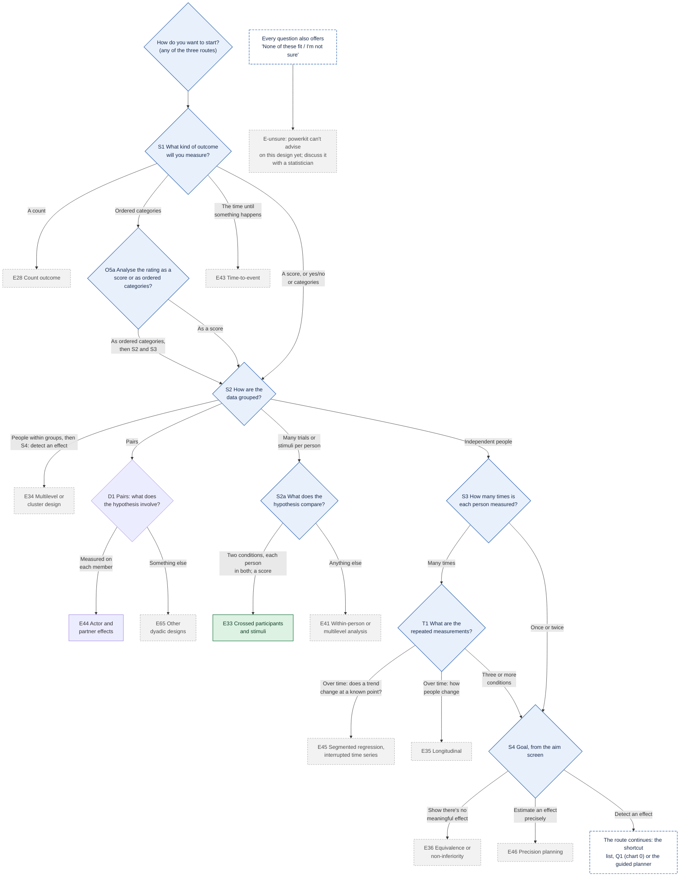
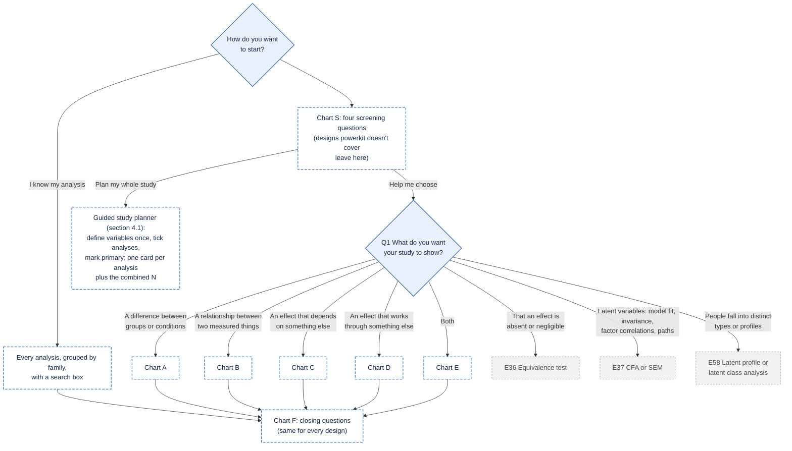
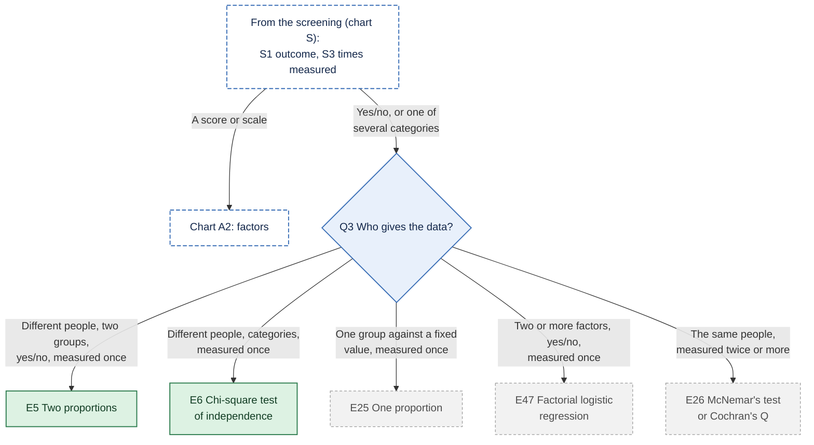
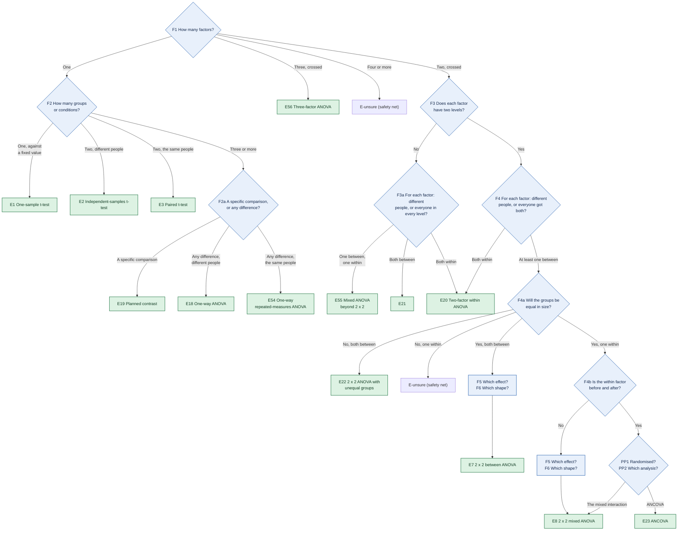
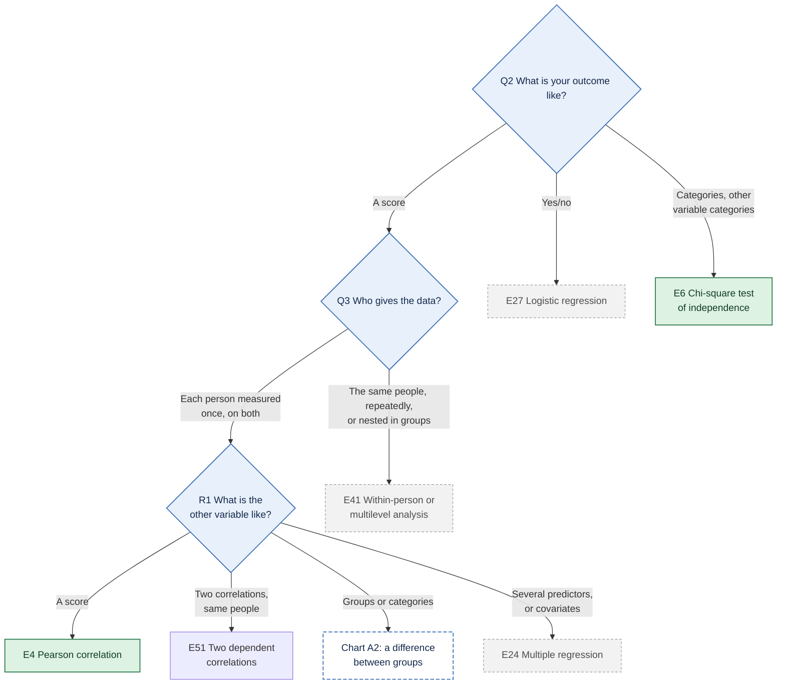
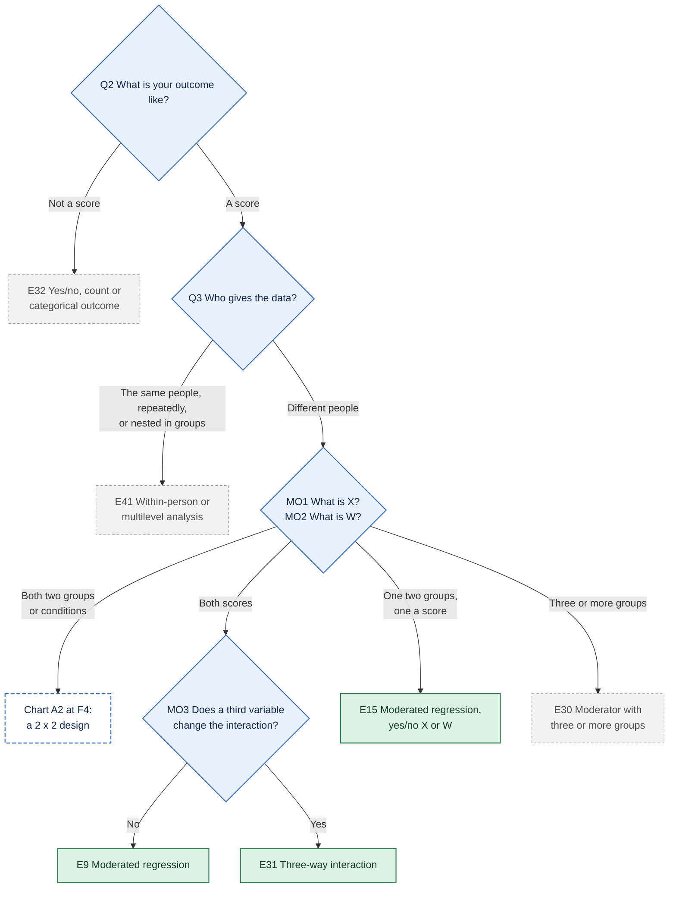
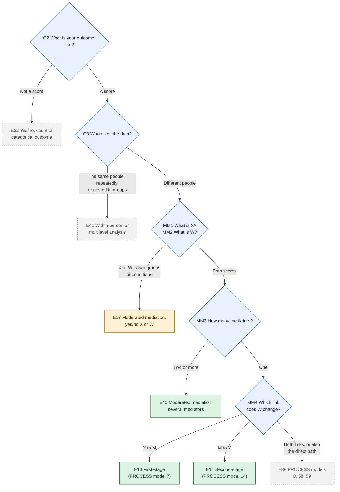
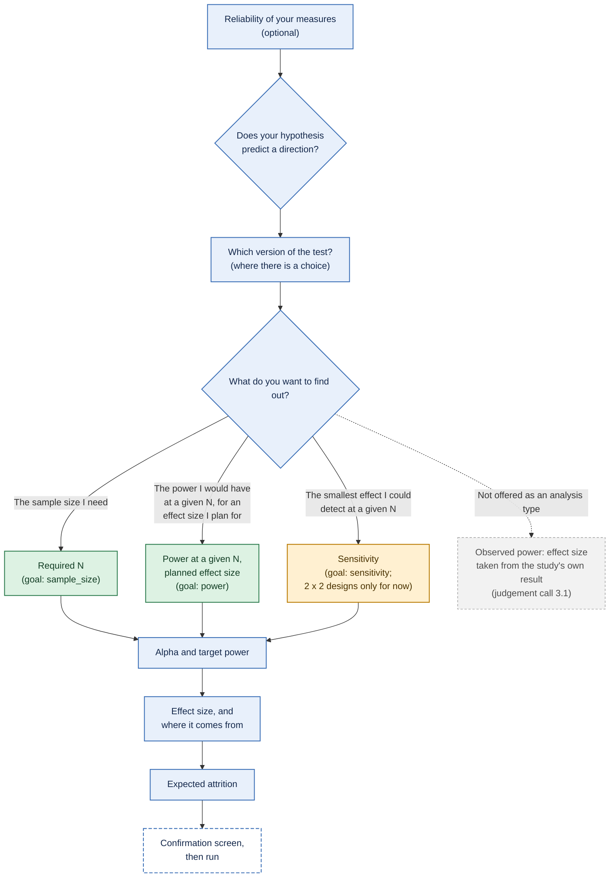
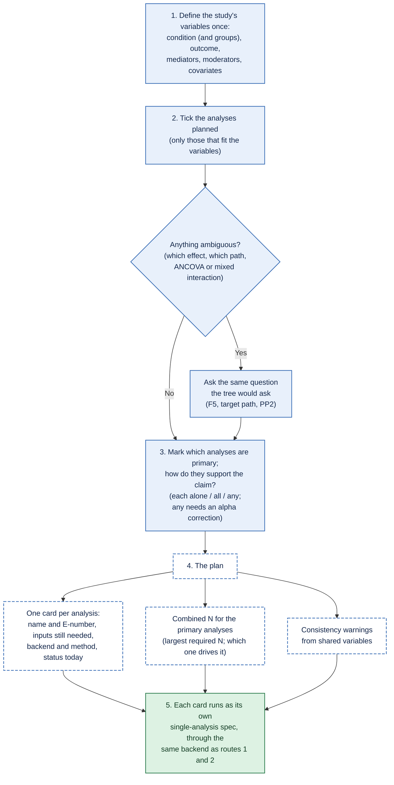
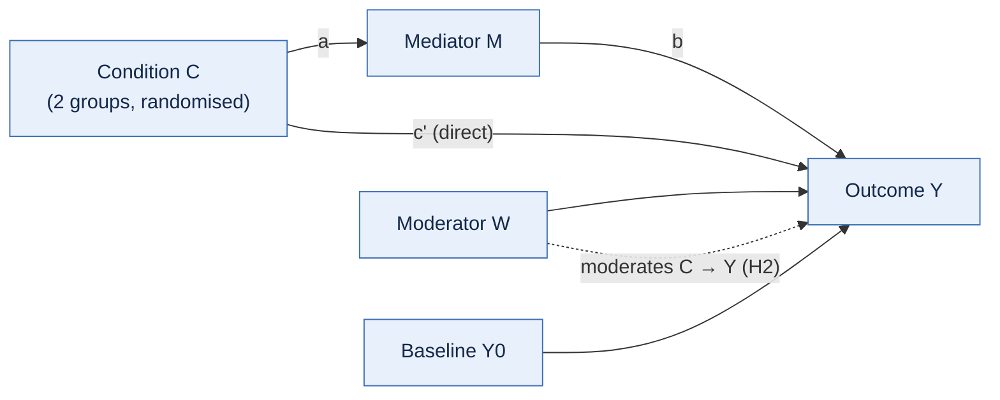

# Decision tree: from a study to a power analysis

*Draft, 15 October 2026. **Everything in this document is a proposal for the
maintainer to confirm.** It is the basis of the question tree in
`app/routing/tree.yaml`; since 18 October 2026 the start screen (screen A
of the new design, `decisions.md`) comes before it, and how the two fit
together is item 1 of [`judgement-session.md`](judgement-session.md).*

This is a draft specification of how a psychologist using the powerkit app
gets from their study to the right power analysis. It will guide the phase 5
app. It sits above [`design-finder.md`](design-finder.md), which already
gives the card wording, "Not sure?" text and maintainer decisions (D1–D9,
N1–N3) for most questions. This document:

1. summarises how established tools route users (precedent);
2. gives the tree, with every question mapped to the spec schema
   (`engine/inst/schema/design.schema.json`), and every end point mapped to
   a backend function, an effect-size form, a validation status and a tier;
3. lists the judgement calls where methodologists disagree, without
   deciding them;
4. proposes how to handle studies with several hypotheses (section 4);
5. ends with open questions.

Where this document and `design-finder.md` overlap, the question IDs (Q1,
F4a, MO1, ...) are the finder's, and the finder's decisions stand. This
document doesn't change them.

## 1. Precedent: how established tools route users

### G\*Power 3.1

From the G\*Power 3.1 manual (edition of 1 June 2023, provided by the
maintainer; *read directly: section 1, pp. 2–6, and chapter 11,
pp. 26–28; the rest of the manual was not read for this document*),
section 1.2, "Program handling":

- **Three steps.** "1. Select the statistical test appropriate for your
  problem. 2. Choose one of the five types of power analysis available. 3.
  Provide the input parameters required for the analysis and click
  'Calculate'" (manual, p. 2).
- **Two ways to choose the test.**
  - *Distribution-based:* first the **test family** (exact, F, t, χ², z),
    then the **statistical test** from a list that adapts to the family.
  - *Design-based:* the Tests menu, first by the **parameter class**
    (correlations and regression coefficients, means, proportions,
    variances, generic), then by the **design of the study** (for example
    number of groups, independent vs dependent samples). The manual notes
    that this keeps tests about the same parameter "in close proximity",
    whereas the distribution route scatters them across families (p. 2).
- **Five types of analysis** (section 1.1, p. 2):
  - a priori (N from power, α and effect size);
  - compromise (α and power from effect size, N and the ratio q = β/α);
  - criterion (α from power, effect size and N);
  - "post hoc" (power from α, effect size and N). This is G\*Power's own
    label. powerkit calls the same calculation with a **planned** effect
    size "power at a given N" and doesn't use "post hoc" for it, because
    the label is often read as *observed* power (see 2.2 and judgement
    call 3.1).
  - sensitivity (effect size from α, power and N).
- **Inputs** (section 1.2.3, p. 4): the number of tails, the effect size,
  α, power, and for two groups the allocation ratio n2/n1. A "Determine"
  button opens an effect-size calculator (for example, Cohen's d from two
  means and an SD). Cohen's (1988) small / medium / large conventions
  appear as tooltips. The manual adds that "these conventions may have
  different meanings for different tests".
- **Factorial ANOVA** (chapter 11, pp. 26–28): the user enters the effect
  size f (directly, from partial η², or from the variance explained and
  the error variance), the numerator df and the number of groups. The
  design itself (which factors, between or within) is not described to
  the program; the user works out f and the df. The manual's worked
  example applies its "post hoc" analysis to the effect sizes observed in
  a data set and reproduces SPSS's "Observed Power" column (pp. 27–28).
  That is observed power, which bears on judgement call 3.1 below.

The 2007 paper describing G\*Power 3 (Faul, Erdfelder, Lang & Buchner,
2007, *Behavior Research Methods*, 39, 175–191, doi:10.3758/BF03193146)
*(seen second-hand, to verify)* describes the same distribution-based and
design-based input modes.

### Superpower

From Superpower 0.2.4.1 (`ANOVA_design()` help and the
`intro_to_superpower` vignette):

- **No routing questions.** The user writes the design as a string, one
  term per factor: number of levels plus `b` (between) or `w` (within),
  for example `"2b*2w"`. Up to three factors.
- **Then the population:** cell means (`mu`), SD (`sd`), the correlation
  between repeated measures (`r`), and n per cell.
- **Then the function:** `ANOVA_exact()` or `ANOVA_power()` returns power
  for **every** main effect and interaction (and, optionally, emmeans
  contrasts) at once.
- **Required n** is found by changing n, or across a range with
  `plot_power()`. The vignette's example raises n step by step towards a
  target power.
- **The effect size** is entered as means, SDs and correlations, not as f
  or partial η².

### Spower

From Spower 0.6.4 (`SpowerIntro` vignette, "Types of power analyses to
evaluate"):

- **The test comes first:** the user picks an experiment function
  (`p_t.test()`, `p_r()`, `p_anova.test()`, `p_mediation()`, ...) or
  writes their own.
- **The type of analysis** is set by which argument is left as `NA`:
  - `n = NA` for a priori;
  - the effect size `NA` for sensitivity;
  - `sig.level = NA` for criterion;
  - `beta_alpha` for compromise;
  - nothing missing for what the vignette calls "prospective/post-hoc"
    power (Spower's wording; with a planned effect size this is powerkit's
    "power at a given N").

  The vignette says "specific naming conventions for the type of analysis
  being performed is not particularly important".
- **The same four quantities as G\*Power** (α, power, effect size, n):
  given three, the fourth is solved by simulation.

### power4mome

From power4mome 0.2.1 (vignette `power4mome`) and its website articles
(GitHub, development version):

- **The workflow:** specify the population model in lavaan syntax and its
  values (`pop_es`); call `power4test()` to check the model; call it again
  with a test function (`test_indirect_effect()`, `test_moderation()`,
  `test_index_of_mome()`, ...); compute power; then find n with
  `n_region_from_power()`, `power4test_by_n()` or `x_from_power()`.
- **"Quick Template" articles are organised by model family, then model
  form, then observed or latent variables:**
  - simple, parallel or serial mediation;
  - simple moderation, or moderation with two moderators;
  - moderated mediation with the a path or the b path moderated.
- **"Quick Functions"** (`q_power_mediation_simple()`, `_parallel()`,
  `_serial()`) take path sizes, including `"s"`/`"m"`/`"l"` labels, and a
  mode: power, region or n.

### InteractionPoweR

From InteractionPoweR 0.2.4 (help files, website articles, README):

- **The function chooses the analysis:**
  - `power_interaction_r2()` for analytic two-way power;
  - `power_interaction()` for simulated two-way power, with binary or
    ordinal variables (`k.x1`, `k.x2`, `k.y`);
  - `power_interaction_3way_r2()` for three-way interactions;
  - `power_interaction_r2_covs()` for interactions with covariates.
- **The population** is entered as correlations (r.x1.y, r.x2.y,
  r.x1x2.y, r.x1.x2), plus reliabilities.
- **Required N** comes from giving a vector of N (a power curve) and
  reading it, or from `power_estimate()`.
- **Two Shiny apps**, one simulation and one analytic, follow the same
  order.

### PAMLj (jamovi)

From PAMLj 1.2.0 (its analysis definitions `jamovi/*.a.yaml` and
`*.u.yaml`, and its README):

- **Menu by analysis family:** Correlation, T-Test, Proportions, General
  Linear Model, Factorial Designs, Generalized Linear Model, Mediation,
  Structural Equation Models, Mixed Models.
- **Then the "aim":** calculate N, power or the effect size. The README
  also lists required alpha.
- **Then a mode within the family:**
  - the design, for example independent, paired or one-sample t-test;
  - or how the effect is entered, for example factorial designs "from
    partial eta-squared" or "from means and SDs".
- **Then parameters:** power, α, alternative. Optional panels hold
  equivalence testing, sensitivity plots, power-parameter plots and
  effect-size conversion (for example, from a reported t to d, or from d
  to d_z).

### What the precedent suggests, and where the tree departs from it

| Established routing | This tree | Departure? Why |
| --- | --- | --- |
| Start from the **test** (G\*Power, Spower, PAMLj menus) or the **model** (Superpower, power4mome, InteractionPoweR) | Starts from the **hypothesis** (design finder Q1: difference, relationship, mediation, moderation, ...), then the outcome and who gives the data | **Departure.** powerkit is for users who may not know the test's name (build guide, section 7). Kept from precedent: an "I already know my analysis" shortcut lists tests by name, as G\*Power's and PAMLj's menus do. The design-based order (parameter, then design) is closest to G\*Power's design-based route |
| Type of analysis chosen **after** the test (G\*Power step 2, Spower's `NA`) | Asked **after** the design (Q-goal below) | Follows G\*Power's order |
| Type of analysis chosen **before** the design (PAMLj's "aim" comes first) | — | Not followed: the available analysis types depend on the design (sensitivity is 2x2-only today) |
| Five analysis types (G\*Power), the same four in Spower | Three: required n; power at a given n, for a planned effect size; smallest detectable effect. Observed power is not offered as an analysis type (2.2, 3.1) | **Departure for now.** The engine's `goal.type` has three values, and a fourth, "justified_alpha", for E1-E4: a justified alpha (JustifyAlpha), whose balanced version is G\*Power's compromise analysis (31 October 2026). Criterion is planned later ([coverage](coverage.md), Analysis types) |
| Effect size as a single standardised number (f, d, partial η²), with a calculator (G\*Power, PAMLj) | The **backend's** parametrisation: cell means and SDs for ANOVA (Superpower), correlations for interactions (InteractionPoweR), standardised paths for mediation (power4mome), d / d_z / r / proportions for basic tests (Spower) | Follows each backend. A converter from reported statistics is planned (build guide section 7) |
| Small / medium / large defaults offered (G\*Power tooltips; power4mome labels) | No defaults; a justification is required (`effect_justification`) | **Departure,** recorded in the build guide (section 4: it "stops 'medium effect' defaults"). See judgement call 3.2 |
| One analysis reported per run (G\*Power, Spower) or all effects at once (Superpower) | One **target** effect per run (F5, `target_test.effect`) | Follows G\*Power and Spower. Superpower's all-effects output could be shown as secondary information. See judgement call 3.5 |
| One analysis planned at a time (all tools; Superpower: all effects of one ANOVA design) | Single-analysis routes kept exactly as in the established tools, **plus** an optional guided "plan my whole study" route (section 4.1): shared variables, one card per analysis, combined N | **Added option, not a statistical departure:** each analysis is still computed by its backend as in the single-analysis routes |
| No screening of the design before a test is chosen: the user picks a test (G\*Power, PAMLj) or a model (Superpower, power4mome, InteractionPoweR), and the tool assumes its data structure | Four screening questions first, in every route (outcome, grouping, times measured, goal); designs outside powerkit's scope leave at an honest card, and every question offers "None of these fit / I'm not sure" | **Added routing step, not a statistical departure:** nothing is computed differently. It exists so that powerkit never routes a design it doesn't cover to the nearest simple test ([routing audit](routing-audit.md)) |
| No contested choices asked (all tools) | Contested choices are asked, never made silently (design finder, principle P1) | **Departure,** by maintainer decision P1 |

## 2. The tree

### 2.1 Flowcharts

The first screen offers three routes: "I know my analysis" (the
shortcut list), "Help me choose" (this tree) and the optional guided
"Plan my whole study" (section 4.1). **"I know my analysis" goes straight
to the list** (since 31 October 2026): every analysis in closed groups by
family (`tree.yaml`, `analysis_families`), with a search box, each card
saying what its test assumes. **The other two routes start with four
screening questions (chart S):** what kind of outcome, how the data are
grouped, how many times each person is measured, and the goal. Designs
powerkit doesn't cover leave at an honest end point there, before any
test is suggested ([routing audit](routing-audit.md)). Every question
also offers **"None of these fit / I'm not sure"**, which leads to a card
saying powerkit can't advise on the design yet and suggesting a
statistician (E-unsure).

The tree is drawn as the screening (chart S), an overview (chart 0), one
chart per goal (A to E) and one chart for the closing questions every
design shares (F). In charts B to E, Q2 and Q3 are answered automatically
from the screening (S1 and S3) and aren't asked again. End points are
numbered E1 to E46, plus E-unsure and E-bayes; the table in 2.3 gives the
details.

**Colours:**
- **blue:** a question;
- **green:** runs in powerkit now;
- **amber:** in the spec, but the engine refuses it until phase 3b (a
  yes/no X or W);
- **grey, dashed:** not in powerkit yet; the card points to another
  tool;
- **white, dashed:** continues in another chart.

**For presentations:** all the goals in one picture, with a key, is in
[`figures/decision-tree/full-presentation.png`](figures/decision-tree/full-presentation.png)
(also `.svg`). Every chart below is also rendered as `.png` (3x) and
`.svg` in [`figures/decision-tree/`](figures/decision-tree/). The `.mmd`
files there are the sources. To regenerate an image after editing its
source:

```
npx -p @mermaid-js/mermaid-cli@11.4.2 mmdc -c docs/figures/decision-tree/theme.json \
  -b white -s 3 -i docs/figures/decision-tree/<chart>.mmd -o docs/figures/decision-tree/<chart>.png
```

#### Chart S: screening (before every route)



#### Chart 0: overview



#### Chart A1: a difference (the outcome)

Q2 and Q3 are answered by the screening (S1 and S3), so they aren't asked
again. Counts, ratings analysed as ordered categories, stimuli, nesting and
measurements over time have already left at the screening (chart S).



#### Chart A2: a difference with a score outcome (the factors)



#### Chart B: a relationship



#### Chart C: moderation (an effect that depends on something else)



#### Chart D: mediation (an effect that works through something else)

```mermaid
flowchart TD
  Q2{"Q2 What is your outcome like?"}
  Q2 -->|Not a score| E32["E32 Yes/no, count or<br/>categorical outcome"]
  Q2 -->|A score| Q3{"Q3 Who gives the data?"}
  Q3 -->|The same people, repeatedly,<br/>or nested in groups| E41["E41 Within-person or<br/>multilevel analysis"]
  Q3 -->|Different people| ME1{"ME1 What is the cause (X)?"}
  ME1 -->|Three or more<br/>conditions or groups| E42["E42 Multi-category X<br/>(not covered by the five tools)"]
  ME1 -->|Conditions you assigned<br/>or two groups| ME4B{"ME4 Are your<br/>mediators scores?"}
  ME4B -->|No| E39
  ME4B -->|Yes| ME2B{"ME2 How many mediators?<br/>ME3 How do they connect?"}
  ME2B -->|One| E16["E16 Mediation<br/>with yes/no X"]
  ME2B -->|Two or more, side by side<br/>(X: two groups on the screen)| E11
  ME2B -->|Two to four, in a chain<br/>(X: two groups on the screen)| E12
  ME1 -->|A measured score| ME4{"ME4 Are your<br/>mediators scores?"}
  ME4 -->|No| E39["E39 Yes/no or<br/>categorical mediator"]
  ME4 -->|Yes| ME2{"ME2 How many mediators?<br/>ME3 How do they connect?"}
  ME2 -->|One| E10["E10 Simple mediation<br/>(PROCESS model 4)"]
  ME2 -->|Two or more,<br/>side by side| E11["E11 Parallel mediation<br/>(PROCESS model 4)"]
  ME2 -->|Two to four,<br/>in a chain| E12["E12 Serial mediation<br/>(PROCESS model 6)"]
  class Q2,Q3,ME1,ME2,ME4,ME2B,ME4B q
  class E10,E11,E12,E16 avail
  class E32,E39,E41,E42 later
  classDef q fill:#E8F0FB,stroke:#3B6FB6,color:#14284B,stroke-width:1.5px
  classDef avail fill:#DDF2E3,stroke:#2E7D4F,color:#123D24,stroke-width:1.5px
  classDef spec fill:#FFF0D1,stroke:#B97A00,color:#4A3200,stroke-width:1.5px
  classDef later fill:#F2F2F2,stroke:#9A9A9A,color:#4D4D4D,stroke-width:1px,stroke-dasharray:4 3
  classDef jump fill:#FFFFFF,stroke:#3B6FB6,color:#14284B,stroke-width:1.5px,stroke-dasharray:6 3
```

#### Chart E: moderated mediation



#### Chart F: closing questions (every design)



### 2.2 Questions and their spec fields

Wording for most cards is in `design-finder.md`. The table gives the
question as the user sees it, the spec fields it sets, and whether the
engine can use the answer today.

**Engine can use it?**
- **Yes:** the answer sets a field the engine reads.
- **Routing only:** the answer chooses the path but isn't stored in the
  spec.
- **No (flag):** the engine has no field or feature for it yet.

| ID | Question (as the user sees it) | Options | Spec fields | Engine can use it? |
| --- | --- | --- | --- | --- |
| S0 | Do you already know which analysis you want? | Yes (searchable list) / No | `design`, `template` directly | Yes |
| S1 | What kind of outcome will you measure? (screening, every route) | A score or scale / yes-no, or one of several categories / a count / ordered categories (e.g. a single rating item) / the time until something happens | `variables.Y.type`: `continuous`, `binary`, `categorical` | Score, yes/no and categories: yes, and the route continues. Count → E28, ordered categories → O5a, time until an event → E43: **no (flag)**. Sets Q2's answer, which isn't asked again |
| S2 | How are the data grouped? (screening) | Independent people / people within groups (including whole groups assigned) / pairs (e.g. couples) / many trials or stimuli per person | — | Independent people: routing only, the route continues. Within groups → E34, pairs → E44, trials or stimuli → S2a |
| D1 | What does your main hypothesis involve? (pairs, 1 November 2026) | Something measured on each member / conditions given to whole pairs / something else | `dyadic / apim` | Measured on each member, with a score → E44; conditions given to whole pairs → E34 (groups of two); anything else, or another outcome → E65 |
| S2a | What does your main hypothesis compare? (many trials or stimuli) | Two conditions, each person responds in both / two conditions, each person in one / three or more conditions, each person in all / something else | `mixed_model / crossed_two_condition, crossed_conditions` | Two conditions with a score, within or (since 31 October 2026) between participants → E33: yes. Three or more conditions within participants with a score → E63 (31 October 2026). A yes/no or count outcome, or anything else → E41 |
| S3 | How many times is each person measured on the outcome? (screening) | Once / twice / many times (→ T1) | Once: `between_factor`; twice: `within_factor` (as Q3) | Once and twice: yes. Sets Q3's answer, which isn't asked again, and hides options that contradict it (e.g. "the same people" after "once") |
| T1 | What are the repeated measurements? (after S3 "many times") | The same people in three or more conditions / over time, to see whether a trend changes at a known point / over time, to see how people change | — | Three or more conditions: routing only, the route continues (E18–E21 and E26 are reached later). A trend that changes → E45, how people change → E35: **no (flag)** |
| S4 | What's your goal? (answered by the aim screen since 28 October 2026, not asked again) | Detect an effect / show there's no meaningful effect (from the aim) | `goal` | Detect: the route continues (people within groups → C1, then E34 or E62). No meaningful effect → E36 (people within groups → E34). Estimating precisely leaves at the aim screen → E46 |
| C1 | What does your main hypothesis involve? (people within groups, since 31 October 2026) | Conditions given to groups or to people in them / something measured on each person or group | — | Conditions → E34. Measured predictors at either level → E62 |
| Every question | None of these fit / I'm not sure | (safety net, on every question in every route and on the shortcut list) | — | Leads to E-unsure: "powerkit can't advise on this design yet. We suggest discussing it with a statistician." |
| Q1 | What do you want your study to show? | A difference; a relationship; works through something (mediation); depends on something (moderation); both; scores more spread out (or more consistent) in one group than another or than a fixed value (a score measured once only); an effect is absent; a model fits, including a model with latent variables (SEM); people fall into distinct types or profiles (E58) | `design`: `basic_test` or `factorial_anova`, `regression_interaction`, `mediation`, `moderated_mediation` | Yes, except "absent" and "model fits": **no (flag)**, not in spec |
| Q2 | What is your outcome like? | Answered by S1 and not asked again. In the relationship path, a categorical outcome asks which kind: yes/no (E27) or one of several categories (E6) | `variables.Y.type` | As S1 |
| O5a | How will you analyse this rating? (after S1 "ordered categories", every route) | As a score / as ordered categories (decision D1) | Score → `continuous` | Score: yes, the route continues as a score. Ordered: the route continues to S2 and S3 with the outcome ordinal; a difference between two groups of different people, measured once, reaches E29 (since 29 October 2026, when E29 began to calculate); measured more than once, the safety net; a relationship, the safety net; moderation or mediation, E32. The choice and the note for the write-up aren't stored: **flag**, see open question 4 |
| Q3 | Who gives the data? | Answered by S2 and S3 and not asked again (an ordinal difference measured once reaches E29), except for a yes/no or categorical difference: two groups, yes/no (E5); categories (E6); one group against a fixed proportion (E25); two or more factors with a yes/no outcome (E47, factorial logistic regression), each when measured once; the same people (E26) when measured twice or more | `variables.*.type` (`between_factor`, `within_factor`, `binary`); `template` (`independent_t` vs `paired_t`; `2x2_between` vs `2x2_mixed`) | Yes |
| V1 | Whose spread of scores are you comparing? | Measured once: one group's, against a fixed value (E52); two groups', different people in each (E53). Measured twice: the same people's (E57) | `template` (`one_variance`, `two_variances`, `paired_variances`) | Yes |
| F1–F3 | How many factors (one, two crossed, three crossed, four or more)? How many groups? Two levels each? | (design finder) | `template`; `variables.A/B/X.levels` | Yes for the templates that exist |
| F2a | Specific comparison or any difference? | (decision D8) | — | **No (flag):** neither contrasts nor one-way ANOVA are in the spec |
| F3a | For each factor: different people, or everyone got every level? (at least one factor with three or more levels) | One between, one within (E55); both between (E21); both within (E20) | `variables.A.type`, `variables.B.type` (A is the between factor in `mixed`) | Yes for one between and one within; routing only otherwise |
| F4 | For each factor: different people, or everyone got both? | (design finder) | `variables.A.type`, `variables.B.type` (A is the between factor in `2x2_mixed`) | Yes |
| F4a | Will the groups be equal in size? | Yes / no (decisions D5, N1–N3) | 2x2 between: `options.cell_ratio`. Two groups: `options.allocation_ratio` | 2x2 between: yes. 2x2 mixed: routing only (unequal → safety net). Two-group tests: yes |
| F4b, PP1, PP2 | Before and after? Randomised? ANCOVA or mixed interaction? | (decision D2) | `factorial_anova / 2x2_mixed`, `target_test.effect = interaction` | Routing only. Randomisation and the reason for the choice aren't stored for the write-up: **flag** (open question 4). ANCOVA: **no (flag)** |
| F5 | Which result matters most for your study? | Effect of A; effect of B; the interaction | `target_test.effect`: `main_effect_A`, `main_effect_B`, `interaction` | Yes |
| F6 | Which picture matches your prediction? (interaction) | Lines cross; one effect shrinks; one disappears (decision D6) | — | **No (flag):** the shape is used only for a warning on the form. It isn't stored, so the write-up can't mention it (open question 4) |
| R1 | What is the other variable like? | Score; a relationship that differs between two separate groups; one correlation stronger than another in the same people; groups; several predictors | `variables.X.type` | Score / groups: yes. Several predictors: **no (flag)** |
| MO1 | What is your main predictor (X)? | Two conditions you assigned or two groups that exist; a score; three or more groups | `variables.X.type`: `binary` or `continuous` | Score: yes. Binary: the spec accepts it but `run_spec()` refuses it until phase 3b. Three or more groups: **no (flag)**, goes to E30. "Assigned vs existing" isn't stored (only used for wording): **flag** |
| MO2 | What does the effect depend on (the moderator, W)? | Two conditions or two groups; a score; three or more groups. Asked after either answer to MO1; with a yes/no X, "two groups" leads to the 2 x 2 factor questions | `variables.W.type`: `binary` or `continuous` | Score × score: yes. Binary: refused until phase 3b. Three or more groups: **no (flag)**, goes to E30 |
| MO3 | Does a third variable change the interaction again? | No / yes | — | Yes → **no (flag)**, three-way not in spec |
| ME1, MM1 | What is the cause (X)? | Conditions you assigned or two groups / a measured score / (ME1 only) three or more conditions or groups | `variables.X.type` | Score: yes. Binary: refused until phase 3b. Three or more conditions (ME1): **no (flag)**, goes to E42. "Manipulated vs measured" (decision D9 notes) isn't stored: **flag** |
| ME2, ME3 | How many mediators? Side by side or in a chain? (asked for a yes/no X too, after ME4) | One; two or more side by side; two to four in a chain | `template`: `process_4` (mediator `M`, or `M1`–`M9`) or `process_6` (`M1`–`M4`); `variables.M*` | Yes. Parallel mediation is validated with two mediators only |
| ME4 | Are your mediators scores? (asked after either answer to ME1) | Yes / no | `variables.M*.type = continuous` | No → **no (flag)** |
| (form) | Which indirect path is your hypothesis about? | e.g. X → M1 → M2 → Y | `target_test.path` | Yes |
| MM2 | What does part of the process depend on (W)? | Two groups / a score | `variables.W.type` | As MO2 |
| MM3, MM4 | How many mediators? Which link does W change? | One / more; X → M; M → Y; both; X → M and X → Y | `template`: `process_7` or `process_14` | Yes for 7 and 14. Others: **no (flag)** |
| Every design: Q-rel | Do you know how reliable your measures are? (optional) | A reliability per variable, or "assume perfect" | `variables.*.reliability` | Regression interactions: yes. Mediation: refused ("not available yet"). Other designs: rejected by the validator |
| Every design: Q-dir | Does your hypothesis predict a direction? | Two-sided / one-sided, with the direction | `target_test.alternative`: `two_sided`, `greater`, `less` | Basic tests except chi-square: yes. Other designs: two-sided only. See judgement call 3.3 |
| Every design: Q-test | Which version of the test? (where there is a choice) | Student or Welch (decision D7); exact or simulation (2x2) | `target_test.method`; `options.method` | Yes |
| Every design: Q-goal | What do you want to find out? | The sample size I need / the power I would have at a given sample size, for an effect size I plan for / the smallest effect I could detect at a given sample size | `goal.type`: `sample_size` (+ `goal.power`), `power` (+ `goal.n`), `sensitivity` (+ `goal.n`, `goal.power`) | Yes. Sensitivity only for the 2x2 designs; elsewhere the option is shown as not available yet: **flag** |
| Every design: Q-alpha | Which significance level (alpha)? | A number | `target_test.alpha` | Yes. The default is a judgement call (3.6) |
| Every design: Q-power | What power do you want? | A number | `goal.power` | Yes. The default is a judgement call (3.6) |
| Every design: Q-effect | What effect do you expect, and where does that number come from? | The design's effect-size form (table 2.3), plus the source: smallest effect of interest; meta-analysis; prior study (with an adjustment); pilot study | `population.*`; `effect_justification.type`, `.source`, `.adjustment` | Yes. Bias-corrected planning (e.g. BUCSS) has no field or backend: **flag** (judgement call 3.2) |
| Every design: Q-attr | How many participants do you expect to lose? | A proportion | `options.attrition` | Yes |
| Every design: Q-multi | Does your study test more than one hypothesis that this power analysis should cover? | No / yes | — | **No (flag):** one target effect per spec (judgement call 3.5; proposals in section 4) |
| Every design: Q-bayes | Will you test your hypothesis with p-values or with Bayes factors? | p-values / Bayes factors / not sure | — | **No (flag):** frequentist only. Bayes factors → E-bayes row in 2.3 |
| Every design: run settings | (advanced) replications, seed, CI draws | — | `options.nrep`, `options.seed`, `options.ci_draws` | Yes |

**Power at a given N (planned effect size) is not observed power.** They
are different analyses, and the app keeps them apart:

- **Power at a given N, for a planned effect size** (`goal.type =
  "power"`). This is the power for an effect size the user plans for and
  justifies (a smallest effect of interest, a meta-analysis, a
  bias-corrected prior study, ...), at a sample size they expect to have.
  It is prospective: "is this N enough for the effect I care about?" The
  app labels it **"power at a given N"** and never "post hoc".
- **Observed power** (the effect size taken from the study's own result).
  This is power computed after the study, from the effect it found. It
  follows directly from the study's p-value (judgement call 3.1). powerkit
  doesn't offer it as an analysis type. Whether the form should block,
  warn about, or allow an effect size that comes from the same study's
  result is open question 5.
- **Why not "post hoc":** G\*Power (manual, section 1.1) and Spower
  (vignette, "prospective/post-hoc") use "post hoc" for the calculation
  itself, whichever effect size goes in. Many readers take "post hoc" to
  mean observed power. Using "power at a given N" for the planned case
  keeps the two apart. Where this document quotes another tool's label,
  it says so.

### Closing questions by card

The full list of closing questions is in table 2.2 (the "Every design"
rows). Each card asks only the ones that apply to its design, following
that table's "Engine can use it?" column:
- reliability (Q-rel) only for regression interactions (E9, E31, and E15
  for its score and outcome only: misclassification in a yes/no X or W is
  a different problem from unreliable scores; maintainer decisions, 16
  and 29 October 2026, `decisions.md`);
- a direction (Q-dir) only for the basic tests except chi-square, and for
  one proportion, McNemar's test and two correlations (E25, E26, E49,
  E51), logistic regression (E27), Poisson regression (E28), the
  cluster-randomised trial (E34), the variance
  tests (E52, E53, E57), the generic t and z tests (E50) and the
  meta-analysis (E61);
- participants expected to be lost (Q-attr) on every card but the generic
  tests (E50), which have no sample size, and the meta-analysis (E61),
  whose sample is studies;
- a test version (Q-test) only where there is a choice: Student's or
  Welch's t-test (E2), the z test or Fisher's exact test (E5), or exact or
  simulation (E7, E8, E18).

Q-goal's note differs by card, because the smallest detectable effect is
available only for the 2 x 2 designs. Cards for designs powerkit doesn't
run don't list closing questions. `app/routing/tree.yaml`
(`closing_questions`, `applies_to`) holds the same table, and a test keeps
the two in step.

| Card | Q-rel | Q-dir | Q-test | Q-goal | Q-alpha | Q-power | Q-effect | Q-attr | Q-multi | Q-bayes |
| --- | --- | --- | --- | --- | --- | --- | --- | --- | --- | --- |
| E1 | — | ✓ | — | ✓ | ✓ | ✓ | ✓ | ✓ | ✓ | ✓ |
| E2 | — | ✓ | ✓ | ✓ | ✓ | ✓ | ✓ | ✓ | ✓ | ✓ |
| E3 | — | ✓ | — | ✓ | ✓ | ✓ | ✓ | ✓ | ✓ | ✓ |
| E4 | — | ✓ | — | ✓ | ✓ | ✓ | ✓ | ✓ | ✓ | ✓ |
| E5 | — | ✓ | ✓ | ✓ | ✓ | ✓ | ✓ | ✓ | ✓ | ✓ |
| E6 | — | — | — | ✓ | ✓ | ✓ | ✓ | ✓ | ✓ | ✓ |
| E7 | — | — | ✓ | ✓ | ✓ | ✓ | ✓ | ✓ | ✓ | ✓ |
| E8 | — | — | ✓ | ✓ | ✓ | ✓ | ✓ | ✓ | ✓ | ✓ |
| E9 | ✓ | — | — | ✓ | ✓ | ✓ | ✓ | ✓ | ✓ | ✓ |
| E31 | ✓ | — | — | ✓ | ✓ | ✓ | ✓ | ✓ | ✓ | ✓ |
| E10 | — | — | — | ✓ | ✓ | ✓ | ✓ | ✓ | ✓ | ✓ |
| E11 | — | — | — | ✓ | ✓ | ✓ | ✓ | ✓ | ✓ | ✓ |
| E12 | — | — | — | ✓ | ✓ | ✓ | ✓ | ✓ | ✓ | ✓ |
| E13 | — | — | — | ✓ | ✓ | ✓ | ✓ | ✓ | ✓ | ✓ |
| E14 | — | — | — | ✓ | ✓ | ✓ | ✓ | ✓ | ✓ | ✓ |
| E40 | — | — | — | ✓ | ✓ | ✓ | ✓ | ✓ | ✓ | ✓ |
| E15 | ✓ | — | — | ✓ | ✓ | ✓ | ✓ | ✓ | ✓ | ✓ |
| E16 | — | — | — | ✓ | ✓ | ✓ | ✓ | ✓ | ✓ | ✓ |
| E17 | — | — | — | ✓ | ✓ | ✓ | ✓ | ✓ | ✓ | ✓ |
| E18 | — | — | ✓ | ✓ | ✓ | ✓ | ✓ | ✓ | ✓ | ✓ |
| E19 | — | — | — | ✓ | ✓ | ✓ | ✓ | ✓ | ✓ | ✓ |
| E20 | — | — | ✓ | ✓ | ✓ | ✓ | ✓ | ✓ | ✓ | ✓ |
| E21 | — | — | ✓ | ✓ | ✓ | ✓ | ✓ | ✓ | ✓ | ✓ |
| E22 | — | — | — | ✓ | ✓ | ✓ | ✓ | ✓ | ✓ | ✓ |
| E23 | — | — | — | ✓ | ✓ | ✓ | ✓ | ✓ | ✓ | ✓ |
| E24 | — | — | — | ✓ | ✓ | ✓ | ✓ | ✓ | ✓ | ✓ |
| E25 | — | ✓ | — | ✓ | ✓ | ✓ | ✓ | ✓ | ✓ | ✓ |
| E26 | — | ✓ | — | ✓ | ✓ | ✓ | ✓ | ✓ | ✓ | ✓ |
| E27 | — | ✓ | — | ✓ | ✓ | ✓ | ✓ | ✓ | ✓ | ✓ |
| E28 | — | ✓ | — | ✓ | ✓ | ✓ | ✓ | ✓ | ✓ | ✓ |
| E29 | — | — | — | ✓ | ✓ | ✓ | ✓ | ✓ | ✓ | ✓ |
| E47 | — | — | — | ✓ | ✓ | ✓ | ✓ | ✓ | ✓ | ✓ |
| E33 | — | — | — | ✓ | ✓ | ✓ | ✓ | ✓ | ✓ | ✓ |
| E34 | — | ✓ | — | ✓ | ✓ | ✓ | ✓ | ✓ | ✓ | ✓ |
| E62 | — | — | — | ✓ | ✓ | ✓ | ✓ | ✓ | ✓ | ✓ |
| E63 | — | — | — | ✓ | ✓ | ✓ | ✓ | ✓ | ✓ | ✓ |
| E48 | — | — | — | ✓ | ✓ | ✓ | ✓ | ✓ | ✓ | ✓ |
| E49 | — | ✓ | — | ✓ | ✓ | ✓ | ✓ | ✓ | ✓ | ✓ |
| E50 | — | ✓ | — | ✓ | ✓ | ✓ | ✓ | — | ✓ | ✓ |
| E51 | — | ✓ | — | ✓ | ✓ | ✓ | ✓ | ✓ | ✓ | ✓ |
| E36 | — | — | — | ✓ | ✓ | ✓ | ✓ | ✓ | ✓ | ✓ |
| E37 | — | — | — | ✓ | ✓ | ✓ | ✓ | ✓ | ✓ | ✓ |
| E52 | — | ✓ | — | ✓ | ✓ | ✓ | ✓ | ✓ | ✓ | ✓ |
| E53 | — | ✓ | — | ✓ | ✓ | ✓ | ✓ | ✓ | ✓ | ✓ |
| E64 | — | ✓ | — | ✓ | ✓ | ✓ | ✓ | ✓ | ✓ | ✓ |
| E66 | — | ✓ | — | ✓ | ✓ | ✓ | ✓ | ✓ | ✓ | ✓ |
| E57 | — | ✓ | — | ✓ | ✓ | ✓ | ✓ | ✓ | ✓ | ✓ |
| E59 | — | — | — | ✓ | ✓ | ✓ | ✓ | ✓ | ✓ | ✓ |
| E60 | — | — | — | ✓ | ✓ | ✓ | ✓ | ✓ | ✓ | ✓ |
| E44 | — | — | — | ✓ | ✓ | ✓ | ✓ | ✓ | ✓ | ✓ |
| E61 | — | ✓ | — | ✓ | ✓ | ✓ | ✓ | — | ✓ | ✓ |
| E54 | — | — | ✓ | ✓ | ✓ | ✓ | ✓ | ✓ | ✓ | ✓ |
| E55 | — | — | ✓ | ✓ | ✓ | ✓ | ✓ | ✓ | ✓ | ✓ |
| E56 | — | — | ✓ | ✓ | ✓ | ✓ | ✓ | ✓ | ✓ | ✓ |

### 2.3 End points

Validation status is from [`coverage.md`](coverage.md) and
[`validation-log.md`](validation-log.md). Test files are in
`engine/tests/testthat/`.

**Status today:**
- **Runs:** `run_spec()` runs it.
- **Spec only:** the spec accepts it, but the engine refuses it with a
  plain-English message.
- **Not in spec:** neither the spec nor the engine has it.

Tiers for rows that run are MVP (build guide section 2). Other tiers are
taken from coverage.md, where they are proposals.

| ID | End point (analysis name shown) | powerkit design / template | Backend function | Default method | Effect size the user enters | Validated? | Tier | Status today |
| --- | --- | --- | --- | --- | --- | --- | --- | --- |
| E1 | One-sample t-test | `basic_test / one_sample_t` | `pwr::pwr.t.test()` (formula, the default since 17 October 2026); `Spower::Spower(Spower::p_t.test())` if simulation is chosen | Formula (no simulation) | Cohen's d: (mean − test value) / SD | Yes: `test-validation-basic-tests.R` (full run passed; no published-value test yet) | MVP | Runs |
| E2 | Independent-samples t-test (Student's; Welch's as an option) | `basic_test / independent_t` | `pwr::pwr.t.test()`, or `pwr::pwr.t2n.test()` for unequal groups; Welch's test, or simulation if chosen: `Spower::p_t.test()`; Welch's by formula if chosen: `pwrss::power.t.welch()` | Formula (no simulation); Welch's: simulation | Cohen's d (group 2 − group 1) / pooled SD; allocation ratio | Yes: `test-validation-basic-tests.R` (full run passed; published value TODO) | MVP | Runs |
| E3 | Paired-samples t-test | `basic_test / paired_t` | `pwr::pwr.t.test(type = "paired")`; Spower if simulation is chosen | Formula (no simulation) | d_z: mean difference / SD of differences (second minus first) | Yes: `test-validation-basic-tests.R` (full run passed; published value TODO) | MVP | Runs |
| E4 | Pearson correlation | `basic_test / correlation` | `pwr::pwr.r.test()`; `Spower::p_r()` if simulation is chosen; Spearman's rho or Kendall's tau as a test version, `Spower::p_r(method = )`, simulated | Formula (no simulation) | r | Yes: `test-validation-basic-tests.R` (full run passed; published value TODO) | MVP | Runs |
| E5 | Test of two proportions (z test; Fisher's exact test as an option) | `basic_test / two_proportions` | `stats::power.prop.test(strict = TRUE)`, the z test as in G\*Power (Departure 11); `pwrss::power.z.twoprops()` for unequal groups; `pwr::pwr.2p2n.test()` with Cohen's h if chosen; `Spower::p_prop.test()` if simulation is chosen (no continuity correction, Departure 5; formula by default, Departure 9); Fisher's exact test if chosen: `pwrss::power.exact.fisher()` | Formula (no simulation) | p1, p2; allocation ratio | Yes: `test-validation-basic-tests.R` (full run passed; unequal groups checked against G\*Power in `test-backend-pwr.R`; published value TODO). Fisher's exact test: no, matches pwrss called directly in `test-backend-formula-tests.R` | MVP | Runs |
| E6 | Chi-square test of independence | `basic_test / chi_square_independence` | `pwr::pwr.chisq.test()`; `Spower::p_chisq.test()` if simulation is chosen | Formula (no simulation) | Cell probabilities (rows = X, columns = Y, summing to 1) | Yes: `test-validation-basic-tests.R` (full run passed; no published-value test yet) | MVP | Runs |
| E7 | 2 x 2 between-participants ANOVA (main effect or interaction) | `factorial_anova / 2x2_between` | `Superpower::ANOVA_exact()`; `ANOVA_power()` if simulation is chosen | Exact dataset (no repeated simulation) | Four cell means (raw or in SD units) and the SD (one, or one per cell) | Yes: `test-validation-anova-2x2-between.R` (full run passed) | MVP | Runs; sensitivity available |
| E8 | 2 x 2 mixed ANOVA (incl. group × time) | `factorial_anova / 2x2_mixed` | As E7 (`ANOVA_exact()`, not `ANOVA_exact2()`, Departure 2) | Exact dataset (no repeated simulation) | Four cell means, SD, correlation between the repeated measures | Yes: `test-validation-anova-2x2-mixed.R` (full run passed) | MVP | Runs; sensitivity available |
| E9 | Moderated regression (continuous × continuous) | `regression_interaction / two_way` | `InteractionPoweR::power_interaction()`; `power_interaction_r2()` only brackets n | Simulation | Correlations r_X_Y, r_W_Y, r_XW_Y (the interaction), r_X_W; optional reliabilities | Yes: `test-validation-regression-interaction.R` (full run passed; published values TODO) | MVP | Runs |
| E10 | Simple mediation (PROCESS model 4) | `mediation / process_4`, mediator `M` | `power4mome::power4test()` with `test_indirect_effect()`, Monte Carlo CI, batches of ≤ 200 | Simulation | Standardised paths X→M, M→Y, X→Y | Yes: `test-validation-mediation-simple.R` (full run passed; published value TODO) | MVP | Runs |
| E11 | Parallel mediation (PROCESS model 4) | `mediation / process_4`, `M1`–`M9` | As E10 | Simulation | Standardised paths; residual correlations between mediators (free, Departure 7) | Yes: `test-validation-mediation-parallel.R` (full run passed with two mediators; three or more not yet tested; published value TODO) | MVP (two); v2 for three or more ([coverage](coverage.md)) | Runs |
| E12 | Serial mediation (PROCESS model 6) | `mediation / process_6`, `M1`–`M4` | As E10 | Simulation | Standardised paths, every forward path | Yes: `test-validation-mediation-serial.R` (full run passed with two mediators; three or more not yet tested; published value TODO) | MVP | Runs |
| E13 | First-stage moderated mediation (PROCESS model 7), index of moderated mediation | `moderated_mediation / process_7` | `power4mome::power4test()` with `test_index_of_mome()` | Simulation | Standardised paths, including XW→M | Yes: `test-validation-modmed-process7.R` (full run passed 17 Oct 2026, the rerun after the seeding fix; published values TODO) | MVP | Runs |
| E14 | Second-stage moderated mediation (PROCESS model 14) | `moderated_mediation / process_14` | As E13 | Simulation | Standardised paths, including MW→Y | Yes: `test-validation-modmed-process14.R` (full run passed 17 Oct 2026, the rerun after the seeding fix; published values TODO) | MVP | Runs |
| E15 | Moderated regression with a yes/no X or W | `regression_interaction / two_way`, X or W `type = binary` | `InteractionPoweR::power_interaction(k.x1 / k.x2 = 2)`: a 50/50 split coded -1 and 1, correlations of the observed yes/no data (point-biserial with Y), simulated; the implied group difference shown by `psych::r2d()`. Both yes/no: pointed to the 2 x 2 ANOVA | Simulation | Which variable is yes/no; the four correlations; reliability of the score and Y only (decided 29 October 2026) | No: matches InteractionPoweR called directly and an independent simulation, and holds alpha, in `test-backend-interaction-binary.R` and `test-validation-interaction-binary.R` (published value TODO) | MVP | Runs |
| E16 | Mediation with a yes/no X | `mediation / process_4`, X `binary`, `population > x_prob` (two or more mediators: E11 and E12, whose screens take a yes/no X) | `power4test()` with `x_fun = list(X = list(rbinary_rs, p1 = x_prob))` and `test_indirect_effect()`, Monte Carlo CI; paths per SD of X, the group difference in M shown | Simulation | X's two groups and the share in each; standardised paths; CI draws | No: matches power4mome called directly and an independent simulation, recovers the split, and holds alpha in `test-backend-mediation-binary.R` and `test-validation-mediation-binary.R` (published value TODO) | MVP | Runs |
| E17 | Moderated mediation with a yes/no X or W | `moderated_mediation / process_7` or `process_14` | As E16 | Simulation | As E16; X or W uncorrelated with the other predictors (maintainer decision) | No | MVP: phase 3b | Spec only |
| E18 | One-way ANOVA (different people), omnibus | `factorial_anova / oneway_between` | `Superpower::ANOVA_design("kb")` + `ANOVA_exact()`; `ANOVA_power()` if simulation is chosen; Welch's F (unequal SDs): `Spower::p_anova.test(var.equal = FALSE)`; the Kruskal-Wallis test: `Spower::p_kruskal.test()`. The same people in every condition: E54 | Exact dataset (no repeated simulation); simulation for Welch's F and the Kruskal-Wallis test | Group means (raw or in SD units) and one SD, or each group's SD for Welch's F | No: matches G\*Power in `test-backend-wave2.R` (not yet in the full validation run; published value TODO) | v2 | Runs |
| E19 | Planned contrast | `factorial_anova / oneway_contrast` | `pwrss::power.t.contrasts()` (one contrast, equal groups, two-sided; `k.covariates = 0`). Also Superpower's emmeans contrasts, which agree with it; pwranova `pwrcontrast()` unchecked | Formula (no simulation) | Group means and SD; contrast weights | Yes: matches the G\*Power 3.1 manual's three contrast examples in the full validation run (27 October 2026) | v2 | Runs |
| E20 | Two-factor within-participants ANOVA (2 x 2 or larger) | `factorial_anova / factorial_within` | `Superpower::ANOVA_design("kw*mw")` + `ANOVA_exact()`; `ANOVA_power()` if simulation is chosen. One SD and one correlation between every pair of cells, so sphericity holds. Reached from F4 (2 x 2) and F3a (larger) when everyone is in every combination | Exact dataset (no repeated simulation) | Cell means (raw or in SD units), one SD, the correlation between any two conditions, which effect | No: matches Superpower's `ANOVA_exact()` in `test-backend-factorial.R` (not yet in the full validation run; published value TODO) | v2 | Runs |
| E21 | Larger factorial ANOVA, different people in every cell (2 x 3, 3 x 3, ...) | `factorial_anova / factorial_between` | `Superpower::ANOVA_design("kb*mb")` + `ANOVA_exact()`; `ANOVA_power()` if simulation is chosen. Equal cells, one SD. Reached from F3a when both factors are different people; three factors go to E56 | Exact dataset (no repeated simulation) | Cell means (raw or in SD units), one SD, which effect | No: matches Superpower's `ANOVA_exact()` in `test-backend-factorial.R` (not yet in the full validation run; published value TODO) | v2 | Runs |
| E22 | 2 x 2 ANOVA with unequal group sizes | `factorial_anova / 2x2_between`, `options > cell_ratio` | `Superpower::ANOVA_power()` with one n per cell (Type III sums of squares), simulated: `ANOVA_exact()` takes equal cells only, and `ANOVA_power()` stops for unequal groups with a within factor, so a mixed design with unequal groups goes to the safety net. Independent check (decision N3): pwrss's `power.f.ancova.shieh()` with one covariate that explains nothing | Simulation | Four cell means, the SD (one, or one per cell), which effect, and each group's size or their ratio | No: agrees with pwrss's Shieh formula and with Superpower called directly in `test-backend-anova-unequal.R` and `test-validation-anova-unequal.R` (published value TODO) | v2 | Runs |
| E23 | ANCOVA (incl. pre–post with a baseline covariate) | `factorial_anova / oneway_ancova`, `factorial_ancova` | `pwrss::power.f.ancova.shieh()` (Shieh's method); for two factors, with the effect's rows of `pwrss::factorial.contrasts()` | Formula (no simulation) | One or two factors; adjusted group or cell means (raw or in SD units), one SD, covariates' R², number of covariates, and with two factors which effect | No: matches pwrss called directly and `Superpower::power_oneway_ancova()` and `ANCOVA_analytic()` in `test-backend-formula-tests.R` and `test-backend-factorial-ancova.R` (G\*Power and published value TODO) | v2 | Runs (one-way overall test; two-way main effects and interaction) |
| E24 | Multiple regression (R² or one coefficient) | `multiple_regression / r2_zero`, `r2_increase` | `pwrss::power.f.regression()` (one coefficient: an R² increase with 1 predictor tested) | Formula (no simulation) | R², or R² with and without the tested predictors; numbers of predictors | No: matches G\*Power in `test-backend-wave2.R` (not yet in the full validation run; published value TODO) | v2 | Runs |
| E25 | One proportion against a fixed value | `basic_test / one_proportion` | `pwrss::power.exact.oneprop()` (exact binomial test) | Formula (no simulation) | Expected proportion and the fixed value | No: matches G\*Power in `test-backend-wave2.R` (not yet in the full validation run; published value TODO) | v2 | Runs |
| E26 | McNemar's test (same people, yes/no); Cochran's Q | `basic_test / mcnemar` | `pwrss::power.exact.mcnemar(method = "exact")`. Cochran's Q: no ready-made tool (custom simulation in R, e.g. with Spower, or advice from a statistician) | Formula (no simulation) | Discordant proportions (yes in the first condition only; yes in the second only) | No: matches G\*Power in `test-backend-wave2.R` (not yet in the full validation run; published value TODO) | v2 | Runs (McNemar only) |
| E27 | Logistic regression (yes/no outcome) | `logistic_regression / single_predictor` | `pwrss::power.z.logistic(method = "demidenko(vc)")` (the Wald z test of one predictor, a score or a yes/no group; other predictors through its R² with them). Also Spower `p_glm(family = binomial())`; PAMLj | Formula (no simulation) | Odds ratio; proportion of 'yes' at the starting point; R² with the other predictors | Yes: matches the G\*Power 3.1 manual's normal and yes/no predictor examples (27 October 2026) | v2 | Runs |
| E28 | Count outcome (Poisson or negative binomial) | `poisson_regression / single_predictor_count` | `pwrss::power.z.poisson(method = "demidenko(vc)")` (the Wald z test of one predictor, a score or a yes/no group, over a mean exposure; other predictors through its R² with them). Also Spower `p_glm(family = poisson())`; WebPower. Negative binomial and zero-inflated counts: still no candidate in powerkit (coverage-roadmap B30) | Formula (no simulation) | Rate ratio; starting rate; mean exposure; R² with the other predictors | No: matches pwrss called directly in `test-backend-formula-tests.R` (G\*Power and published value TODO) | v2 | Runs |
| E29 | Ordinal outcome (ordered categories) | `ordinal_regression / ordinal_two_groups` | `powertools::propodds()` (the proportional-odds comparison of two groups, Whitehead's method, two-sided; groups may differ in size). Two groups only. Reached from O5a (ordered categories) and the guided route's ordinal outcome | Formula (no simulation) | Group 1's share in each category; the odds ratio; the allocation ratio | No: matches powertools called directly and Hmisc's `popower()` in `test-backend-ordinal.R` and `test-validation-ordinal.R` (published value TODO) | v2 | Runs (two groups) |
| E30 | Moderator with three or more groups | — | No ready-made tool: custom simulation in R (e.g. with Spower; power4mome as a general lavaan model) or advice from a statistician | — | — | No | later | Not in spec |
| E31 | Three-way interaction | `regression_interaction / three_way` | `InteractionPoweR::power_interaction_3way_r2()` (analytic: the change in R² when XWZ is added, predictors treated as fixed; no simulation exists for three-way models). Reached from MO3 | Formula (no simulation) | Correlations of X, W, Z and Y and of the products XW, XZ and WZ with Y; the standardised coefficient of XWZ; optional reliabilities | No: matches InteractionPoweR called directly and holds alpha in `test-backend-three-way.R` and `test-validation-three-way.R` (published value TODO) | v2 | Runs |
| E32 | Moderation or mediation with a yes/no, count or categorical outcome | — | No ready-made tool: custom simulation in R (e.g. with Spower) or advice from a statistician | — | — | No | later | Not in spec |
| E33 | Crossed participants and stimuli | `mixed_model / crossed_two_condition` | `simr::powerSim()` on `makeLmer(y ~ cond + (1 + cond \| participant) + (1 \| item))` (a by-item slope with items in both conditions; with the conditions between participants, from 31 October 2026, a participant intercept only), the condition tested with lmerTest's Satterthwaite t test (`fixed("cond", "sa")`; Departure 16), simulated | Simulation | The difference between conditions and the SDs of participants' intercepts and slopes, items' intercepts and the residual, in the outcome's units; the number of items; items in one condition or both | No: matches simr replication for replication and agrees with an independent simulation in `test-backend-mixed-model.R` and `test-validation-mixed-model.R` (published value TODO) | v2 | Runs |
| E34 | Multilevel or cluster design (cluster-randomised or multisite trial) | `cluster_trial / cluster_randomised, multisite, group_treatment` | `powertools::crt.parallel.cont()` for whole groups assigned (the design-effect approximation, design-finder P4, with degrees of freedom from the number of groups; varying group sizes through `re.clustsize.cont()`), and `powertools::multisite.cont()` for people randomised within each group (df = groups - 1); `crt.parallel.bin()` and `multisite.bin()` for a yes/no outcome (z test of the log odds ratio, groups of equal size); `irgtt.cont()` and `irgtt.bin()` when people are randomised one by one and only one condition is delivered in groups. A baseline score (one covariate) for a score outcome in the first two designs. Not yet: other covariates. Predictors at both levels: E62 PowerUpR and clusterPower, earlier candidates, have been removed from CRAN | Formula (no simulation) | Cohen's d over the total SD; ICC; for a multisite trial, the ICC of the effect; group size and its SD. Yes/no: the proportion in each condition and the SD on the log-odds scale | No: matches powertools called directly, and the design-effect calculation with pwrss's generic t test, in `test-backend-powertools.R` (published values TODO) | v2 | Runs |
| E62 | Multilevel model: a person-level and a group-level predictor, and their cross-level interaction | `mixed_model / two_level` | simr's `powerSim()` on `y ~ X + W + X:W` with random intercepts and X slopes by group, each effect by lmerTest's Satterthwaite t test. Reached from C1 (people within groups, measured predictors) | Simulation | Each effect per SD of its predictor, the SDs of the groups' averages and X effects, the residual SD, the group size | No: agrees with a simulation written separately in `test-validation-two-level.R` (published value TODO) | v2 | Runs |
| E63 | Crossed participants and stimuli, three or more conditions | `mixed_model / crossed_conditions` | simr's `powerSim()` on `makeLmer(y ~ cond + (1 \| participant) + (1 \| participant:cond) + (1 \| item))` (an item-by-condition term with items in every condition), tested with lmerTest's Satterthwaite F test, or one pair's Satterthwaite t test adjusted for all the pairs (Holm by default; Departures 16 and 17). Reached from S2a | Simulation | Each condition's mean; the SDs of participants' averages, of their condition effects (the same for every condition), of items' averages and the residual; the number of items; items in one condition or all | No: agrees with an independent simulation in `test-validation-crossed-conditions.R` (published value TODO) | v2 | Runs |
| E35 | Longitudinal: three or more occasions (growth curves, cross-lagged panels, experience sampling) | — | Candidates: longpower; powRICLPM; semPower; PowerAnalysisIL | — | Model-specific | No | later | Not in spec |
| E36 | Equivalence test (TOST) | `equivalence_test / tost_independent, tost_paired, tost_one_sample, tost_correlation, tost_two_proportions, noninf_independent, noninf_paired, noninf_one_sample, noninf_two_proportions` | `TOSTER::power_t_TOST()` (the two one-sided tests for two independent groups, paired data or one sample; exact formula); `TOSTER::power_z_cor()` (a correlation, z tests on Fisher's z) and `TOSTER::power_twoprop()` (two proportions, z tests, equal groups). Non-inferiority: `pwrss::power.t.student()` and `pwrss::power.z.twoprops()` with `margin` and `alternative = "one.sided"`. Minimum-effect tests are a test version on the t-test cards (E1-E3: `pwrss::power.t.student()` with the margin on the effect's side) | Formula (no simulation) | The equivalence bound and the expected difference (Cohen's d, d_z or the measure's own units), correlation, or proportions; group sizes for two groups | No: matches TOSTER called directly, a large-sample approximation and Type I error in the engine's tests; published examples to come | v2 | Runs |
| E37 | CFA, SEM model fit, measurement invariance, factor correlations and latent paths | `sem / model_fit, invariance, factor_correlation, latent_regression` | Model fit: `semPower::semPower.postHoc()` with `effect.measure = "RMSEA"`, the chi-square test of exact fit (noncentrality (N − 1) × RMSEA² × df), with `semPower::semPower.getDf()` counting a CFA's df through lavaan. Measurement invariance of one factor across two groups (metric against configural, scalar against metric): `semPower::semPower.powerMI()`; the correlation between two factors against 0: `semPower::semPower.powerCFA()`; one latent slope against 0: `semPower::semPower.powerRegression()`; each the chi-square difference test, power at each n through the model's F0 and `semPower.postHoc()`. Not yet: longitudinal invariance, invariance of several factors or groups, the test of close fit | Formula (no simulation) | Model fit: items and factors (a CFA) or the df, and the RMSEA. Invariance: items, loading, how many items differ and by how much, the group ratio. Factor correlation: items and loading per factor, the correlation. Latent regression: slopes, the predictors' correlation, items and loading | No: matches semPower called directly, power and required N, in `test-backend-sempower.R` (published values TODO in `test-validation-sem-model-fit.R` and `test-validation-sem-latent.R`) | v2 | Runs |
| E38 | Moderated mediation with W on both links or the direct link (PROCESS models 8, 58, 59) | — | Candidate: power4mome as a general lavaan model (no template); WebPower `wp.modmed.m8()`, `m58()` | — | Standardised paths | No | v2 (build guide) | Not in spec |
| E39 | Mediation with a yes/no or categorical mediator | — | No ready-made tool: custom simulation in R (e.g. with Spower) or advice from a statistician | — | — | No | later | Not in spec |
| E40 | Moderated mediation with two or more mediators | `moderated_mediation / process_7, process_14` (parallel mediators M1, M2) | `power4mome::power4test()` with `test_index_of_mome()` for the chosen mediator; residual correlations between the mediators are passed as correlations (power4mome reads them so in a model with a product term). Reached from MM3 and the guided route when there are several mediators | Simulation | Which link W changes; standardised paths for each mediator, including the interactions; the mediators' residual correlation; the mediator whose index is tested | No: recovers the population in its check run and its script reproduces the result in `test-backend-modmed-parallel.R` (not yet in the full validation run; published value TODO) | later | Runs |
| E41 | Within-person, repeated-measures or multilevel correlation, moderation or mediation | — | Moderation: mlmpower; simr. Mediation: none found (within-person mediation has no ready-made tool; [coverage](coverage.md)) | — | Model-specific | No | later | Not in spec |
| E42 | Mediation with a condition of three or more groups (multi-category X) | — | Not covered by the five tools ([coverage](coverage.md)). No ready-made tool: custom simulation in R (e.g. with Spower) or advice from a statistician | — | Relative indirect effects (each condition against a reference) | No | later | Not in spec |
| E43 | Time-to-event (survival) outcome | — | Generic card: "Established tools exist for this design; powerkit hasn't checked them." (open question 18) | — | — | No | later | Not in spec |
| E44 | Dyadic data: actor and partner effects (the actor-partner interdependence model) | `dyadic / apim` | power4mome's `power4test()` on the APIM (each member's Y on both members' X, the X correlated, the Y residuals correlated), fitted with lavaan, the effect tested by `test_parameters()` (Wald z); indistinguishable members with equal actor and partner effects. Reached from D1 (1 November 2026) | Simulation | The actor and partner effects (standardised), the correlation of the members' X, the residual correlation of their Y; whether the members are distinguishable | No: agrees with an independent simulation in `test-validation-apim.R` (published value TODO) | v2 | Runs |
| E65 | Other dyadic designs (pairs of people whose scores are related) | — | Generic card, as E43. Matched pairs analysed with a paired t-test may belong at E3 instead (open question 19) | — | — | No | later | Not in spec |
| E45 | Many measurements over time: segmented regression or interrupted time series | — | Card text (17 October 2026): "A recently released package addresses the known-breakpoint case; powerkit hasn't checked it." The package (PITS, on CRAN since 30 June 2026) isn't named on the card while open question 18 is undecided. For an estimated breakpoint: custom simulation in R (e.g. with Spower) or advice from a statistician. The card says: with a known breakpoint, the slope change can be treated as an added regression predictor; with an estimated breakpoint, a custom simulation is needed; autocorrelation makes standard calculations wrong: too optimistic when it's positive, too pessimistic when it's negative (changed 17 October 2026; Zhang et al., 2011, Table 1). Whether it shares an end point with E35 is open question 17 | — | Depends on the model: number and spacing of measurements, breakpoint, change in level and slope, autocorrelation | No | later | Not in spec |
| E46 | Precision planning (a target confidence-interval width) | — | Generic card, as E43 | — | — | No | later | Not in spec |
| E47 | Yes/no outcome with two or more crossed factors (factorial logistic regression) | `logistic_regression / factorial` | `Spower::p_glm(family = binomial())`: logistic regression with both factors and their interaction, effect (sum-to-zero) coding, the Wald chi-square test of the effect's coefficients (`car::lht()`), simulated; equal cells; two between-participants factors. Reached from Q3 (yes/no difference, two or more factors) and from the guided route's moderation analysis (yes/no outcome, X and W of two groups each), so both routes give the same card | Simulation | Proportion of 'yes' in each cell; which effect | No: recovers every cell's proportion in its check run, matches Spower called directly and holds alpha in `test-backend-logistic-factorial.R` and `test-validation-logistic-factorial.R` (published value TODO) | later | Runs |
| E48 | Chi-square goodness-of-fit test | `basic_test / chi_square_gof` | `pwrss::power.chisq.gof()`, Cohen's w from `pwrss::probs.to.w()`. Reached from Q3 (one group, outcome in several categories) | Formula (no simulation) | Expected proportions; fixed proportions to compare with (equal if left out) | No: matches pwrss called directly and `pwr::pwr.chisq.test()` in `test-backend-formula-tests.R` (G\*Power and published value TODO) | v2 | Runs |
| E49 | Two independent correlations | `basic_test / two_correlations` | `pwrss::power.z.twocors()` (Fisher's z test). Reached from R1 (a relationship between scores that differs between two separate groups) | Formula (no simulation) | r in each group; allocation ratio | No: matches pwrss called directly in `test-backend-formula-tests.R` (G\*Power and published value TODO) | v2 | Runs |
| E50 | Generic t, F, chi-square and z tests (from a noncentrality parameter) | `generic_test / t, f, chi_square or z` | `pwrss::power.t.test()`, `power.f.test()`, `power.chisq.test()`, `power.z.test()`. Reached only from "I know my analysis" | Formula (no simulation) | Noncentrality parameter; degrees of freedom. No sample size | Yes: matches four G\*Power 3.1 examples in the full validation run (27 October 2026) | v2 | Runs |
| E51 | Two dependent correlations | `basic_test / overlapping_correlations, nonoverlapping_correlations` | `pwrss::power.z.twocors.steiger(pooled = FALSE)` (Steiger's z test, unpooled as in G\*Power: Departure 12). Reached from R1 (scores, and whether one correlation is stronger than another in the same people) | Formula (no simulation) | The two compared correlations and the correlations among the other pairs | Yes: matches both G\*Power 3.1 manual examples in the full validation run (27 October 2026) | v2 | Runs |
| E52 | One variance against a fixed value | `basic_test / one_variance` | `Spower::p_var.test()` (the chi-square test of one variance, simulated: Known difference 4). Reached from Q1 (scores more spread out or more consistent) and V1 | Simulation | The expected variance and the fixed value | Yes: matches the G\*Power 3.1 manual's examples, Spower and Type I error in the full validation run (27 October 2026) | v2 | Runs |
| E53 | Two variances (independent groups) | `basic_test / two_variances` | `Spower::p_var.test()` (the F test of two variances, simulated, equal groups only: Known difference 4). Reached from Q1 and V1 | Simulation | The expected variance in each group | Yes: matches the G\*Power 3.1 manual's example, Spower and Type I error in the full validation run (27 October 2026) | v2 | Runs |
| E64 | Jonckheere-Terpstra trend test | `factorial_anova / oneway_between` | Spower, with powerkit's `p_jonckheere()` calling `PMCMRplus::jonckheereTest()` (one- or two-sided; equal or unequal groups, `options > group_ratio`). Reached from F2a | Simulation | Group means (raw or in SD units), one SD, the shape of the scores and, optionally, relative group sizes | No: agrees with Spower called directly, a plain simulation loop and Type I error in the engine's tests (published value TODO) | v2 | Runs |
| E66 | Cochran-Armitage trend test | `basic_test / proportion_trend` | Spower, with powerkit's `p_cochran_armitage()` calling `stats::prop.trend.test()` (one- or two-sided, by the sign of the trend; equal or unequal groups, `options > group_ratio`). Reached from Q3 | Simulation | The proportion of 'yes' in each group, optional scores and optional relative group sizes | No: agrees with Spower called directly, a plain simulation loop and Type I error in the engine's tests (published value TODO) | v2 | Runs |
| E57 | Two variances in the same people (Pitman-Morgan test) | `basic_test / paired_variances` | `Spower::p_r()` on the sum and the difference of the paired scores (the Pitman-Morgan test, simulated). Reached from Q1 and V1 when each person is measured twice | Simulation | The expected variance at each measurement and the correlation between them | No: matches a direct Spower call and holds alpha in `test-backend-paired-variances-rank-cor.R` (published value TODO) | v2 | Runs |
| E59 | Several outcomes compared across groups (MANOVA, one or two factors; Hotelling's T-squared for two groups) | `basic_test / manova` | Spower with powerkit's `p_manova()` experiment: multivariate normal scores analysed with `stats::manova()`, Pillai's trace (simulated). Reached from F2 when each person is measured once | Simulation | Each group's mean on each outcome, each outcome's SD, the correlation between the outcomes | No: matches Hotelling's T-squared exactly (pwrss) and a separate simulation, and holds alpha, in `test-validation-manova.R` (G*Power values TODO) | v2 | Runs |
| E60 | Several outcomes in one group compared with fixed values (one-sample Hotelling's T-squared) | `basic_test / hotelling_one` | Spower with powerkit's `p_hotelling_one()` experiment: multivariate normal scores whose mean vector is tested against the fixed values (`stats::anova()` of `lm()`, Pillai's trace, exact with one group; simulated). Reached from F2 when each person is measured once | Simulation | Each outcome's expected mean, the fixed value it is compared with, each outcome's SD, the correlation between the outcomes | No: matches the exact F test (pwrss) and holds alpha, in `test-validation-hotelling-one.R` (G*Power value TODO) | v2 | Runs |
| E61 | A planned meta-analysis: the test of the average effect | `meta_analysis / mean_effect, subgroups` | Random-effects model: the Hartung-Knapp test (default, Departure 18), simulated with Spower and metafor's `rma(test = "knha")`, or metapower's `mpower()` z test (Jackson and Turner's 2017 method); fixed-effect model: `mpower()`'s z test. Reached from the aim question ("Combine studies others have done") | Simulation or formula | The average effect (d or r), the size of a typical study, the heterogeneity (I-squared), the model and the test; n is the number of studies | No: matches simulated meta-analyses in `test-validation-meta-analysis.R` (Valentine et al. 2010 values TODO) | v2 | Runs |
| E58 | Latent profile or latent class analysis (how many types of people, and who belongs to which) | — | No power function: planned from published simulation studies (Tein, Coxe & Cham, 2013; Nylund, Asparouhov & Muthén, 2007; Nylund-Gibson & Choi, 2018; Spurk et al., 2020) or a custom simulation (e.g. Mplus Monte Carlo, or Spower in R). Reached from Q1 | — | The number of profiles, their separation on each indicator, the number of indicators, the size of the smallest profile | No | later | Not in spec |
| E54 | One-way repeated-measures ANOVA, omnibus | `factorial_anova / oneway_within` | `Superpower::ANOVA_design("kw")` + `ANOVA_exact()`; `ANOVA_power()` if simulation is chosen. One SD and one correlation for every pair of conditions, so sphericity holds and no correction applies. Test versions: Friedman's test (Spower with powerkit's `p_friedman()`, simulated, a chosen shape of scores) and pairwise comparisons (Superpower's `ANOVA_power(p_adjust =)`). Reached from F2a when the screening says the same people are in three or more conditions | Exact dataset (no repeated simulation) | Condition means (raw or in SD units), one SD, the correlation between any two conditions | No: matches Superpower's `ANOVA_exact()` and `power_oneway_within()` in `test-backend-oneway-within.R` (not yet in the full validation run; published value TODO) | v2 | Runs |
| E55 | Mixed ANOVA beyond 2 x 2 (e.g. group by time with three or more timepoints) | `factorial_anova / mixed` | `Superpower::ANOVA_design("kb*mw")` + `ANOVA_exact()`; `ANOVA_power()` if simulation is chosen. Equal groups, one SD and one correlation, so sphericity holds. Reached from F3a, and from the guided route for three conditions measured twice | Exact dataset (no repeated simulation) | Cell means (raw or in SD units), one SD, the correlation between any two levels of the within factor, which effect | No: matches Superpower's `ANOVA_exact()` in `test-backend-mixed.R` (not yet in the full validation run; published value TODO) | v2 | Runs |
| E56 | Three-factor ANOVA (2 x 2 x 2 or larger; any mix of between and within factors) | `factorial_anova / factorial_three` | `Superpower::ANOVA_design()` with three factors (e.g. `"2b*2w*2w"`) + `ANOVA_exact()`; `ANOVA_power()` if simulation is chosen. Equal groups, one SD and one correlation, so sphericity holds. Reached from F1 "Three, crossed" | Exact dataset (no repeated simulation) | Cell means (raw or in SD units), which factors are within participants, one SD, the correlation between any two of a person's conditions, which effect | No: matches Superpower's `ANOVA_exact()` in `test-backend-factorial-three.R` (not yet in the full validation run; published value TODO) | v2 | Runs |
| E-unsure | No matching design (safety net) | — | None: "powerkit can't advise on this design yet. We suggest discussing it with a statistician." | — | — | No | None (safety net) | Not in spec |
| E-bayes | Bayes factor design (any design) | — | t-tests: bfpwr, as a test version on E1, E2 and E3 (28 October 2026); other designs: candidates BFDA; Spower with a user-written criterion | — | Prior and expected effect | t-tests only | later | `target_test > method` "bayes_factor" (t-tests) |

**Generic cards.** Where the screening finds a design powerkit doesn't
cover and it is unclear which specific end point applies, the route ends
at one generic card per category (E43, E44, E46) rather than at an
invented specific one. These cards say *"Established tools exist for this
design; powerkit hasn't checked them."* without naming tools; whether they
should name them is open question 18. E-unsure is the safety net.

**For "not in spec" end points the card says so plainly.** It names the
analysis, the tool from [coverage.md](coverage.md) that covers it, and
whether the R script export can help. Where no tool offers the analysis
(E30, E32, E39, E42, and Cochran's Q in E26), the card says plainly: no
ready-made tool; the options are a custom simulation in R (for example
with Spower) or advice from a statistician. A proposed wording: *"powerkit
doesn't cover [analysis name] yet. [Tool] does: see [link]. powerkit
can't check results from other tools."* The finder never routes such a
design to a simpler test as a stand-in (decision N2's principle,
generalised; see open question 6).

**The R script export** (phase 4) writes code for designs powerkit runs. For
designs it doesn't run, nothing exists to export. Rows that say "R script
export" mean the full-model builder plus a hand-written script, which is a
phase 4–5 question (open question 7).

## 3. Judgement calls (no decisions made here)

These are the points where psychologists or statisticians disagree. For
each one, the main positions are listed with sources. Following principle
P1, where a call changes the analysis, the app asks the user and the
write-up states the choice. **This section decides nothing.**

**How sources are tagged.** *(read in full)*: the source itself was read.
*(seen second-hand, to verify)*: known only from web search results,
abstracts, package documentation or other papers that cite it, so the
claim needs checking against the source before anything depends on it.
Unless a source is tagged *read in full*, it is second-hand.

### 3.1 Observed power (effect size taken from the study's own result)

This is about **observed power**: power computed after a study from the
effect size that study found. It is not "power at a given N" for a
planned effect size (2.2), which is prospective. Some tools call both
"post hoc".

- **Against:** observed power is a direct function of the study's
  p-value, so it adds no information, and using it to interpret a
  non-significant result is fallacious (Hoenig & Heisey, 2001, *The
  American Statistician*, 55(1), 19–24,
  doi:10.1198/000313001300339897) *(seen second-hand, to verify)*.
- **Narrower reading:** that argument concerns power for a single test,
  computed from that test's own result. Power computed from observed
  effects can still describe a body of research. Perugini, Gallucci and
  Costantini (2014, p. 319) write that "the post hoc calculation of power
  can also be useful for characterizing entire domains of research"
  *(read in full)*. A blog post argues the same against broad readings of
  Hoenig and Heisey (Replication Index, "The abuse of Hoenig and Heisey",
  2016; not peer-reviewed) *(seen second-hand, to verify)*.
- **Common practice:** statistics packages report observed power (SPSS's
  "Observed Power" column). G\*Power's manual reproduces that column by
  applying its "post hoc" analysis to the observed effect sizes (G\*Power
  manual, 2023, pp. 27–28; read directly). Reviewers sometimes request it.
- **What this means for powerkit:** powerkit doesn't offer observed power
  as an analysis type (2.2). Whether the form should block, warn about, or
  allow an effect size that comes from the same study's result is open
  (open question 5). `effect_justification.type` has no "this study's own
  result" option today.

### 3.2 Where effect sizes come from

- **Smallest effect size of interest (SESOI):** power the study for the
  smallest effect that would matter, rather than the expected one. Lakens
  (2022, "Sample size justification", *Collabra: Psychology*) *(seen second-hand, to verify)* sets out
  this and other justifications: an a priori power analysis, planning for
  accuracy, resource constraints, heuristics, or no justification.
- **Published studies and meta-analyses:** published effects tend to be
  inflated by publication bias. Two responses:
  - **Bias and uncertainty correction.** BUCSS implements Anderson,
    Kelley and Maxwell (2017, *Psychological Science*,
    doi:10.1177/0956797617723724) *(seen second-hand, to verify)* and its extension to replications
    (Anderson & Kelley, 2024, *Psychological Methods*,
    doi:10.1037/met0000520) *(seen second-hand, to verify)*. Both are known from BUCSS's own
    documentation.
  - **Safeguard power** (Perugini, Gallucci & Costantini, 2014,
    *Perspectives on Psychological Science*, 9(3), 319–332,
    doi:10.1177/1745691614528519) *(read in full)*. Plan with the lower
    bound of a two-tailed confidence interval around the published
    effect: the 60% interval (its 20th percentile) gives 80% protection
    against overestimating the effect, and the 90% interval gives 95%.
    In their simulations, safeguard power at 80% gave actual power above
    the nominal .80 under most conditions typical of psychology, where
    standard power analysis fell short (pp. 320–321). They also propose a
    "safeguard sample ratio" to judge how strong an original study's
    evidence is (pp. 325–326), and compare the method with the "2.5 rule"
    (pp. 325–329).
    mixpower implements it as `mp_safeguard_effect()`.
- **Pilot studies:** effect sizes from small pilots are imprecise. Going
  ahead only with pilots that look promising causes "follow-up bias" that
  leaves main studies underpowered. Albers and Lakens (2018, *Journal of
  Experimental Social Psychology*, 74, 187–195,
  doi:10.1016/j.jesp.2017.09.004) *(seen second-hand, to verify)* also advise against η² for this
  purpose. powerkit already warns about pilot estimates
  (`spec_advice()`).
- **Conventional benchmarks** (small / medium / large; Cohen, 1988 *(seen second-hand, to verify)*):
  G\*Power offers them as tooltips, with the caution that "these
  conventions may have different meanings for different tests" (manual,
  p. 4; read directly). powerkit's build guide rules out "medium effect"
  defaults (section 4). Whether the app should show benchmarks at all,
  even as context, is open.
- **Replications:** the "small telescopes" approach plans a replication
  around the effect the original study had 33% power to detect, which
  takes about 2.5 times the original sample for 80% power (Simonsohn,
  2015, *Psychological Science*, doi:10.1177/0956797614567341 *(seen second-hand, to verify)*;
  implemented in RSmallTelescopes). Perugini et al. (2014, pp. 325–329)
  *(read in full)* compare it with safeguard power. The 2.5 rule depends
  only on the original sample size, while safeguard power depends on both
  the size and the precision of the original estimate. In their examples the
  2.5 rule can ask for much more or much less than safeguard power,
  depending on the original sample size and effect size.

### 3.3 One-tailed tests

- **For, when justified:** a directional research hypothesis can be tested
  one-tailed. Two-tailed tests are often used because people wrongly
  believe they are more conservative, and because the research hypothesis
  isn't kept apart from the statistical one (Cho & Abe, 2013, *Journal of
  Business Research*, 66(9), 1261–1266) *(seen second-hand, to verify)*.
- **With conditions:** use a one-tailed test only when the researcher can
  explain why only one direction matters, and say in advance how a large
  effect in the other direction would be treated (Ruxton & Neuhäuser,
  2010, *Methods in Ecology and Evolution*, 1(2), 114–117) *(seen second-hand, to verify)*.
- **Against by default:** many journals and reviewers treat two-tailed
  testing as the norm. A one-tailed test that isn't preregistered invites
  suspicion.
- **Already decided in powerkit:** a one-sided test counts only effects in
  the stated direction (Spower's own one-sided test since Spower 0.7;
  before that, powerkit's Departure 4, now retired). It is allowed only for directional
  basic tests (`two_sided_only` elsewhere). G\*Power asks for the number
  of tails as an input (manual, p. 4; read directly). Open: whether the
  app should require a preregistration note before allowing one-sided,
  and whether to offer it for more designs.

### 3.4 Powering an interaction versus its simple effects

- **Interactions need large samples:** attenuated interactions, where a
  moderator shrinks an effect, need far more participants than the main
  effect they modify:
  - Blake and Gangestad (2020, *Personality and Social Psychology
    Bulletin*) *(seen second-hand, to verify)*;
  - Simonsohn, "No-way interactions" (Data Colada [17], 2014) *(seen second-hand, to verify)*;
  - Giner-Sorolla (2018, blog post "Powering your interaction") *(seen second-hand, to verify)*, with
    rules of thumb for reversal, knockout and attenuation;
  - Sommet, Weissman, Cheutin and Elliot (2023, *AMPPS*) *(seen second-hand, to verify)*, already a
    benchmark source in the build guide, with required sizes by
    interaction shape.
- **Which test matches the hypothesis:** some argue the hypothesis is
  often really about the simple effects (for example "praise helps on
  hard tasks"), so the power analysis should target them. Others say the
  interaction is the test that licenses the claim that an effect differs,
  so it must be powered.
- **Existing powerkit design:** the finder asks which effect matters (F5)
  and records the expected shape (F6, decision D6). There is no
  simple-effect target in the spec. Superpower can give power for simple
  effects through emmeans ([coverage](coverage.md)).

### 3.5 Power for one test versus all the tests in a study

- **One test:** standard practice (G\*Power, Spower, and powerkit's single
  `target_test`) powers the main hypothesis test.
- **All tests:** a study that needs several tests to all succeed has lower
  power for the whole set than for any one test. The "curse of
  multiplicities" affects power as well as Type I error, and has largely
  been ignored (Maxwell, 2004, *Psychological Methods*, 9(2),
  147–163) *(seen second-hand, to verify)*.
- **Whether to correct alpha:** Rubin (2021, *Synthese*, 199,
  10969–11000, doi:10.1007/s11229-021-03276-4) *(read in full, in the
  author preprint; volume and pages as listed in Rubin, 2024, *Methods in
  Psychology*, 10, 100140)*
  distinguishes three cases:
  - *disjunction* testing (any one significant result supports the
    claim): alpha needs adjusting;
  - *conjunction* testing (all results must be significant): no
    adjustment needed;
  - *individual* testing (each claim stands alone): no adjustment
    needed.

  Rubin argues adjustment shouldn't be automatic: "researchers should not
  automatically (mindlessly) assume that alpha adjustment is necessary
  during multiple testing" (author preprint, p. 1). Quotes and pages are
  in [`judgement-calls.md`](judgement-calls.md), B6 and G7. The same split
  appears elsewhere: rejecting only when every test rejects (an
  intersection–union test) needs no correction (Berger, 1982 *(seen
  second-hand, to verify; Rubin, 2021, p. 6, cites it for this)*), while confirmatory studies
  need an adjustment when several tests feed one conclusion (Bender &
  Lange, 2001 *(seen second-hand, to verify)*).
- **In powerkit:** section 4 proposes a study level, with the combination
  rule tied to this call.
- **Tools:** powertools (`coprimary.t()` for all, `altprimary()` for any),
  power4mome (`rejection_rates(collapse = "all_sig")`) and Superpower
  (`p_adjust`) support parts of this ([coverage](coverage.md)).

### 3.6 Defaults for alpha and target power

- **Power .80:** Cohen proposed .80 as a convention for when the
  researcher has no other basis. He reasoned that a Type I error is about
  four times as serious as a Type II error (.20 / .05) (Cohen, 1988,
  *Statistical Power Analysis for the Behavioral Sciences*, 2nd ed.) *(seen second-hand, to verify)*.
  Perugini et al. (2014, p. 319) *(read in full)* also report that "Cohen
  (1988) suggested .80 as a desirable threshold of power", which is still
  second-hand for Cohen's own wording.
- **Power .90 or .95:** many Registered Report formats ask for higher
  power. The exact requirement varies by journal and isn't checked here.
- **Alpha .05:** the convention. Benjamin et al. (2018, "Redefine
  statistical significance", *Nature Human Behaviour*) *(seen second-hand, to verify)* proposed .005
  for claims of new discoveries.
- **Justify, don't default:** Lakens et al. (2018, "Justify your alpha",
  *Nature Human Behaviour*, doi:10.1038/s41562-018-0311-x) *(seen second-hand, to verify)* argue that
  every design choice, alpha included, should be justified rather than
  set by convention. Superpower's `optimal_alpha()` and Spower's
  compromise analysis put this into practice ([coverage](coverage.md)).
- **What the form needs:** pre-filled values (and which ones), blank
  fields, or pre-filled values plus a required reason.

### 3.7 Chi-square goodness-of-fit: E6 or its own card

**Decided 19 October 2026** (`decisions.md`): its own card, E48, on
pwrss's `power.chisq.gof()`. The rest of this section is the record of
the options.

Found by the routing audit's cross-check against the UCLA OARC table
([routing audit](routing-audit.md)). A goodness-of-fit test compares one
categorical variable with expected proportions. The tree has no answer for
it, so it reaches E25 (a single proportion) or E6 (the test of
independence).

- **One chi-square routine:** G\*Power handles goodness-of-fit and
  contingency tables in one chi-square routine, where Cohen's w and the
  degrees of freedom differ (maintainer's recollection, 16 October 2026)
  *(seen second-hand, to verify against the G\*Power manual)*. Spower's
  `p_chisq.test()` does both: a probability vector (`P0`, `P`) gives a
  goodness-of-fit test, and a matrix gives a test of independence (Spower
  0.6.4 help page and examples) *(read in full)*. [Coverage](coverage.md)
  lists goodness-of-fit as planned, v2.
- **What E6 is today:** independence only. The
  `chi_square_independence` template requires two categorical variables
  (X and Y) and a probability table of at least 2 x 2, which the engine
  passes to `p_chisq.test()` as a matrix
  (`engine/inst/schema/design.schema.json`, `engine/R/backend-spower.R`;
  read in this session). So routing goodness-of-fit to E6 would send users
  to a form that can't take their design.
- **The positions:**
  - route goodness-of-fit to E6, with the card explaining how to set it
    up. This works only after the spec gains a goodness-of-fit form (a
    schema change and a validation test);
  - an honest card now ("not in powerkit yet: Spower's `p_chisq.test()`
    with a probability vector"), then E6 once the template exists.
- **Maintainer's view (16 October 2026, not a decision):** routing to E6
  could be correct if E6 handled goodness-of-fit; otherwise it needs an
  honest card. Since E6 is independence only, the view points to an
  honest card for now.
- **Why it's a judgement call:** whether to extend E6 or give
  goodness-of-fit its own end point is a scope decision for the spec and
  engine (phase 3 or later). The router can't settle it alone.

### 3.8 Rank-based (non-parametric) tests reaching parametric end points

The audit's cross-check found that the one-sample median,
Wilcoxon–Mann–Whitney, Wilcoxon signed-rank, Kruskal–Wallis, Friedman and
non-parametric correlation tests reach the parametric end points (E1–E4,
E18), because no question asks how the data will be analysed.

- **Efficiency adjustment:** G\*Power plans the Mann–Whitney and Wilcoxon
  tests by adjusting the t-test calculation with an asymptotic relative
  efficiency that depends on the assumed parent distribution (maintainer's
  recollection; coverage.md cites G\*Power Examples 22.1, 22.3 and 23.3,
  with normal and Laplace parents, through Spower's documentation)
  *(seen second-hand, to verify against the G\*Power manual)*.
- **Simulation of the rank test itself:** Spower's `p_wilcox.test()`
  simulates the Wilcoxon signed-rank and Mann–Whitney tests from chosen
  parent distributions, and `p_kruskal.test()` does the same for
  Kruskal–Wallis (Spower 0.6.4 help pages) *(read in full)*. No Friedman
  function is among Spower 0.6.4's exported functions (checked in this
  session). [Coverage](coverage.md) lists Wilcoxon and Mann–Whitney as
  planned (v2) and Kruskal–Wallis as planned (later).
- **The positions:**
  - follow G\*Power's efficiency adjustment, recorded as the convention;
  - simulate the rank test with Spower, which also follows an established
    tool and needs a parent distribution from the user;
  - keep the parametric end point and say plainly on the card that the
    figure is the t-test's, an approximation for the rank-based test;
  - give tests with no backend an honest card.
- **Maintainer's view (16 October 2026, not a decision):** a card note
  rather than a new route. Either follow G\*Power's approach and record
  it, or say plainly that the card gives the t-test figure as an
  approximation. Kruskal–Wallis and Friedman should get honest "no
  ready-made tool" cards. **Note on the facts:** Spower's
  `p_kruskal.test()` is a ready-made tool for Kruskal–Wallis, so its card
  would say "not in powerkit yet: use Spower", not "no ready-made tool".
  For Friedman, no ready-made tool was found in Spower.
- **Why it's a judgement call:** the efficiency adjustment and simulation
  can give different answers, and both depend on an assumed distribution
  that users rarely know. Whichever is chosen becomes powerkit's
  convention, so it needs recording in `docs/conventions.md` with a test
  showing the size of any difference (CLAUDE.md).

### 3.9 Fisher's exact test reaching the large-sample tests

The audit's cross-check found that Fisher's exact test reaches E5 (two
proportions, a large-sample test without continuity correction) or E6.
With small samples, the large-sample calculation can be quite wrong, and
small samples are when people choose Fisher's test.

- **Exact calculation:** G\*Power has a Fisher's exact test for two
  proportions (maintainer's recollection; coverage.md tags it [GP, search])
  *(seen second-hand, to verify against the G\*Power manual)*. Spower's
  `p_prop.test(exact = TRUE)` runs `fisher.test()` on each simulated data
  set, given the proportions as a matrix (Spower 0.6.4 help page)
  *(read in full)*. [Coverage](coverage.md) lists it as planned, v2.
- **What E5 does today:** `p_prop.test()` with `correct = FALSE` and no
  `exact` option (`engine/R/backend-spower.R`; read in this session).
  Because E5 simulates, its power is for the large-sample test on finite
  samples. It is not the power of Fisher's test.
- **The positions:**
  - offer the exact test (Spower `exact = TRUE`), as a test version at
    Q-test;
  - warn on E5 and E6 that the figure isn't reliable for small expected
    counts;
  - both.
- **Maintainer's view (16 October 2026, not a decision):** check whether
  an exact option exists. If powerkit doesn't do exact calculations, the
  card should warn that its figure isn't reliable for small expected
  counts. **Note on the facts:** Spower, powerkit's backend for E5, has
  the exact option, so following it adds no new maths.
- **Why it's a judgement call:** adding the exact test changes E5's spec
  and needs its own validation. A warning needs a threshold for "small
  expected counts", which is itself a convention to choose and record.

## 4. Studies with several hypotheses (proposals only)

The study that motivated powerkit tested several hypotheses on the same
data: an ANOVA or ANCOVA, an interaction, and a mediation or moderation.
That is typical. The tree in section 2 routes **one hypothesis to one end
point**, and each spec has a single `target_test`. This section proposes
how the app could handle a whole study. **Nothing here is decided;** it
links to judgement call 3.5 (power for one test versus all the tests in
a study).

### 4.1 Three ways in, including a guided "plan my whole study" route

The app would offer three routes on its first screen. The first two plan
one analysis, exactly as established tools do. The third is an added,
optional route.

| Route | Who it's for | What happens |
| --- | --- | --- |
| **"I know my analysis"** | Users who can name their test | Search for it, or open its family in a grouped list of every analysis (no screening questions, since 31 October 2026), then fill in its form. As in G\*Power's and PAMLj's menus |
| **"Help me choose"** | Users who know their hypothesis but not the test's name | The tree in section 2 (design finder), ending on one form |
| **"Plan my whole study"** (guided, optional) | Users less familiar with power analysis, and studies with several hypotheses on the same data | Define the study's variables once, tick the analyses planned, mark which are primary, and get a plan (below) |

**The guided route, step by step:**

1. **Define the study's variables once:**
   - the condition, and its number of groups (and whether participants
     were randomised);
   - the outcome, and its type (score, yes/no, ...);
   - any mediator(s);
   - any moderator(s);
   - any covariates (for example, a baseline measure).

   In the routing prototype, these follow the screening answers:
   - the outcome offers only the types S1 allows (after "yes/no, or one of
     several categories": yes/no, or one of several categories);
   - after S3's "Twice", the condition can be "the same people in two
     conditions, or before and after" (paired tests: E3, E26), and a
     baseline measure can be a covariate. A baseline needs "Twice",
     because it is a second measurement of the outcome;
   - two groups each measured twice lead to the pre-post question
     (ANCOVA, E23, or the mixed-ANOVA interaction, E8);
   - moderation and mediation with two measurements lead to E41, as in
     "Help me choose".

   Each variable gets the user's own label, type and, optionally, its
   reliability. These are the same `variables` fields as in a single
   spec.
2. **Tick the analyses planned on these variables.** The app lists only
   analyses that fit the variables defined, for example:
   - a comparison of the conditions (t-test, ANOVA or ANCOVA, depending
     on the number of groups and covariates);
   - condition × moderator;
   - condition → mediator → outcome;
   - first- or second-stage moderated mediation.

   Where a tick leaves something ambiguous (which effect in a 2 x 2; which
   indirect path; ANCOVA or the mixed interaction for a pre–post design),
   the app asks the same question the tree would ask (F5, the target path,
   PP2), so the routing stays identical to the single-analysis routes.
3. **Mark which analyses are primary.** These are the ones the study must
   be powered for. Then ask how they support the study's claim
   (judgement call 3.5):
   - **each stands alone:** each analysis is a separate claim, tested at
     its own alpha;
   - **all must be significant** for the claim: no alpha correction is
     needed. Rejecting the combined null only when every test rejects
     keeps the overall false-positive rate at or below alpha (the
     intersection–union principle; Berger, 1982, *Technometrics*, 24,
     295–300 *(seen second-hand, to verify)*; Rubin, 2021 *(read in full, author preprint)*). The cost is lower joint power (see
     below);
   - **any one is enough** for the claim: this inflates the
     false-positive rate. With three independent tests at α = .05 the
     chance of at least one false positive is 1 − .95³ ≈ .14. It
     therefore **needs an alpha correction**, for example Bonferroni
     (α / k for k tests), and the correction **raises the required N**.
     Bender and Lange (2001, *Journal of Clinical Epidemiology*, 54,
     343–349) *(seen second-hand, to verify)* state that confirmatory studies need a multiplicity
     adjustment when several tests feed one conclusion; Rubin (2021) *(read in full, author preprint)*
     makes the same distinction between "disjunction" and "conjunction"
     testing.

   **An illustration of the cost** (computed with R's `stats::power.t.test()`,
   two-sided independent-samples t-test, d = 0.5, power .90):

   | Alpha per test | Total N |
   | --- | --- |
   | .05 (no correction) | 172 |
   | .05 / 2 = .025 (Bonferroni, two tests) | 202 |
   | .05 / 3 ≈ .0167 (Bonferroni, three tests) | 220 |

   So correcting for three tests raises N by about 28% here.
4. **Get the plan.** The plan screen shows:
   - **one card per analysis:**
     - its standard name and end point (E-number);
     - the inputs still needed (the effect-size form from table 2.3, and
       anything not yet entered);
     - the backend function and default method;
     - whether it **runs today**, is **spec only** (e.g. a yes/no X until
       phase 3b) or is **not in powerkit yet** (with the tool that
       covers it).
   - **the combined N for the primary analyses:** the largest required N
     among the primary analyses that run, with the analysis that drives
     it named and each one's own interval. The plan states the
     combination rule chosen in step 3 and what it means:
     - *each stands alone* or *all must be significant*: each analysis
       uses the chosen alpha, with no correction;
     - *any one is enough*: the card says "This needs an alpha correction
       because any one significant result would support the claim. With
       Bonferroni across k primary analyses, each uses α / k, which
       raises the required N." Each card's N is computed at the corrected
       alpha, and the combined N is the largest of those. If a primary analysis doesn't
     run yet, the combined N is shown as incomplete and says which one is
     missing.
   - **consistency warnings:** because the variables are shared, the app
     can compare effect sizes entered for different analyses that
     describe the same relationship (4.2). For example, the condition
     effect on the outcome entered for the ANCOVA, and the total effect
     implied by the mediation paths.
5. **Run.** Each card runs as its own single-analysis spec, through the
   same backend and method as if the user had come by route 1 or 2.
   Attrition is applied once, to the combined N.

Chart G (also rendered in [`figures/decision-tree/`](figures/decision-tree/)):



**Status of the guided route: an added option, not a statistical
departure.** Each analysis is computed exactly as in the single-analysis
routes, so the established tools' conventions are unchanged. What the
route adds is a way in (variables defined once), the bookkeeping
(several cards, the combined N) and the consistency warnings. Single-
analysis planning stays available exactly as in the established tools.
On this reading the guided route doesn't need a "departure" entry in
`docs/conventions.md`, but it should be described in the methods
paragraph ("sample size set by the largest of the required Ns for H1–H3")
so the combination rule is visible.
- **One exception would be a departure:** a whole-study simulation from
  one data-generating model (4.2, approach B). The guided route doesn't
  require it.

**What "the largest N" does and doesn't give.** It gives each primary
analysis at least its target power **on its own**. It doesn't give the
target power for **all of them together**:
- **If the tests were independent,** the joint power would be the
  product of the separate powers: three tests at .90 each give .90³ ≈
  .73 together.
- **Tests on the same data are usually positively correlated** (they
  share participants, the outcome, and often the condition effect).
  Positive correlation generally makes joint power **higher** than the
  product, up to at most the lowest single power (.90 here). So .73 is
  closer to a **floor** than to an estimate. The exception is tests that
  are negatively correlated, where joint power can fall below the
  product. How high it is depends on the correlations, and only a
  simulation of the whole study can say (4.2, approach B).

The "curse of multiplicities" for power (Maxwell, 2004) *(seen second-hand, to verify)* is this
problem. If the user chooses "all must be significant", the plan should
say plainly that the combined N doesn't guarantee joint power. It gives
each test its target power on its own, and joint power somewhere between
the independence figure (e.g. .73) and the lowest single power.

The tools that can compute joint power from one simulation are
power4mome and Spower:
- power4mome: `rejection_rates(collapse = "all_sig")`, and in its
  development version a named list of tests in one `power4test()` call
  (0.2.1.27, `NEWS.md`);
- Spower: a user-written experiment that returns one TRUE/FALSE combining
  several tests. Its vignette lists "multiple hypotheses" among the uses
  (`SpowerIntro`).

**What the spec would need.** A study file that holds:
- the shared variables;
- the list of analysis specs and their roles (primary or secondary);
- the combination rule from step 3;
- the study-level result: the N, which analysis set it, and each
  analysis's power.

Each analysis keeps its own spec and provenance, so it can be re-run or
exported on its own. This is a schema change (open question 11).

**Precedent.** None of the tools in section 1 has a whole-study route:
G\*Power, Spower, InteractionPoweR, power4mome and PAMLj each plan one
analysis at a time. Superpower comes closest, with every effect of one
ANOVA design from one set of means.

### 4.2 Consistency between hypotheses that share variables

**The problem.** When analyses share variables, effect sizes entered
separately for each one can contradict each other. For example:
- the condition effect in an ANOVA is the **total effect** in a mediation
  with condition as X (the indirect path plus the direct path);
- the condition effect on the outcome appears again as the main effect
  of X in a condition × moderator interaction.

Entered on three separate forms, these numbers are under no obligation
to agree. Nothing in the per-hypothesis tools checks them.

**An illustration.** Suppose the ANOVA form gets d = 0.5 for the
condition effect. Suppose the mediation form, with the same 50/50
condition as X, gets standardised paths a = .30, b = .30, c' = .05. The
two forms then describe different condition effects: d = 0.5 against
d ≈ 0.28. The step-by-step calculation is in the worked example (4.3).
The required N from each form is right only for the study that form
describes.

**Two approaches. No decision is made here.**

**Approach A: per hypothesis (established).** Each hypothesis has its own
effect sizes, entered on its own form, and is run through its own
backend.
- **Precedent:** this is how the established tools work. G\*Power
  computes one test at a time (manual, section 1.2; read directly).
  Spower runs one experiment function at a time, InteractionPoweR one
  interaction model, power4mome one population model with one target
  test (its standard workflow).
- **Partial exception:** Superpower derives power for every main effect
  and interaction from one set of means, SDs and correlations: one
  data-generating model within one ANOVA (`ANOVA_exact()`,
  `ANOVA_power()`; Lakens & Caldwell, 2021, *AMPPS*,
  doi:10.1177/2515245920951503 *(seen second-hand, to verify)*).
- **For:** matches established practice and each backend's validated
  route; simple forms; each analysis can be validated separately, as
  powerkit already does.
- **Against:** the contradictions above can go unnoticed; joint power
  isn't available; correlation between the tests is ignored.
- **A possible mitigation:** a consistency check that compares shared
  quantities across forms and warns. For example: the total effect
  implied by the mediation paths against the condition effect in the
  ANOVA; the r_X_Y in the interaction form against the others. Where
  possible the implied quantities would come from the backends (for
  example, power4mome's population model, `ptable_pop()`), not from new
  maths (CLAUDE.md).

**Approach B: the whole study simulated from one data-generating model**
(via the full-model builder).
- **How it works:** the user specifies one population model containing
  every variable and path (means, correlations, standardised paths,
  interaction terms). Each simulated data set is then analysed with
  **every** planned analysis. Power for each hypothesis, and joint power
  (all or any), come from the same replications. Every analysis's effect
  size follows from the one model, so the hypotheses agree by
  construction.
- **Tools that support parts of it:**
  - power4mome generates data from one lavaan model (`power4test(model,
    pop_es)`), and its development version runs several tests on the
    same replications;
  - Spower runs any user-written generate-and-analyse function (SpowerIntro,
    "User-defined simulation experiments");
  - faux and simr simulate data for factorial and mixed designs;
  - pwrSEM runs power analysis for SEM parameters from one population
    model;
  - DeBruine and Barr (2021, *AMPPS*, doi:10.1177/2515245920965119) *(seen second-hand, to verify)*
    give a tutorial on simulating data from a specified model to plan
    complex designs.
- **For:** consistent effect sizes; joint power; the correlation between
  tests is handled; it forces the analysis plan to be written down in
  full (which covariates go in which model), which a preregistration
  needs anyway.
- **Against:**
  - more inputs, each needing a justification (`effect_justification`
    per parameter?);
  - for most analyses it isn't what the established tools do, so it
    would be a departure, needing an entry in `docs/conventions.md`, a
    statement on the results screen and in the methods paragraph, and a
    test of its size;
  - the combined pipeline would need its own validation, even though
    each analysis still comes from a backend;
  - slower;
  - parametrisations differ between backends (fully standardised paths
    in power4mome; correlations in InteractionPoweR; cell means in
    Superpower), so one model must be translated into each backend's
    form.

**How this relates to the guided route (4.1).** The guided route as
proposed uses approach A, plus the consistency warnings that shared
variables make possible. Whether to also offer approach B (whole-study
simulation through the full-model builder, for users who want joint
power) is left open.

### 4.3 Worked example

**The study.** A randomised experiment with:
- **condition** C: two groups, 50/50;
- **outcome** Y, measured after the manipulation;
- a **baseline** measure of the outcome, Y0;
- a **moderator** W (a score);
- a **mediator** M (a score).

**Three primary hypotheses:**
- **H1 (ANCOVA):** C affects Y, adjusting for Y0.
- **H2 (interaction):** the effect of C on Y depends on W (C × W).
- **H3 (mediation):** C affects Y through M (C → M → Y).



**Where each hypothesis ends in the tree today:**
- **H1 → E23 (ANCOVA):** not in the spec. Candidates: Superpower
  `ANCOVA_analytic()`; pwrss.
- **H2 → E15 (moderated regression with a yes/no X):** runs (29 October
  2026).
- **H3 → E16 (mediation with a yes/no X):** runs (29 October 2026).

So none of the three runs in powerkit yet; the example is about what
the forms would ask.

**What the guided route's plan screen would show** (4.1, step 4), with
all three marked primary and "each stands alone":

| Card | Standard name | Inputs still needed | Backend (candidate where not built) | Status today |
| --- | --- | --- | --- | --- |
| H1 | ANCOVA: effect of condition on the outcome, adjusting for baseline | Adjusted mean difference (or d), SD, correlation between baseline and outcome | Superpower `ANCOVA_analytic()` or pwrss (candidates) | Not in powerkit yet (E23) |
| H2 | Moderated regression: condition × moderator | r_X_Y, r_W_Y, r_XW_Y; r_X_W = 0 (randomised) | InteractionPoweR `power_interaction()` with `k.x1 = 2` | Runs (E15) |
| H3 | Simple mediation: condition → mediator → outcome | Paths a, b, c'; CI draws | power4mome `power4test()` with `rbinary_rs()` and `test_indirect_effect()` | Runs (E16) |
| Study | Combined N for H1–H3 | — | — | Incomplete: no primary analysis runs yet |

**Warning shown:** "The condition's effect on the outcome is entered in
H1, H2 and H3 (H3's total effect = a·b + c'). The three values imply
different effects: [values]. Check that they describe the same study."

**If the user had chosen "any one is enough"** in step 3, each card
would be computed at α = .05 / 3 ≈ .0167 (Bonferroni), and the plan
would say so. For a two-group comparison with d = 0.5 and power .90,
that alone raises the total N from 172 to 220 (table in 4.1).

**Where the contradiction comes from, step by step.** Suppose H1's form
says the condition effect is d = 0.5, and H3's form has a = .30, b = .30,
c' = .05. The condition C is a 50/50 two-group variable. In H3 it is
standardised, as in power4mome. For two equal groups, the standardised
effect of C (its correlation with the outcome, r) and Cohen's d convert
as

  r = d / √(d² + 4)   and, the other way,   d = 2r / √(1 − r²).

*Step 1: H1's effect on H3's scale.*
- d² = 0.5² = 0.25
- d² + 4 = 4.25
- √4.25 ≈ 2.062
- r = 0.5 / 2.062 ≈ **0.243**

*Step 2: H3's total effect.* The total effect of C on Y is the indirect
plus the direct effect:
- ab + c' = (.30 × .30) + .05 = .09 + .05 = **.14**

*Step 3: H3's total effect on H1's scale.*
- r² = .14² = .0196
- 1 − r² = .9804
- √.9804 ≈ .990
- 2r = .28
- d = .28 / .990 ≈ **0.28**

*Result:* H1 says the condition shifts the outcome by d = 0.5 (r ≈
.24). H3's paths imply only d ≈ 0.28 (r = .14), little more than half as
large. Either H1's effect is too optimistic, or H3's paths are too small
(or both). The plan would show both numbers and ask the user to
reconcile them.
- **Caveat:** H1 is an ANCOVA, so its d is the effect adjusted for the
  baseline, and the two numbers measure the same thing only if H3 also
  adjusts for the baseline. That is one more reason the app has to ask
  which covariates each analysis includes (open question 13).
- **Source of the numbers:** the conversion is the standard one between
  d and the point-biserial correlation for two equal groups. These
  numbers were checked in R.


**What each approach asks the user for:**

| | Approach A: per hypothesis | Approach B: one model for the whole study |
| --- | --- | --- |
| H1 (ANCOVA) | Adjusted mean difference (or d) between conditions; the SD; the correlation (or R²) between Y0 and Y; alpha; target power → N₁ | (Implied by the model.) The analysis to run: Y ~ C + Y0 |
| H2 (C × W) | Correlations r_X_Y (C with Y), r_W_Y, r_XW_Y (the interaction), r_X_W (0, as C is randomised); reliabilities; split fixed at 50/50 → N₂ | (Implied.) The analysis: Y ~ C × W, **with or without Y0** as a covariate (a choice the user must make) |
| H3 (C → M → Y) | Standardised paths a (C → M), b (M → Y), c' (C → Y); CI draws → N₃ | (Implied.) The analysis: M ~ C and Y ~ C + M, **with or without Y0 and W** (again a choice) |
| The population | Not asked as such: each form describes its own | One model: C (50/50, uncorrelated with W and Y0); the correlation of Y0 with W; M = a·C (+ any path from Y0 or W); Y = c'·C + b·M + β_W·W + β_CW·C×W + β_Y0·Y0; residual variances implied by standardisation |
| Effect-size justification | One per form | One per parameter, or per group of parameters |
| Study result | N = max(N₁, N₂, N₃) if all three are primary; each hypothesis's power at that N | Each hypothesis's power at N, **and** the power for all three together; or the smallest N meeting the chosen rule (each, or all) |
| Consistency | The C → Y effect is entered three times: as H1's adjusted difference, H2's r_X_Y and H3's total effect ab + c'. Nothing makes them agree unless a check is added. H1's effect is adjusted for Y0, while H2 and H3 (as specified) aren't, so even "agreeing" numbers may not mean the same thing | Agree by construction. The adjusted and unadjusted effects of C both follow from the same model |
| What's still missing in powerkit | ANCOVA (E23); a yes/no X (phase 3b); covariates in interactions (analytic only in InteractionPoweR) and in mediation (not in the spec) | The full-model builder; running several analyses per replication; a study-level result |

**What the example shows.** Approach A asks less of the user per form,
but the user can describe three incompatible populations without
knowing it. It also stays silent on whether Y0 and W belong in the H2
and H3 models. Approach B makes those analysis decisions explicit and
gives joint power, at the cost of a larger form and a departure from
how the wrapped tools work.

## 5. Open questions for the maintainer

All of these, the judgement calls in section 3 and the prototype's other
open questions are collected, with their options and what established
tools do, in [`judgement-calls.md`](judgement-calls.md).

1. **Starting point.** Should the tree start from the hypothesis (as here
   and in `design-finder.md`), or offer G\*Power's design-based order
   (parameter class, then design) as an alternative route alongside the
   shortcut list?
2. **Analysis types.** Offer only the three `goal.type` values for now? Show
   compromise and criterion as "coming later", or leave them out? Should
   "smallest detectable effect" appear for designs where the engine can't
   do it yet, greyed out, or be hidden?
3. **Order of the closing questions.** The tree asks what you want to find
   out after the design (G\*Power's order). PAMLj asks first. Confirm.
4. **Answers the spec can't store.** Several answers matter for the
   write-up but have no spec field:
   - O5a: rating analysed as a score;
   - PP1: randomised or not;
   - PP2: why ANCOVA or the mixed interaction was chosen;
   - F6: the expected shape;
   - MO1, ME1: manipulated or measured.

   Add a spec field (for example `design_notes`), put them in
   `effect_justification.notes`, or keep them in the app only? A new field
   is a schema change (spec version). PP1 (randomised) and F6 (expected
   shape) are a separate undecided setting in the routing prototype: store
   them, show them on screen only, or drop them.
5. **Judgement calls (section 3).** For each: ask the user, set a default
   with a recorded reason, or leave it to the user without comment?
   Specifically:
   - 3.1: should an effect size from the study's own result be blocked,
     warned about, or allowed?
   - 3.2: should benchmarks be shown, and should BUCSS-style correction
     be offered (no backend yet)?
   - 3.3: should one-sided tests require a preregistration note?
   - 3.4: should simple effects become a target?
   - 3.5: should the app ask about several hypotheses?
   - 3.6: which defaults, if any, should alpha and power have?
   - 3.7: should chi-square goodness-of-fit go to E6 (after the spec gains
     a goodness-of-fit form) or get its own card?
   - 3.8: for rank-based tests, follow G\*Power's efficiency adjustment,
     simulate with Spower, or label the t-test figure as an approximation?
   - 3.9: for Fisher's exact test, offer Spower's exact option, warn about
     small expected counts, or both?
6. **"Not in spec" end points.** Confirm the wording for pointing users to
   another tool, and the rule that powerkit never routes to a simpler
   stand-in test. This rule generalises decision N2 beyond 2x2 main
   effects.
7. **R script export for uncovered designs.** The export (phase 4) writes
   code for designs powerkit runs. For uncovered designs (E30, E32, E39,
   E40), should the full-model builder generate a power4mome or Spower
   script the user runs themselves, without powerkit's validation? This
   is not planned anywhere yet.
8. **Bayes factors.** Ask "p-values or Bayes factors?" up front (and route
   Bayes factors to "not available"), or leave Bayesian designs to the
   shortcut list? Where in the tree it enters is undecided: at the start,
   after "what do you want to find out?", among the closing questions
   (where the prototype shows Q-bayes for now), or only in the shortcut
   list.
9. **`design-finder.md` status labels.** Updated in this PR: the basic
   tests, regression interactions and mediation now show **Available**;
   a yes/no X or W in moderation or mediation shows **Coming later (spec
   ready)** until phase 3b. Should the two documents stay separate (card
   wording there, structure here), or be merged?
10. **Parallel mediation with three or more mediators.** The spec and
    engine accept up to nine mediators, but validation covers two
    ([coverage](coverage.md) proposes v2 for three or more). Should the
    form allow three or more before that validation exists?
11. **The guided "plan my whole study" route (4.1).** Add it as a third
    route? If so: is a study file that wraps several specs acceptable (a
    schema change)? Should the combination rule (largest N; joint power;
    alpha adjustment) be asked as in step 3? Agree that it's an added
    option rather than a departure, given that each analysis is computed
    as in the single-analysis routes?
12. **Consistency (4.2).** Approach A with a consistency check, approach
    B (whole-study simulation through the full-model builder), or the
    middle route? Whatever is chosen: is it a departure that needs
    recording in `docs/conventions.md`?
13. **Analysis choices across hypotheses (4.3).** Should the app ask,
    for each analysis, which covariates it includes? For example, is Y0
    in the interaction and mediation models, or only in the ANCOVA? Today
    the spec can't hold covariates for any design.
14. **What the guided route does with repeated measures, stimuli or
    nested data.** The guided route (4.1) assumes different people, each
    measured once. Today a study with repeated measures, many stimuli or
    nesting is sent to "Help me choose". Keep that, extend the guided route
    to these designs, or say up front that it covers only the simpler
    case?
15. **Covariates in the guided route's moderation and mediation
    analyses.** When the user lists covariates on the variables screen,
    should the moderation and mediation analyses leave them out (as the
    spec does today), include them (a spec change), or ask per analysis?
    Related to open question 13.
16. **Wording of the screening questions (S1–S4, T1).** The wording is a
    draft. In particular: does S3's "Twice (e.g. once before and once
    after)" separate a two-measurement design clearly enough from a trend
    over time? Someone with a segmented-regression design who answers
    "Twice" still reaches the before/after tests.
17. **Segmented regression and growth curves.** Should E45 (segmented
    regression, interrupted time series) and E35 (growth curves, diary
    and panel studies) share one end point? Now they are two cards,
    chosen at T1.
18. **Naming other tools on "not covered" cards.** Should cards name other
    established tools (e.g. simr, G\*Power's logistic and Poisson
    routines)? For now the generic cards (E43, E44, E46) say only
    "Established tools exist for this design; powerkit hasn't checked
    them." The cards built from [coverage](coverage.md) still list its
    tools; the decision would apply to them too.
19. **Matched pairs.** S2's "Pairs" leads to the dyadic card (E44). A
    matched-pairs design analysed with a paired t-test might belong at
    E3 instead. Should S2 tell the two apart?
20. **A note on other defensible analyses.** Covered cards could say:
    "Other defensible analyses exist for this design (e.g. ...), and they
    can need different sample sizes. Power the analysis you plan to run."
    The drafts, with each card's list, are in
    [routing-audit.md](routing-audit.md), "Other defensible analyses". Show
    the note on the cards, or not? (It is off while undecided.)

## Sources

**Read in full or read directly:**
- The G\*Power 3.1 manual, edition of 1 June 2023 (provided by the
  maintainer; not committed to the repository). Read directly: section 1
  (pp. 2–6) and chapter 11 (pp. 26–28); the rest wasn't read for this
  document.
- Perugini, M., Gallucci, M., & Costantini, G. (2014). Safeguard power as
  a protection against imprecise power estimates. *Perspectives on
  Psychological Science*, 9(3), 319–332. doi:10.1177/1745691614528519
  (provided by the maintainer; read in full).
- Rubin, M. (2021). When to adjust alpha during multiple testing: A
  consideration of disjunction, conjunction, and individual testing.
  *Synthese*. https://doi.org/10.1007/s11229-021-03276-4 (as printed on
  the author preprint, SSRN abstract 3904565; provided by the maintainer;
  read in full in the preprint, not the published version).
- Package sources and documentation as in [`coverage.md`](coverage.md),
  "Sources": Superpower 0.2.4.1, Spower 0.6.4, power4mome 0.2.1 (and its
  GitHub website articles), InteractionPoweR 0.2.4, PAMLj 1.2.0, and the
  candidate tools in its "Not covered by the five tools" section. These
  were read for what each tool does, not for the papers they cite.

**Seen second-hand, to verify** (from web search results, abstracts,
package documentation or citing papers; not read in full):
- Faul, Erdfelder, Lang & Buchner (2007), *Behavior Research Methods*.
- Hoenig & Heisey (2001), *The American Statistician*.
- Replication Index (2016), "The abuse of Hoenig and Heisey" (blog).
- Lakens (2022), *Collabra: Psychology*.
- Anderson, Kelley & Maxwell (2017), *Psychological Science*.
- Anderson & Kelley (2024), *Psychological Methods*.
- Albers & Lakens (2018), *Journal of Experimental Social Psychology*.
- Cohen (1988), *Statistical Power Analysis for the Behavioral Sciences*
  (2nd ed.).
- Simonsohn (2015), *Psychological Science*.
- Cho & Abe (2013), *Journal of Business Research*.
- Ruxton & Neuhäuser (2010), *Methods in Ecology and Evolution*.
- Blake & Gangestad (2020), *Personality and Social Psychology Bulletin*.
- Simonsohn (2014), "No-way interactions", Data Colada [17] (blog).
- Giner-Sorolla (2018), "Powering your interaction" (blog).
- Sommet, Weissman, Cheutin & Elliot (2023), *AMPPS*.
- Maxwell (2004), *Psychological Methods*.
- Benjamin et al. (2018), *Nature Human Behaviour*.
- Lakens et al. (2018), *Nature Human Behaviour*.
- Berger (1982), *Technometrics*.
- Bender & Lange (2001), *Journal of Clinical Epidemiology*.
- Lakens & Caldwell (2021), *Advances in Methods and Practices in
  Psychological Science*.
- DeBruine & Barr (2021), *Advances in Methods and Practices in
  Psychological Science*.
- Hayes & Preacher (2014), *British Journal of Mathematical and
  Statistical Psychology* (cited in [`coverage.md`](coverage.md)).
