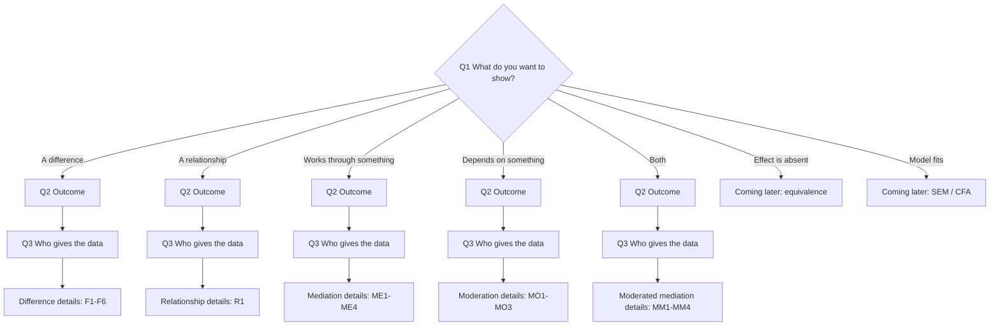

# Design finder: question tree

The design finder is the simple route on the app's first screen (build guide,
section 7). It helps users who don't yet know the name of their design reach
the right design form. It asks a few questions, each answered by clicking a
plain-language card. This document gives, for every question and every
option:

- the wording the user sees (a card title and a short line of help);
- a **Not sure?** explanation with an example from psychology;
- where the answer leads: the next question, or a design and template in
  `engine/inst/schema/design.schema.json`.

This is a specification for the app (build phase 5). It is not built yet.

## Rules the finder follows

- **Deterministic.** The same answers always lead to the same form. There is
  no AI in the finder; the optional assistant (build phase 7) may fill in the
  same answers from a description, and the user still sees and confirms them.
- **Every answer can be changed.** The path so far is shown as a row of chips
  (e.g. "Different people · Score · Effect depends on W"); clicking a chip
  goes back to that question with the other answers kept where they still
  apply.
- **"Not sure" is always an option.** It opens the question's explanation and
  examples. It never guesses an answer.
- **The finder ends on one design form** and names the analysis in standard
  terms (e.g. "This is a 2 x 2 mixed ANOVA; the test of interest is the
  interaction") so users learn the vocabulary.
- **Shortcut.** "I already know my analysis" skips the questions (see the
  last section).
- **Methodological choices are not hidden in wording.** Where the right
  analysis is a judgement, the path is marked **Open question** below and
  routes nowhere until the maintainer decides.

## Status labels

Each end point carries one of these labels, shown to the user on the final
card.

| Label | Meaning | What the user sees |
| --- | --- | --- |
| **Available** | The engine runs this design today. | The design form. |
| **Coming later (spec ready)** | The design is in the spec format; its engine is being built (build phase 3). | "This design is coming soon. You can fill in the form and save the spec, but you can't run it yet." |
| **Coming later (not in spec)** | Planned (build guide section 2) but not yet in the spec format. | "powerkit doesn't cover this design yet. It is planned for a later version." plus the analysis name, so they can look for another tool. |
| **Open question** | Which analysis to route to is a methodological decision still to be made (see the end of this document). | Not shown to users until decided. |

Today only `factorial_anova / 2x2_between` and `factorial_anova / 2x2_mixed`
are **Available**.

## Overview

---

## Q1. What do you want your study to show?

Help line: *Pick the sentence closest to your main hypothesis. You can change
it later.*

**G1. A difference between groups or conditions** *(picture: two bars of
different heights)*
Not sure? Choose this if you compare groups of people, or the same people
under different conditions, on an outcome. Example: *do students who sleep
eight hours recall more words than students who sleep five hours?*
→ Q2 (outcome), then Q3, then the difference details (F1).

**G2. A relationship between two things you measure** *(picture: a scatter
plot with an upward trend)*
Not sure? Choose this if you didn't assign people to conditions, but measured
two variables and expect them to go together. Example: *is daily screen time
related to loneliness?*
→ Q2, then Q3, then R1.

**G3. That an effect works through something else** *(picture: X → M → Y)*
Not sure? This is **mediation**: X affects Y because it changes something in
between (M). Example: *a self-affirmation task reduces defensiveness, which in
turn makes people more willing to change their behaviour.*
→ Q2, then Q3, then ME1.

**G4. That an effect depends on something else** *(picture: two lines with
different slopes)*
Not sure? This is **moderation**, also called an **interaction**: the effect
of X on Y is stronger, weaker or reversed depending on a third variable (W).
Example: *daily stress harms sleep less for people with more social support.*
→ Q2, then Q3, then MO1.

**G5. Both: an effect that works through something else, and part of that
depends on something else** *(picture: X → M → Y with W pointing at one
arrow)*
Not sure? This is **moderated mediation**. Example: *a threat manipulation
raises perceived threat, which raises support for a policy, but the first
step happens mainly for people who identify strongly with their group.*
→ Q2, then Q3, then MM1.

**G6. That an effect is absent, or too small to matter** *(picture: a
narrow band around zero)*
Not sure? Choose this if your hypothesis is that two things are **the same**,
within a margin you care about. A non-significant result is not evidence of
no effect; you need an equivalence test. Example: *a 5-item short form gives
the same scores as the 20-item original, within ±0.2 SD.*
→ **Coming later (not in spec):** equivalence test (TOST) or minimum-effect
test.

**G7. That a model or questionnaire structure fits the data** *(picture: a
small path diagram with latent circles)*
Not sure? Choose this if your aim is to check a measurement model or a
structural equation model rather than one effect. Example: *checking that a
new wellbeing scale has the three factors it was designed to have.*
→ **Coming later (not in spec):** CFA / SEM model fit (e.g. RMSEA).

**Not sure** — *Think of the sentence you would write as Hypothesis 1 in a
preregistration. "Group A will score higher than group B" is a difference;
"X will be related to Y" is a relationship; "X will affect Y through M" is
mediation; "the effect of X on Y will be stronger when W is high" is
moderation. If none fits, use "Build my own model".*

---

## Q2. What is your outcome like?

Help line: *The outcome is what you measure to see whether your hypothesis
holds (your dependent variable).*

**O1. A score or scale** *(picture: a ruler)*
Not sure? A number where higher means more of something: a questionnaire
total or average, a reaction time, words recalled out of 20, a 0–100 slider.
Example: *the mean of a 10-item anxiety scale.*
→ Continue to Q3.

**O2. Yes or no** *(picture: a tick and a cross)*
Not sure? Each person ends up in one of two categories. Example: *did the
participant attend the follow-up session? Did they choose the healthy snack?*
→ G1 or G2: continue to Q3.
→ G3, G4 or G5: **Coming later (not in spec):** mediation and moderation with
a yes/no outcome (logistic models).

**O3. One of several categories** *(picture: three labelled boxes)*
Not sure? Each person ends up in one of three or more categories with no
order. Example: *attachment style: secure, anxious or avoidant.*
→ G1 or G2: continue to Q3.
→ G3, G4 or G5: **Coming later (not in spec).**

*(This option is not in the guide's list for Q2; it is needed to reach the
chi-square test of independence.)*

**O4. A count** *(picture: tally marks)*
Not sure? How many times something happened, with no fixed maximum. Example:
*cigarettes smoked last week; intrusive thoughts recorded in a day.*
→ **Coming later (not in spec):** Poisson or negative binomial models.

**O5. A rating on a few points** *(picture: five radio buttons)*
Not sure? A single question answered on a short scale, such as 1 to 5 from
"strongly disagree" to "strongly agree". If you average several such items
into a scale score, choose "A score or scale" instead.
→ **Open question OQ1.**

**Not sure** — *Look at one participant's data for your outcome. Is it a
number that can take many values (score), one of two answers (yes/no), one
of several labels (categories), how many times something happened (count),
or one answer on a short rating scale (rating)?*

---

## Q3. Who gives the data?

Help line: *How participants relate to your conditions or measurements.*

For G2 (a relationship) the first option reads: **"Each person is measured
once, on both variables."** For all other goals the options are as below.

**P1. Different people in each group or condition** *(picture: two separate
groups of figures)*
Not sure? Each person takes part in only one condition, or belongs to only
one group. Example: *half the participants do the training and half don't.*
→ Continue to the details for the chosen goal.

**P2. The same people in every condition** *(picture: one group of figures
with arrows to each condition)*
Not sure? Each person does every condition, usually in a counterbalanced
order. Example: *everyone rates faces both under time pressure and without
it.*
→ G1: continue to F1.
→ G2, G3, G4, G5: **Coming later (not in spec):** within-person correlation,
mediation and moderation (multilevel models).

**P3. People respond to many items or stimuli** *(picture: one person facing
a grid of pictures)*
Not sure? Each person reacts to many stimuli (words, faces, vignettes) and you
want your conclusion to hold for other stimuli like these, not just the ones
you used. Example: *a lexical decision task with 80 words.*
→ **Coming later (not in spec):** mixed-effects models with crossed
participants and stimuli. See also **Open question OQ3.**

**P4. People are nested in groups (classes, teams, clinics)** *(picture:
figures inside circles)*
Not sure? Participants come in clusters that share something, so people in
the same cluster tend to be more alike. Example: *pupils in 20 classrooms,
with whole classrooms assigned to the intervention.*
→ **Coming later (not in spec):** multilevel models. See also **Open
question OQ4.**

**P5. The same people measured over time** *(picture: one figure on a
timeline)*
Not sure? You measure each person on several occasions. Example: *depression
before and after therapy; a daily diary kept for two weeks.*
→ Ask T1.

**Not sure** — *Ask yourself: could one participant appear in more than one of
your conditions? If no, choose "Different people". If yes, choose "The same
people". If your participants come in groups (classes, couples, teams) or
each respond to many stimuli, choose the option that describes that.*

### T1. How many times is each person measured? *(after P5)*

**Twice (for example, before and after)** *(picture: two dots on a
timeline)*
Not sure? Example: *anxiety measured at the start and at the end of an
8-week course.*
→ Treated as a within-person factor "Time" with two levels, then F1.
→ **Open question OQ2** applies to the pre–post designs this creates.

**Three or more times** *(picture: several dots on a timeline)*
Not sure? Example: *mood measured weekly for 10 weeks; experience sampling
five times a day.*
→ **Coming later (not in spec):** growth curve, cross-lagged panel or
intensive longitudinal models.

---

## Difference details (G1)

### F1. How many things did you vary or compare?

Help line: *Each thing you vary is called a factor (for example "condition"
or "time").*

**One** *(picture: one row of bars)*
Not sure? A single manipulation or grouping. Example: *training vs no
training.*
→ F2.

**Two, crossed** *(picture: a 2 x 2 grid)*
Not sure? Two factors where every combination appears. Example: *feedback
(none vs praise) crossed with task difficulty (easy vs hard), giving four
combinations.*
→ Score outcome (O1): F3.
→ Yes/no or categories (O2, O3): **Coming later (not in spec):** logistic or
log-linear models for two factors.

**Three or more** *(picture: a cube)*
Not sure? Example: *feedback x difficulty x age group.*
→ **Coming later (not in spec):** 2 x 2 x 2 and larger factorial designs.

### F2. How many groups or conditions? *(one factor)*

**One group, compared with a fixed value** *(picture: one bar and a dashed
line)*
Not sure? You have one group and compare its average with a known number.
Example: *is mean mood above the scale midpoint of 4? Is accuracy above
chance (50%)?*
→ O1 score: `basic_test / one_sample_t` — **Coming later (spec ready).**
Analysis name: *one-sample t-test.*
→ O2 yes/no: **Coming later (not in spec):** test of one proportion.

**Two** *(picture: two bars)*
Not sure? Example: *intervention vs control; morning vs evening testing.*
→ See the table below.

**Three or more** *(picture: three bars)*
Not sure? Example: *three types of feedback: none, praise, criticism.*
→ See the table below.

| Outcome | Who gives the data | Two groups / conditions | Three or more |
| --- | --- | --- | --- |
| O1 Score | P1 Different people | `basic_test / independent_t`, **Coming later (spec ready)**; *independent-samples t-test*; see OQ7 | **Coming later (not in spec):** *one-way ANOVA*; see OQ8 |
| O1 Score | P2 Same people, or P5 measured twice | `basic_test / paired_t`, **Coming later (spec ready)**; *paired-samples t-test*; P5 path also under OQ2 | **Coming later (not in spec):** *repeated-measures ANOVA*; see OQ8 |
| O2 Yes/no | P1 Different people | `basic_test / two_proportions`, **Coming later (spec ready)**; *test of two proportions (z test)* | `basic_test / chi_square_independence`, **Coming later (spec ready)**; *chi-square test of independence* |
| O2 Yes/no | P2 or P5 | **Coming later (not in spec):** *McNemar's test* | **Coming later (not in spec):** *Cochran's Q* |
| O3 Categories | P1 Different people | `basic_test / chi_square_independence`, **Coming later (spec ready)** | `basic_test / chi_square_independence`, **Coming later (spec ready)** |
| O3 Categories | P2 or P5 | **Coming later (not in spec)** | **Coming later (not in spec)** |

### F3. Does each factor have exactly two levels? *(two factors, score outcome)*

**Yes: 2 x 2** *(picture: a 2 x 2 grid)*
Not sure? Each factor has two versions. Example: *praise vs none, and easy vs
hard.*
→ F4.

**No: at least one factor has three or more** *(picture: a 2 x 3 grid)*
Not sure? Example: *three feedback types crossed with easy vs hard.*
→ **Coming later (not in spec):** larger factorial ANOVA.

### F4. For each factor: did different people get each level, or did everyone get both?

Help line: *Answer once for each factor. Example: "Group: different people;
Time: everyone at both."*

For each factor the options are **Different people** (between participants)
and **Everyone got both** (within participants), with this Not sure?: *If one
person could appear at both levels of this factor, choose "Everyone got
both". Example: in a study of therapy vs waitlist measured before and after,
"therapy vs waitlist" is different people and "before vs after" is everyone
got both.*

| Factor A | Factor B | Leads to | Status | Analysis name shown |
| --- | --- | --- | --- | --- |
| Different people | Different people | `factorial_anova / 2x2_between` | **Available** | *2 x 2 between-participants ANOVA* |
| Different people | Everyone got both | `factorial_anova / 2x2_mixed` (A between, B within) | **Available**; pre–post versions also under OQ2 | *2 x 2 mixed ANOVA* |
| Everyone got both | Different people | `factorial_anova / 2x2_mixed`, with the factors swapped so that A is the between factor (the spec's convention) | **Available**; pre–post versions also under OQ2 | *2 x 2 mixed ANOVA* |
| Everyone got both | Everyone got both | **Coming later (not in spec)** | | *2 x 2 within-participants ANOVA* |

Then F5.

### F5. Which result matters most for your study?

Help line: *Power is calculated for one effect. Choose the one your main
hypothesis is about.* (The options use the user's own factor names.)

**"The effect of [Factor A], averaged over [Factor B]"** → `target_test.effect
= main_effect_A`
Not sure? You expect Factor A to matter regardless of B. Example: *praise
improves persistence on both easy and hard tasks.*

**"The effect of [Factor B], averaged over [Factor A]"** → `main_effect_B`
Not sure? As above, for Factor B.

**"Whether the effect of one depends on the other"** → `interaction`, then F6
Not sure? You expect the effect of one factor to be different at the two
levels of the other. Example: *praise helps on hard tasks but not on easy
ones.* In a pre–post study with a control group, the hypothesis "the therapy
group improves more than the waitlist group" is this one.

### F6. Which picture matches your prediction? *(interaction only)*

Help line: *Each picture shows the outcome for the four combinations. Pick the
shape you expect; you will enter the actual numbers on the next screen.*

**The lines cross** *(picture: an X)*
Not sure? The effect reverses: it goes one way at one level and the other way
at the other. Example: *praise helps on hard tasks but hurts on easy ones.*

**One effect shrinks** *(picture: two lines that converge but don't meet)*
Not sure? The effect is there at both levels but smaller at one. Example:
*praise helps a lot on hard tasks and a little on easy ones.*

**One effect disappears** *(picture: one flat line and one sloped line)*
Not sure? The effect is present at one level and absent at the other.
Example: *praise helps on hard tasks and makes no difference on easy ones.*

All three lead to the same form (2 x 2 between or mixed, as chosen in F4).
What the picture should set on that form is **Open question OQ6.**

---

## Relationship details (G2)

### R1. What is the other variable like?

Help line: *Your outcome is [outcome type from Q2]. What is the variable you
expect it to be related to?*

**A score or scale** *(picture: a ruler)*
Not sure? Example: *screen time in hours per day.*
→ O1 score outcome, P1: `basic_test / correlation`, **Coming later (spec
ready)**. Analysis name: *Pearson correlation.*
→ O2 yes/no outcome: **Coming later (not in spec):** *logistic regression.*
→ O3 categories outcome: **Coming later (not in spec).**

**Groups or categories** *(picture: labelled boxes)*
Not sure? Example: *smokers vs non-smokers; attachment style.*
→ O1 score outcome: this is a comparison between groups. The finder says
*"A score compared across groups is a difference between groups; we've moved
you to that path"* and goes to F1 with Q2 and Q3 kept.
→ O2 or O3 outcome, P1: `basic_test / chi_square_independence`, **Coming
later (spec ready).** Analysis name: *chi-square test of independence.*

**Several predictors at once, or controlling for other variables** *(picture:
several arrows into one box)*
Not sure? Example: *does screen time predict loneliness after accounting for
age and social anxiety?*
→ **Coming later (not in spec):** *multiple regression.*

For G2, any answer other than P1 at Q3 leads to **Coming later (not in
spec)** (within-person or multilevel correlation).

---

## Moderation details (G4)

*Requires O1 (score outcome); other outcomes are coming later (see Q2).*

### MO1. What is your main predictor (X)?

**Conditions you assigned, with two levels** *(picture: two boxes with an
arrow from a die)*
Not sure? You randomly assigned people to one of two conditions. Example:
*mindfulness exercise vs reading a text.*

**Two groups that already exist** *(picture: two labelled groups)*
Not sure? A grouping you didn't assign. Example: *smokers vs non-smokers.*

**A measured score** *(picture: a ruler)*
Not sure? Example: *daily stress measured with a questionnaire.*

**Three or more conditions or groups** *(picture: three boxes)*
→ **Coming later (not in spec).**

### MO2. What does the effect depend on (the moderator, W)?

**Two groups or conditions** *(picture: two boxes)*
Not sure? Example: *easy vs hard task; men vs women.*

**A measured score** *(picture: a ruler)*
Not sure? Example: *social support; trait anxiety.*

**Three or more groups** *(picture: three boxes)*
→ **Coming later (not in spec).**

### MO3. Does a third variable change the interaction again?

**No** → see the mapping below.
**Yes (a three-way interaction)** → **Coming later (not in spec).**
Not sure? Example of a three-way interaction: *praise helps on hard tasks,
but only for children, not adults.*

| X (MO1) | W (MO2) | Who gives the data (Q3) | Leads to | Status | Analysis name shown |
| --- | --- | --- | --- | --- | --- |
| Two levels (assigned or existing) | Two groups | P1, or one factor within | F4, then `factorial_anova / 2x2_between` or `2x2_mixed`, with `effect = interaction` | **Available** for the 2 x 2 designs; routing is **Open question OQ5** | *2 x 2 ANOVA interaction* |
| Two levels | A score | P1 | `regression_interaction / two_way` (X binary, W continuous) | **Coming later (spec ready)** | *moderated regression (continuous x binary interaction)* |
| A score | Two groups | P1 | `regression_interaction / two_way` (X continuous, W binary) | **Coming later (spec ready)** | *moderated regression (continuous x binary interaction)* |
| A score | A score | P1 | `regression_interaction / two_way` (both continuous) | **Coming later (spec ready)** | *moderated regression (continuous x continuous interaction)* |
| Any | Any | P2, P3, P4, P5 (except 2 x 2 mixed above) | | **Coming later (not in spec)** | *multilevel moderation* |

---

## Mediation details (G3)

*Requires O1 (score outcome) and P1 at Q3 (each person measured once, or
measured at several times but analysed person by person). Repeated-measures
and multilevel mediation are **Coming later (not in spec).***

### ME1. What is the cause (X)?

**Conditions you assigned** *(picture: two boxes with a die)*
Not sure? Example: *self-affirmation vs control task.*

**A measured score** *(picture: a ruler)*
Not sure? Example: *workload measured with a questionnaire.* See **Open
question OQ9.**

Both lead to ME2. (The spec allows X to be binary or continuous.)

### ME2. How many go-betweens (mediators)?

**One** *(picture: X → M → Y)*
Not sure? Example: *workload → exhaustion → intention to quit.*
→ ME4, then `mediation / process_4` with a single mediator `M`. Analysis
name: *simple mediation (PROCESS model 4).*

**Two or more** *(picture: X with two arrows)*
→ ME3.

### ME3. How do the mediators connect?

**Side by side: X affects each one separately** *(picture: X → M1 → Y and X →
M2 → Y)*
Not sure? Example: *workload raises both exhaustion and cynicism, and each
raises intention to quit.*
→ ME4, then `mediation / process_4` with mediators `M1`, `M2`, ... (up to 9).
Analysis name: *parallel mediation (PROCESS model 4).*

**In a chain: X affects the first, which affects the next** *(picture: X → M1
→ M2 → Y)*
Not sure? Example: *a growth-mindset intervention changes beliefs, which
increases effort, which raises grades.*
→ ME4, then `mediation / process_6` (2 to 4 mediators; more is **Coming later
(not in spec)**). Analysis name: *serial mediation (PROCESS model 6).*

### ME4. Are your mediators scores?

**Yes** → the form for the template chosen in ME2 or ME3: **Coming later
(spec ready).**
**No, at least one is yes/no or a category** → **Coming later (not in spec).**
Not sure? A mediator is a score if it is a number that can take many values,
like a questionnaire mean.

The final screen also asks which indirect path the power analysis is for (the
spec's `target_test.path`, e.g. "X → M1 → M2 → Y"). That is part of the form,
not the finder.

---

## Moderated mediation details (G5)

*Requires O1 (score outcome) and P1 at Q3, as for mediation.*

### MM1. What is the cause (X)?

As ME1.

### MM2. What does part of the process depend on (the moderator, W)?

As MO2: **Two groups or conditions** or **A measured score** (the spec allows
W to be binary or continuous). Three or more groups → **Coming later (not in
spec).**

### MM3. How many mediators?

**One** → MM4.
**Two or more** → **Coming later (not in spec).**

### MM4. Which link depends on W?

**The link from X to the mediator** *(picture: W pointing at the X → M
arrow)*
Not sure? Example: *the threat manipulation raises perceived threat more for
people who identify strongly with their group.*
→ `moderated_mediation / process_7`, **Coming later (spec ready).** Analysis
name: *first-stage moderated mediation (PROCESS model 7); test of the index
of moderated mediation.*

**The link from the mediator to the outcome** *(picture: W pointing at the M →
Y arrow)*
Not sure? Example: *emotional exhaustion lowers job performance less for
people with high coping self-efficacy.*
→ `moderated_mediation / process_14`, **Coming later (spec ready).**
Analysis name: *second-stage moderated mediation (PROCESS model 14); test of
the index of moderated mediation.*

**Both links** *(picture: W pointing at both arrows)*
→ **Coming later (not in spec):** PROCESS model 58.

**The link from X to the mediator, and the direct link from X to the
outcome** *(picture: W pointing at X → M and X → Y)*
→ **Coming later (not in spec):** PROCESS model 8 (all three links: model
59).

**Not sure** — *Ask which part of your explanation you expect to be stronger
for some people. If W changes how much X moves the mediator, it is the first
link; if W changes how much the mediator matters for the outcome, it is the
second.*

---

## "I already know my analysis" (shortcut)

A searchable list. Choosing an entry opens its form directly and shows the
same status label.

| Listed as | Leads to | Status |
| --- | --- | --- |
| One-sample t-test | `basic_test / one_sample_t` | Coming later (spec ready) |
| Independent-samples t-test (Student or Welch) | `basic_test / independent_t` | Coming later (spec ready) |
| Paired-samples t-test | `basic_test / paired_t` | Coming later (spec ready) |
| Pearson correlation | `basic_test / correlation` | Coming later (spec ready) |
| Test of two proportions (z test) | `basic_test / two_proportions` | Coming later (spec ready) |
| Chi-square test of independence | `basic_test / chi_square_independence` | Coming later (spec ready) |
| 2 x 2 between-participants ANOVA | `factorial_anova / 2x2_between` | **Available** |
| 2 x 2 mixed ANOVA (one factor between, one within) | `factorial_anova / 2x2_mixed` | **Available** |
| Moderated regression (two-way interaction) | `regression_interaction / two_way` | Coming later (spec ready) |
| Simple mediation (PROCESS model 4) | `mediation / process_4`, one mediator | Coming later (spec ready) |
| Parallel mediation (PROCESS model 4) | `mediation / process_4`, several mediators | Coming later (spec ready) |
| Serial mediation (PROCESS model 6) | `mediation / process_6` | Coming later (spec ready) |
| PROCESS model 7 | `moderated_mediation / process_7` | Coming later (spec ready) |
| PROCESS model 14 | `moderated_mediation / process_14` | Coming later (spec ready) |
| One-way ANOVA; repeated-measures ANOVA; 2 x 2 within ANOVA; 2 x 2 x 2 ANOVA; ANCOVA | | Coming later (not in spec) |
| Three-way interaction; PROCESS models 8, 58, 59 | | Coming later (not in spec) |
| Equivalence test (TOST); minimum-effect test | | Coming later (not in spec) |
| Logistic, Poisson or ordinal regression; McNemar's test | | Coming later (not in spec) |
| Mixed-effects (participants x stimuli); multilevel models | | Coming later (not in spec) |
| Growth curve, cross-lagged panel, EMA models | | Coming later (not in spec) |
| CFA, SEM, measurement invariance | | Coming later (not in spec) |

---

## Open questions for the maintainer

These are methodological choices. The finder does not route these paths until
each is decided.

**OQ1. Single rating items (O5).** A single 1–5 or 1–7 item: route it to the
score designs (t-test, ANOVA, treating the rating as continuous), or treat it
as ordinal and mark it "Coming later" until ordinal models arrive (v2)? If
routed to score designs, should the finder show a warning?

**OQ2. Pre–post designs (P5 with two time points).** "Therapy vs waitlist,
measured before and after" currently maps to a 2 x 2 mixed ANOVA with the
interaction as the target. ANCOVA (post-test adjusted for pre-test) is a
common alternative that usually needs fewer participants. Should the finder:
(a) route to 2 x 2 mixed only, (b) route to ANCOVA once it exists, or
(c) offer both with an explanation? The same question applies to a single
group measured twice (currently the paired t-test).

**OQ3. Many items or stimuli (P3).** Block until mixed-effects models are
supported (v2), or allow a by-participant analysis (averaging over stimuli)
with a warning that it ignores stimulus variability?

**OQ4. Nested data (P4).** Block until multilevel models are supported, or
allow single-level designs with an adjustment for clustering (e.g. a design
effect) and a warning?

**OQ5. Two binary factors as moderation (MO1 and MO2 both two levels).**
Route to the 2 x 2 ANOVA (current mapping, which assumes equal cell sizes) or
to the regression interaction template (which allows measured moderators
with unequal group sizes and unreliable measures)? For a measured binary
moderator such as gender, group sizes are rarely equal.

**OQ6. Interaction pictures (F6).** Should choosing a picture only record the
expected shape (the user then enters all cell means and justifies them), or
should it pre-fill cell means of that shape? Pre-filling needs default effect
sizes, which the guide asks the tool to avoid.

**OQ7. Two groups, score outcome: Student or Welch t-test?** The template
supports both. Which should the finder name and pre-select as the default?

**OQ8. Three or more groups.** When one-way and repeated-measures ANOVA
arrive, should the finder suggest powering the key planned contrast (e.g.
treatment vs control) instead of the omnibus test?

**OQ9. Measured X in mediation (ME1).** Should the finder warn that
mediation with a measured (not manipulated) X, measured at the same time as M
and Y, supports weaker causal conclusions? Should it ask about the timing of
measurement?
