# Walkthroughs: example studies through every route

*Last updated: 16 October 2026.*

For each design in [`routing-audit.md`](routing-audit.md), this page gives:
- a two-sentence example study, written the way a psychologist might
  describe it;
- the answers given in each of the routing prototype's three routes;
- the end point reached in each route, with a screenshot of its card;
- a note on whether the card would make sense to someone without
  statistics training.

Problems were **flagged, not fixed**, when the walkthroughs were first run
(F1–F15, listed first); the table's Status column says what has since been
fixed. Entries whose end point changed have a before/after note. Wording also
changed on these cards without changing where any route leads: the
validated cards' status lines (E1–E14), E5 and E8 (internal references
removed), E36 (names non-inferiority) and E44 (dyadic wording). The flags
cover
anything confusing, inconsistent between routes, or claiming more than the
audit supports. No typos were found to fix.

**How this was produced.**
- The examples and answers are in
  [`app/routing/walkthroughs/scenarios.json`](../app/routing/walkthroughs/scenarios.json).
- Where each route leads was worked out with the app's own routing
  functions (`walkthroughs.R`), and then confirmed by clicking through the
  running prototype in all three routes
  ([`screenshots.js`](../app/routing/walkthroughs/screenshots.js)). All 183
  route runs reached the recorded end point.
- `tests/testthat/test-walkthroughs.R` keeps the recorded answers and end
  points in step with the tree.
- **Screenshots:** there is one per end card, in
  [`figures/walkthroughs/`](figures/walkthroughs/), taken from the
  end-point list. A card's text is the same whichever route reaches it;
  only the row of answer chips above it differs. The grey dashed boxes on
  the cards are the maintainer's undecided settings, not text for users.
- **The answers are a judgement:** they are what a plausible user would
  click. In the guided route, where the variables screen can't describe a
  design, the user picks "None of these fit / I'm not sure" for the main
  predictor.

The prototype is routing only. No numbers are calculated, and a card that
"runs in powerkit" would run in the engine, not here.

## Flags

| Flag | Type | What | Status | Walkthroughs |
| --- | --- | --- | --- | --- |
| F1 | Inconsistent between routes | **The guided route ignores S3's "Twice".** After the screening says each person is measured twice, the variables screen offers the same choices as for once. A condition with two groups then leads to the independent-groups end points (E2, E5) instead of the paired ones (E3, E26). | **Fixed** after the walkthroughs: after "Twice" the guided route offers "The same people in two conditions, or before and after" (E3, E26), and two groups measured twice get the pre-post question. | [Paired t-test](#u-paired), [Wilcoxon signed ranks](#u-wsr), [McNemar](#u-mcnemar) |
| F2 | Inconsistent between routes | **The guided route has no outcome with several categories.** S1 combines "yes/no, or one of several categories", but the guided outcome option is "Yes/no" only. So an outcome with three categories reaches E5 (two proportions) or E27 (logistic regression). "Help me choose" reaches E6. | **Fixed:** the guided outcome offers "One of several categories", which reaches E6. | [Chi-square test (two groups)](#u-chi2), [Chi-square test (two or more groups)](#u-chi2b) |
| F3 | Inconsistent between routes; claims more than the audit supports | **Factorial logistic regression gets opposite advice.** "Help me choose" and the list reach E27, which names tools (Spower's `p_glm()`, pwrss). The guided route reaches E32 ("moderation … when the outcome isn't a score"), which says there is no ready-made tool. The audit only establishes E27 for this design, so E32's no-ready-made-tool claim isn't supported here. | **Fixed:** both routes reach E47, a generic card with the neutral tools sentence (open question 18 decides whether it names tools). Still open: Q1's moderation answer with a yes/no outcome leads to E32 for this design (audit, "What's left"). | [Factorial logistic regression](#u-factlogit) |
| F4 | Inconsistent between routes | **ANCOVA with a covariate other than a baseline.** "Help me choose" never asks about it and reaches E2. The list and the guided route reach E23. The audit lists this under "What's left" (item 6). | Open: already in the audit's "What's left". | [Analysis of covariance](#u-ancova) |
| F5 | Inconsistent between routes | **The end-point list ignores the screening.** After "Twice" it still offers the independent-groups tests, and after "Yes/no" it still offers the score tests. No scenario here picked a contradicting card, but nothing stops a user from doing so. | **Fixed:** the list shows only the analyses that fit the screening answers, and says how many it shows. | — (general) |
| F6 | Inconsistent between routes | **Tests that aren't on the list by name.** These lead to the safety net (E-unsure) in "I know my analysis", but to a parametric or single-outcome end point in "Help me choose" and the guided route. Most are already in the audit's "What's left" (rank-based tests, judgement call 3.8; MANOVA; curvilinear effects). | Open: mostly in the audit's "What's left" (judgement call 3.8 and others). | [Multiple outcomes (MANOVA)](#manova), [Curvilinear effects](#curvilinear), [Non-parametric tests](#nonparam), [One-sample median](#u-median), [Wilcoxon–Mann–Whitney](#u-mww), [Wilcoxon signed ranks](#u-wsr), [Kruskal–Wallis](#u-kw), [Friedman](#u-friedman), [Non-parametric correlation](#u-spearman), [One-way MANOVA](#u-manova), [Multivariate multiple regression](#u-mmreg), [Canonical correlation](#u-canon) |
| F7 | Audit mismatch; confusing | **IRT and exploratory factor analysis reach E37.** The audit says IRT is "not reachable" in every route, but Q1's "a questionnaire structure" plausibly leads an IRT user to E37. For exploratory factor analysis, the audit already notes that the nearest answer leads to E37. In both cases the card is about CFA and SEM and doesn't mention the user's analysis. | **For the maintainer:** change the route (e.g. a Q1 wording that doesn't invite IRT, or an IRT card) or change the audit (IRT reaches E37). Routing not changed. | [Factor analysis (exploratory)](#efa), [IRT](#irt), [Factor analysis](#u-fa) |
| F8 | Claims more than the audit supports (audit mismatch) | **SEM with latent variables in the guided route.** The audit's "after" column says Q1 now names SEM and leads to E37. That holds only in "Help me choose": the guided route has no SEM option, so a latent-variable model described as "X is a score" still reaches E4. | Open: the guided route still has no SEM option. | [SEM with latent variables](#sem) |
| F9 | Claims more than the audit supports | **E44's card says treating partners as independent "would overstate power".** The audit says only that ignoring the pairing is wrong. Whether power is overstated or understated depends on the design (e.g. whether the predictor varies between or within couples). | **Fixed:** the card now says that ignoring the pairing can overstate or understate power, depending on whether the predictor varies between or within dyads, so dyadic methods are needed. | [Dyadic data](#dyadic) |
| F10 | Confusing | **S2 for one person, or for group averages.** A single participant's daily ratings, or a school's monthly averages, must be answered "Independent people" to reach E45. No answer describes one unit measured many times. | **Wording fixed:** S2's "Independent people" now says to choose it for one person or one unit too. | [Longitudinal: time series (many measurements of one unit)](#timeseries), [Longitudinal: segmented regression or interrupted time series](#segmented) |
| F11 | Confusing; audit mismatch | **Reliability studies.** Two raters each rating once fits S3's "Twice" awkwardly, and only S4's "Estimate an effect precisely" leads to a fitting card (E46). **Audit mismatch:** the audit says test–retest reliability entered as a relationship still reaches E4. But after S3's "Twice", which is how a test–retest study would answer, the relationship path reaches E41 (within-person relationships). E4 is reached only after "Once". | **For the maintainer:** change the route (e.g. an inter-rater or test–retest answer) or change the audit (test–retest answered "Twice" reaches E41). Routing not changed. | [Reliability or ICC](#icc) |
| F12 | Confusing | **Diary studies.** A within-person relationship (sleep on stressful days) goes to E35 ("measured three or more times"). E41 ("relationships measured within people") may fit better, but it isn't reachable once T1 says the measurements are over time. | **Needs a routing decision:** whether T1's "how people change" should separate within-person relationships (E41) from change over time (E35). | [Longitudinal: diary or EMA](#diary) |
| F13 | Confusing | **Non-inferiority.** S4 offers "equivalence or non-inferiority", but E36's card names TOST and minimum-effect tests, not non-inferiority. | **Fixed:** E36's title names non-inferiority. | [Equivalence or non-inferiority](#equivalence) |
| F14 | Confusing | **Internal references on user-facing cards.** E5's backend line cites "Departure 5", and validated cards say "published value still to be transcribed". Neither means anything to a user. | **Fixed:** internal references are out of user-facing text, and validation notes say "A check against a published example is still to come." | [Binary outcome](#binary), [Fisher's exact test](#u-fisher), [Two independent samples t-test](#u-t2), [Paired t-test](#u-paired), [Correlation](#u-corr) |
| F15 | Confusing | **The same ten closing questions on every card that runs.** "What you'd be asked next" lists the same ten questions on every card, including ones that don't apply. For example, E5 (yes/no outcome) asks about the reliability of measures and Student vs Welch. A reader can't tell which questions apply. Table 2.2 of decision-tree.md lists them for every design, which the routing prototype's PR noted as an ambiguity. | Open: card-specific closing questions are the next PR's work. | [Binary outcome](#binary), [Sequential designs with interim looks](#sequential), [Unequal variances](#unequalvar), [Attrition or missing data](#attrition), [Curvilinear effects](#curvilinear), [Non-parametric tests](#nonparam), [SEM with latent variables](#sem), [One-sample t-test](#u-onet), [One-sample median](#u-median), [Two independent samples t-test](#u-t2), [Wilcoxon–Mann–Whitney](#u-mww), [Chi-square test (two groups)](#u-chi2), [Fisher's exact test](#u-fisher), [Paired t-test](#u-paired), [Wilcoxon signed ranks](#u-wsr), [Chi-square test (two or more groups)](#u-chi2b), [Factorial ANOVA](#u-factanova), [Correlation](#u-corr), [Simple linear regression](#u-slr), [Non-parametric correlation](#u-spearman), [Analysis of covariance](#u-ancova), [One-way MANOVA](#u-manova) |

Already in the audit's "What's left", and confirmed by these walkthroughs:
- curvilinear effects reaching E4;
- rank-based tests (judgement call 3.8);
- Fisher's exact test (3.9);
- goodness-of-fit (3.7);
- MANOVA;
- sequential designs;
- non-baseline covariates.

## Card readability

One note per end card reached by the walkthroughs, for a reader without statistics training. The walkthrough entries refer to these.

| Card | Note |
| --- | --- |
| [E1](figures/walkthroughs/E1.png): Compare one group's average with a fixed value | The title is clear. "What you would enter" asks for Cohen's d and an SD without explaining them. |
| [E2](figures/walkthroughs/E2.png): Compare two separate groups on a score | The title is clear. The inputs use Cohen's d, a pooled SD and "Student's or Welch's test" without explanation. |
| [E3](figures/walkthroughs/E3.png): Compare the same people in two conditions (or before and after) | The title is clear. "d_z" and "SD of the differences" are opaque without training. |
| [E4](figures/walkthroughs/E4.png): Test whether two scores are related | The title is clear. "The expected correlation r" needs a little background. |
| [E5](figures/walkthroughs/E5.png): Compare two groups on a yes/no outcome | The title is clear. The backend line's "no continuity correction" needs training (the internal reference "Departure 5" was removed after the walkthroughs). |
| [E6](figures/walkthroughs/E6.png): Test whether two sets of categories are related | The title ("two sets of categories") and the inputs are understandable. Two maintainer placeholders (judgement calls 3.7 and 3.9) also show on this card. |
| [E7](figures/walkthroughs/E7.png): Two factors crossed, different people in each of the four groups | The title is clear. "Exact (analytic)" and "cell means" assume some training. |
| [E18](figures/walkthroughs/E18.png): Any difference among three or more groups or conditions | The title is clear. The standard name uses "omnibus", and "correlations between conditions" needs explaining. |
| [E23](figures/walkthroughs/E23.png): Compare groups adjusting for a covariate (e.g. the before score) | The title is clear and gives an example. "R-squared" needs explaining. |
| [E24](figures/walkthroughs/E24.png): Several predictors at once, or one predictor controlling for others | The title is clear. "R-squared change" needs explaining. |
| [E25](figures/walkthroughs/E25.png): Compare one group's proportion with a fixed value | Clear. |
| [E26](figures/walkthroughs/E26.png): The same people, a yes/no outcome in each condition | The title is clear. "Discordant proportions" is jargon a lay reader won't follow. The Cochran's Q line (no ready-made tool) is clear. |
| [E27](figures/walkthroughs/E27.png): Predict a yes/no outcome | "Predict a yes/no outcome" is clear. "Odds ratio or regression coefficients" needs training. |
| [E28](figures/walkthroughs/E28.png): An outcome that counts how often something happened | The title is clear. "Rate ratio" and "Poisson or negative binomial" need explaining. |
| [E29](figures/walkthroughs/E29.png): An outcome in ordered categories (e.g. a single Likert item analysed as ordinal) | The title is clear and has an example. "Odds ratio" and "proportional odds" need training. |
| [E33](figures/walkthroughs/E33.png): Each person responds to many items or stimuli | The title is clear. "Fixed effects" and "variance components" are jargon. |
| [E34](figures/walkthroughs/E34.png): People nested in groups (classes, teams, clinics) | The title is clear and has examples. "Intraclass correlation (ICC)" needs explaining. |
| [E35](figures/walkthroughs/E35.png): The same people measured three or more times | The title is clear. "Depends on the model" gives a lay reader nothing to go on, and the package names won't mean much. |
| [E36](figures/walkthroughs/E36.png): Show that an effect is absent or too small to matter (equivalence, or non-inferiority) | The title is clear and now names non-inferiority, as S4 does. "TOST" and "equivalence bounds" need explaining. |
| [E37](figures/walkthroughs/E37.png): Check that a model or questionnaire structure fits | The title is clear for someone checking a questionnaire's structure. "RMSEA" is jargon. The card doesn't mention exploratory factor analysis or IRT, which can reach it. |
| [E43](figures/walkthroughs/E43.png): An outcome that is the time until something happens | Clear, and it says why (some people haven't had the event when the study ends). The neutral tools sentence leaves the reader with nowhere to go next. |
| [E44](figures/walkthroughs/E44.png): Data that come in pairs, such as couples or a parent and child | Clear. It now says why dyadic methods are needed: ignoring the pairing can overstate or understate power. |
| [E45](figures/walkthroughs/E45.png): A trend over time that may change at a known point | Mostly clear. The four points explain the problem in plain words, and "autocorrelation" is explained in brackets. |
| [E46](figures/walkthroughs/E46.png): Estimate an effect precisely (plan for a confidence-interval width) | Clear and short. As with E43, it doesn't say where to go next. |
| [E47](figures/walkthroughs/E47.png): Two or more factors crossed, with a yes/no outcome | Clear, with an example. As with E43, the neutral tools sentence doesn't say where to go next (open question 18). |
| [E-unsure](figures/walkthroughs/E-unsure.png): None of these fit, or I'm not sure | Clear and plain: powerkit can't advise yet; talk to a statistician. |

## Part A: designs in the audit

### Dependence

#### Nested or multilevel data

> We will compare a new reading programme with usual teaching in 20 primary-school classes, about 25 pupils per class. Each pupil's reading score is measured once, at the end of the year.

**Answers given**

- **Help me choose:** *A score or scale* → *People within groups*
- **I know my analysis:** *A score or scale* → *People within groups*
- **Plan my whole study:** *A score or scale* → *People within groups*

**End point:** E34 (People nested in groups (classes, teams, clinics)) in all three routes.

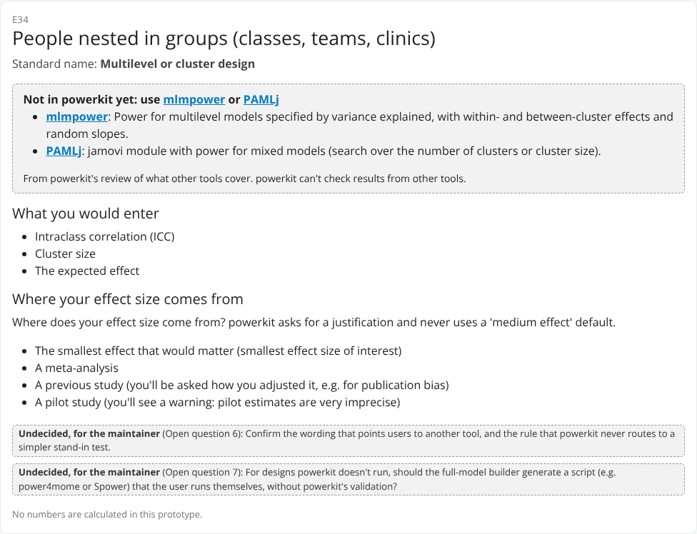

**Would the card make sense without statistics training?** **E34:** The title is clear and has examples. "Intraclass correlation (ICC)" needs explaining.

#### Crossed random effects (participants × stimuli)

> Participants will rate 40 faces for trustworthiness after a happy or a neutral mood induction. Every participant rates every face, and we want to know whether mood shifts the ratings.

**Answers given**

- **Help me choose:** *A score or scale* → *Many trials or stimuli per person*
- **I know my analysis:** *A score or scale* → *Many trials or stimuli per person*
- **Plan my whole study:** *A score or scale* → *Many trials or stimuli per person*

**End point:** E33 (Each person responds to many items or stimuli) in all three routes.

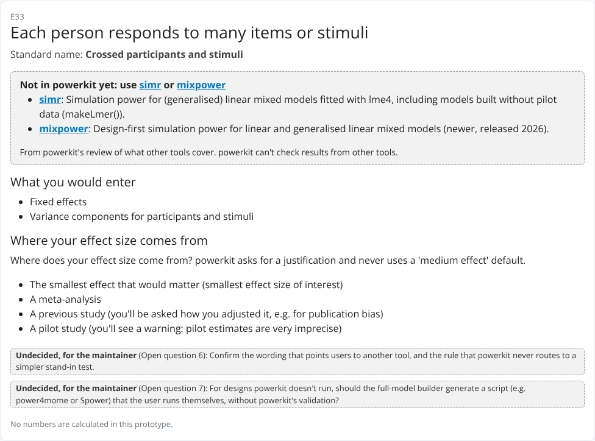

**Would the card make sense without statistics training?** **E33:** The title is clear. "Fixed effects" and "variance components" are jargon.

#### Cluster-randomised designs

> Twelve GP practices will be randomly assigned to offer a brief anxiety leaflet or not, and patients' anxiety will be measured a month later. Whole practices, not individual patients, are assigned.

**Answers given**

- **Help me choose:** *A score or scale* → *People within groups*
- **I know my analysis:** *A score or scale* → *People within groups*
- **Plan my whole study:** *A score or scale* → *People within groups*

**End point:** E34 (People nested in groups (classes, teams, clinics)) in all three routes.

**Would the card make sense without statistics training?** **E34:** The title is clear and has examples. "Intraclass correlation (ICC)" needs explaining.

#### Dyadic data

> We will recruit 150 couples and measure each partner's stress and relationship satisfaction once. We want to know whether one partner's stress relates to the other partner's satisfaction.

**Answers given**

- **Help me choose:** *A score or scale* → *Pairs*
- **I know my analysis:** *A score or scale* → *Pairs*
- **Plan my whole study:** *A score or scale* → *Pairs*

**End point:** E44 (Data that come in pairs, such as couples or a parent and child) in all three routes.

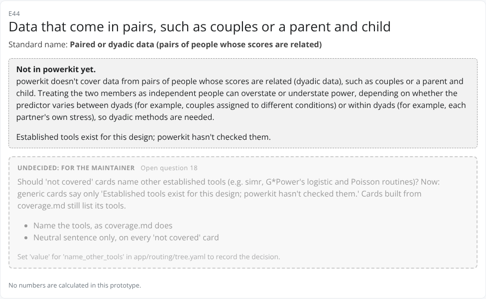

**Would the card make sense without statistics training?** **E44:** Clear. It now says why dyadic methods are needed: ignoring the pairing can overstate or understate power.

**Flags:** [F9](#flags)

#### Longitudinal: growth curves

> Adolescents will complete a self-esteem questionnaire every six months for three years. We want to know whether self-esteem rises faster for girls than for boys.

**Answers given**

- **Help me choose:** *A score or scale* → *Independent people* → *Many times* → *Measurements over time, to see how people change*
- **I know my analysis:** *A score or scale* → *Independent people* → *Many times* → *Measurements over time, to see how people change*
- **Plan my whole study:** *A score or scale* → *Independent people* → *Many times* → *Measurements over time, to see how people change*

**End point:** E35 (The same people measured three or more times) in all three routes.

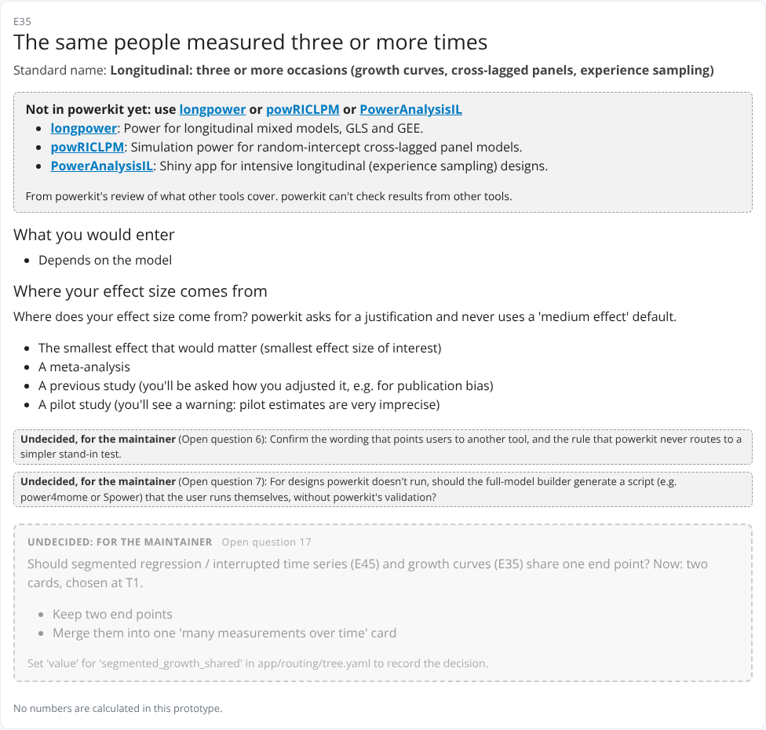

**Would the card make sense without statistics training?** **E35:** The title is clear. "Depends on the model" gives a lay reader nothing to go on, and the package names won't mean much.

#### Longitudinal: diary or EMA

> For 14 days, students will report each evening how stressed they felt and how long they slept. We want to know whether sleep is shorter on more stressful days.

**Answers given**

- **Help me choose:** *A score or scale* → *Independent people* → *Many times* → *Measurements over time, to see how people change*
- **I know my analysis:** *A score or scale* → *Independent people* → *Many times* → *Measurements over time, to see how people change*
- **Plan my whole study:** *A score or scale* → *Independent people* → *Many times* → *Measurements over time, to see how people change*

**End point:** E35 (The same people measured three or more times) in all three routes.

**Would the card make sense without statistics training?** **E35:** The title is clear. "Depends on the model" gives a lay reader nothing to go on, and the package names won't mean much.

**Flags:** [F12](#flags)

#### Longitudinal: time series (many measurements of one unit)

> One participant with chronic pain will rate pain intensity from 0 to 100 every day for 120 days, and a relaxation routine starts on day 60. We want to know whether the pain trend changes after day 60.

**Answers given**

- **Help me choose:** *A score or scale* → *Independent people* → *Many times* → *Measurements over time, to see whether a trend changes at a known point*
- **I know my analysis:** *A score or scale* → *Independent people* → *Many times* → *Measurements over time, to see whether a trend changes at a known point*
- **Plan my whole study:** *A score or scale* → *Independent people* → *Many times* → *Measurements over time, to see whether a trend changes at a known point*

**End point:** E45 (A trend over time that may change at a known point) in all three routes.

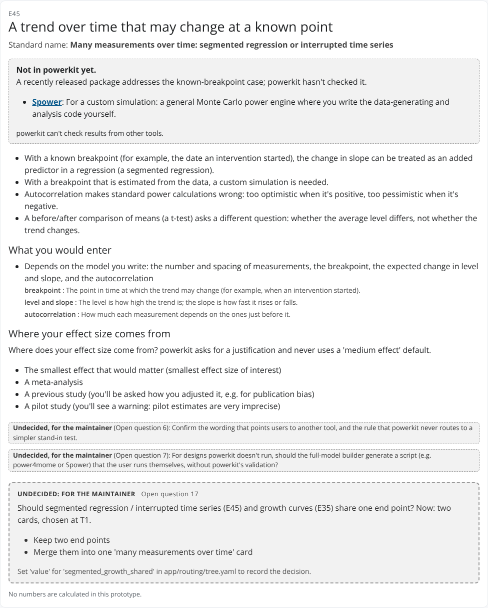

**Would the card make sense without statistics training?** **E45:** Mostly clear. The four points explain the problem in plain words, and "autocorrelation" is explained in brackets.

**Flags:** [F10](#flags)

#### Longitudinal: segmented regression or interrupted time series

> A school introduced a phone ban last September, and we have its average wellbeing score for every month in the two years before and the year after. We want to know whether the trend in wellbeing changed when the ban started.

**Answers given**

- **Help me choose:** *A score or scale* → *Independent people* → *Many times* → *Measurements over time, to see whether a trend changes at a known point*
- **I know my analysis:** *A score or scale* → *Independent people* → *Many times* → *Measurements over time, to see whether a trend changes at a known point*
- **Plan my whole study:** *A score or scale* → *Independent people* → *Many times* → *Measurements over time, to see whether a trend changes at a known point*

**End point:** E45 (A trend over time that may change at a known point) in all three routes.

**Would the card make sense without statistics training?** **E45:** Mostly clear. The four points explain the problem in plain words, and "autocorrelation" is explained in brackets.

**Flags:** [F10](#flags)

### Outcome type

#### Binary outcome

> Participants will read a CV with either a male or a female applicant's name and decide whether to invite them to interview (yes or no). We want to know whether the invitation rate differs between the two versions.

**Answers given**

- **Help me choose:** *Yes/no, or one of several categories* → *Independent people* → *Once* → *Detect an effect* → *A difference between groups or conditions* → *Different people, two groups, yes/no outcome*
- **I know my analysis:** *Yes/no, or one of several categories* → *Independent people* → *Once* → *Detect an effect* → list: *Compare two groups on a yes/no outcome*
- **Plan my whole study:** *Yes/no, or one of several categories* → *Independent people* → *Once* → *Detect an effect* → variables: Main predictor (X): A condition with two groups (or two existing groups); Outcome (Y): Yes/no; Mediators (go-betweens): None; Moderator (W): None; Covariates: None → analysis ticked: *The effect of X on the outcome*

**End point:** E5 (Compare two groups on a yes/no outcome) in all three routes.

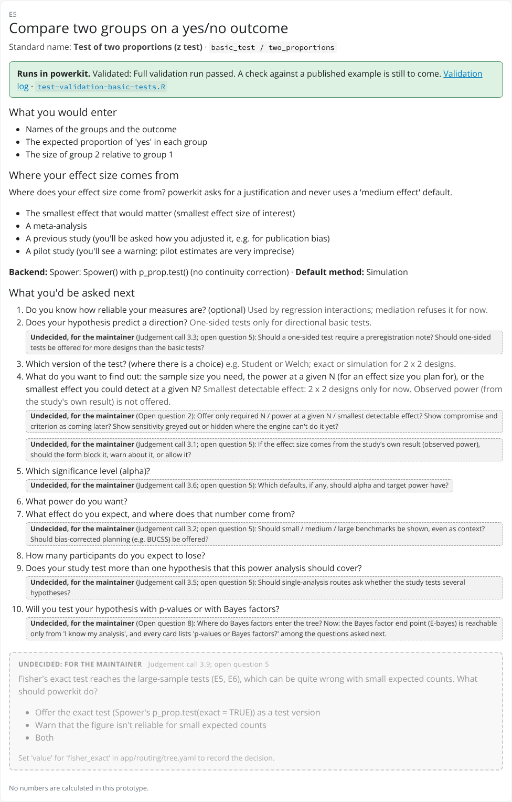

**Would the card make sense without statistics training?** **E5:** The title is clear. The backend line's "no continuity correction" needs training (the internal reference "Departure 5" was removed after the walkthroughs).

**Flags:** [F14](#flags), [F15](#flags)

#### Count outcome

> We will count how many times children interrupt during a 20-minute task, comparing children with and without an ADHD diagnosis. Most children interrupt only a few times, and many not at all.

**Answers given**

- **Help me choose:** *A count*
- **I know my analysis:** *A count*
- **Plan my whole study:** *A count*

**End point:** E28 (An outcome that counts how often something happened) in all three routes.

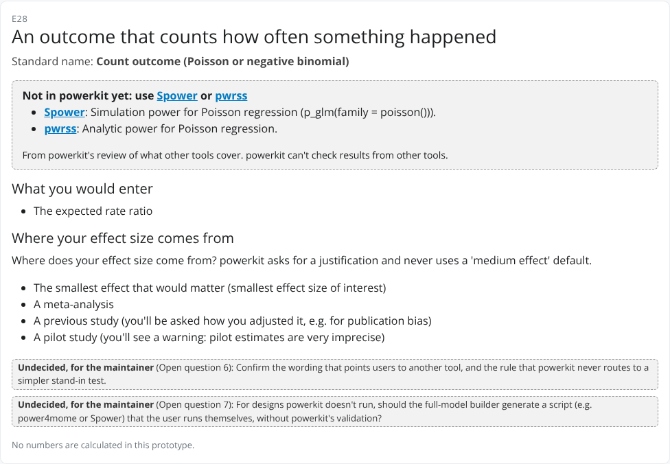

**Would the card make sense without statistics training?** **E28:** The title is clear. "Rate ratio" and "Poisson or negative binomial" need explaining.

#### Single ordinal item

> After using one of two versions of an app, participants will rate one statement, 'I would recommend this app', from 1 (strongly disagree) to 5 (strongly agree). We plan to analyse the ratings as ordered categories.

**Answers given**

- **Help me choose:** *Ordered categories (e.g. a single rating item)* → *As ordered categories*
- **I know my analysis:** *Ordered categories (e.g. a single rating item)* → *As ordered categories*
- **Plan my whole study:** *Ordered categories (e.g. a single rating item)* → *As ordered categories*

**End point:** E29 (An outcome in ordered categories (e.g. a single Likert item analysed as ordinal)) in all three routes.

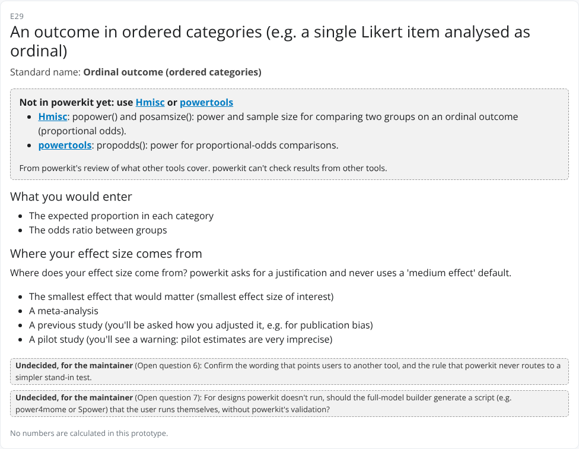

**Would the card make sense without statistics training?** **E29:** The title is clear and has an example. "Odds ratio" and "proportional odds" need training.

#### Time-to-event outcome

> After a stop-smoking session, participants will be followed for six months and we will record the day each first smokes again. Some will not relapse before the study ends.

**Answers given**

- **Help me choose:** *The time until something happens*
- **I know my analysis:** *The time until something happens*
- **Plan my whole study:** *The time until something happens*

**End point:** E43 (An outcome that is the time until something happens) in all three routes.

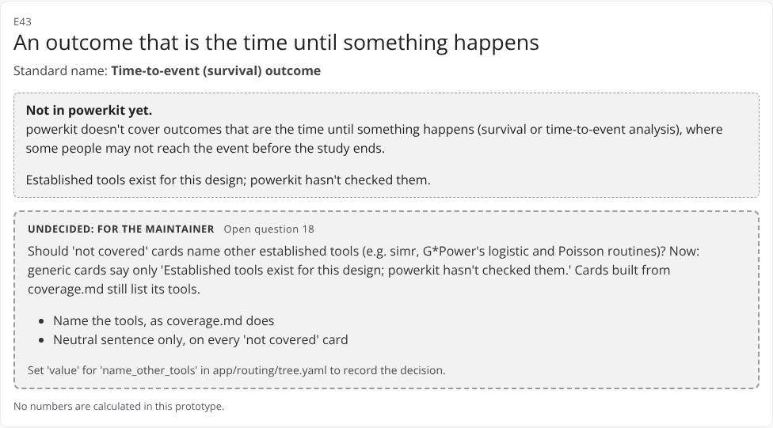

**Would the card make sense without statistics training?** **E43:** Clear, and it says why (some people haven't had the event when the study ends). The neutral tools sentence leaves the reader with nowhere to go next.

### Goal

#### Equivalence or non-inferiority

> We want to show that an online version of a memory test gives the same average score as the paper version, within 2 points. Each participant does one version once.

**Answers given**

- **Help me choose:** *A score or scale* → *Independent people* → *Once* → *Show there's no meaningful effect*
- **I know my analysis:** *A score or scale* → *Independent people* → *Once* → *Show there's no meaningful effect*
- **Plan my whole study:** *A score or scale* → *Independent people* → *Once* → *Show there's no meaningful effect*

**End point:** E36 (Show that an effect is absent or too small to matter (equivalence, or non-inferiority)) in all three routes.

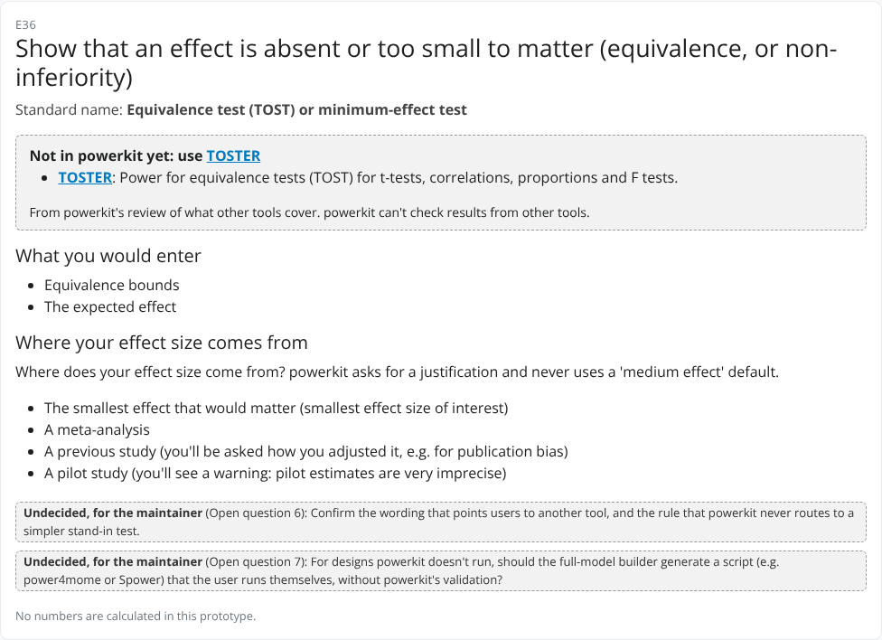

**Would the card make sense without statistics training?** **E36:** The title is clear and now names non-inferiority, as S4 does. "TOST" and "equivalence bounds" need explaining.

**Flags:** [F13](#flags)

#### Precision (CI width)

> We want to estimate the correlation between empathy and helping in teenagers, with a confidence interval no wider than plus or minus 0.10. We aren't testing a hypothesis, only measuring how strong the relationship is.

**Answers given**

- **Help me choose:** *A score or scale* → *Independent people* → *Once* → *Estimate an effect precisely*
- **I know my analysis:** *A score or scale* → *Independent people* → *Once* → *Estimate an effect precisely*
- **Plan my whole study:** *A score or scale* → *Independent people* → *Once* → *Estimate an effect precisely*

**End point:** E46 (Estimate an effect precisely (plan for a confidence-interval width)) in all three routes.

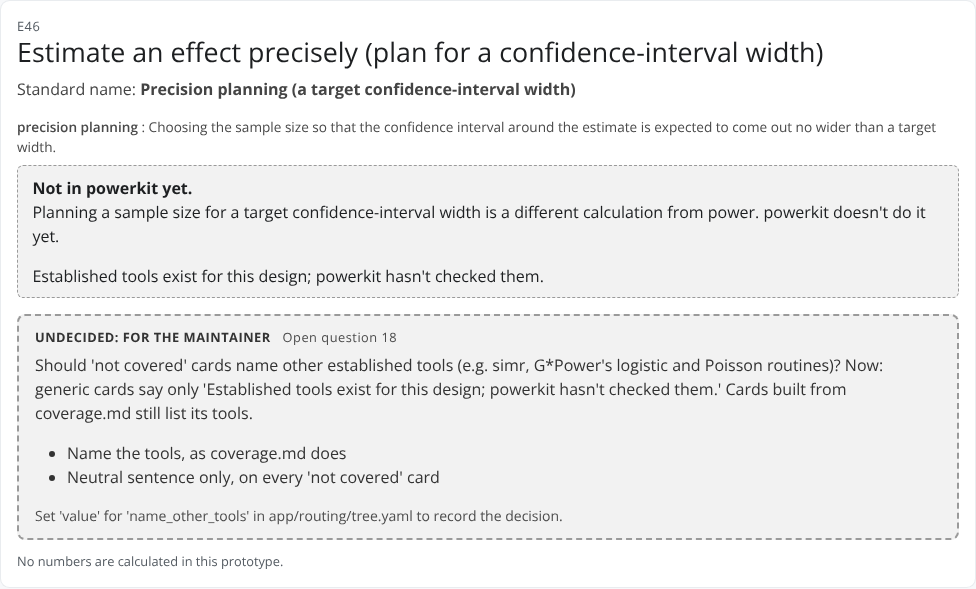

**Would the card make sense without statistics training?** **E46:** Clear and short. As with E43, it doesn't say where to go next.

#### Sequential designs with interim looks

> We plan a two-group experiment on a gratitude exercise, looking at the data after every 50 participants and stopping early if the effect is clear. We want to know the most participants we might need.

**Answers given**

- **Help me choose:** *A score or scale* → *Independent people* → *Once* → *Detect an effect* → *A difference between groups or conditions* → *One* → *Two, with different people in each*
- **I know my analysis:** *A score or scale* → *Independent people* → *Once* → *Detect an effect* → list: *Compare two separate groups on a score*
- **Plan my whole study:** *A score or scale* → *Independent people* → *Once* → *Detect an effect* → variables: Main predictor (X): A condition with two groups (or two existing groups); Outcome (Y): A score or scale; Mediators (go-betweens): None; Moderator (W): None; Covariates: None → analysis ticked: *The effect of X on the outcome*

**End point:** E2 (Compare two separate groups on a score) in all three routes.

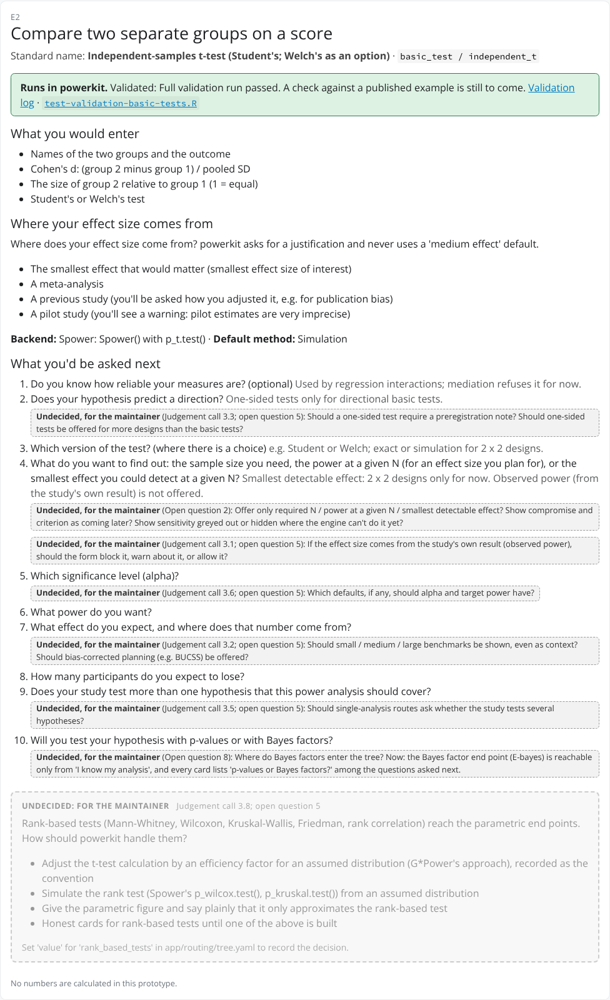

**Would the card make sense without statistics training?** **E2:** The title is clear. The inputs use Cohen's d, a pooled SD and "Student's or Welch's test" without explanation. The card plans a fixed sample and says nothing about interim looks. The audit lists sequential designs as a judgement call ("What's left", item 4).

**Flags:** [F15](#flags)

### Extensions

#### ANCOVA or covariates

> Patients will be randomly assigned to CBT or a waiting list, with depression measured before and after. We will compare the after scores, adjusting for the before scores.

**Answers given**

- **Help me choose:** *A score or scale* → *Independent people* → *Twice* → *Detect an effect* → *A difference between groups or conditions* → *Two, crossed (every combination appears)* → *Yes: 2 x 2* → *One factor different people, the other everyone got both* → *Yes: the same number in every group* → *Yes: before and after* → *Yes, randomly assigned* → *ANCOVA: the after score, adjusting for the before score*
- **I know my analysis:** *A score or scale* → *Independent people* → *Twice* → *Detect an effect* → list: *Compare groups adjusting for a covariate (e.g. the before score)*
- **Plan my whole study:** *A score or scale* → *Independent people* → *Twice* → *Detect an effect* → variables: Main predictor (X): A condition with two groups (or two existing groups); Outcome (Y): A score or scale; Mediators (go-betweens): None; Moderator (W): None; Covariates: A baseline (before) measure of the outcome → analysis ticked: *The effect of X on the outcome* → *ANCOVA: the outcome adjusting for the baseline*

**End point:** E23 (Compare groups adjusting for a covariate (e.g. the before score)) in all three routes.

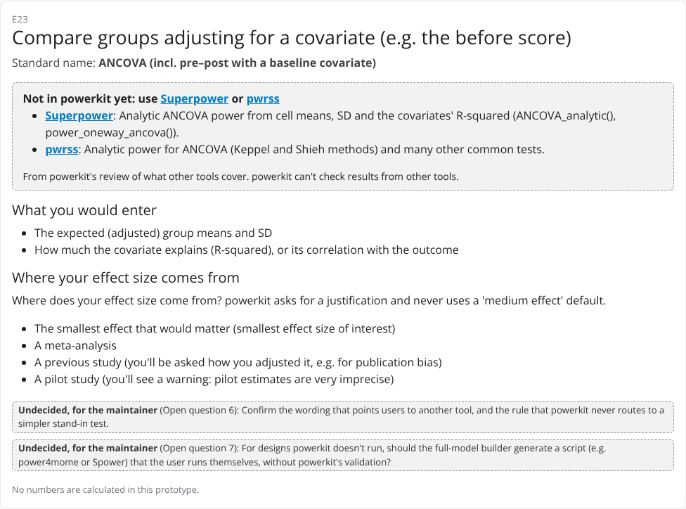

**Would the card make sense without statistics training?** **E23:** The title is clear and gives an example. "R-squared" needs explaining.

#### Multiple outcomes (MANOVA)

> We will compare three therapy groups on anxiety and depression, analysed together as two outcomes. Each participant is measured once, after therapy.

**Answers given**

- **Help me choose:** *A score or scale* → *Independent people* → *Once* → *Detect an effect* → *A difference between groups or conditions* → *One* → *Three or more* → *Any difference among the groups*
- **I know my analysis:** *A score or scale* → *Independent people* → *Once* → *Detect an effect* → list: *None of these fit / I'm not sure*
- **Plan my whole study:** *A score or scale* → *Independent people* → *Once* → *Detect an effect* → variables: Main predictor (X): A condition with three or more groups; Outcome (Y): A score or scale; Mediators (go-betweens): None; Moderator (W): None; Covariates: None → analysis ticked: *The effect of X on the outcome*

**End points:** Help me choose: E18 (Any difference among three or more groups or conditions); I know my analysis: E-unsure (None of these fit, or I'm not sure); Plan my whole study: E18 (Any difference among three or more groups or conditions). **The routes differ.**

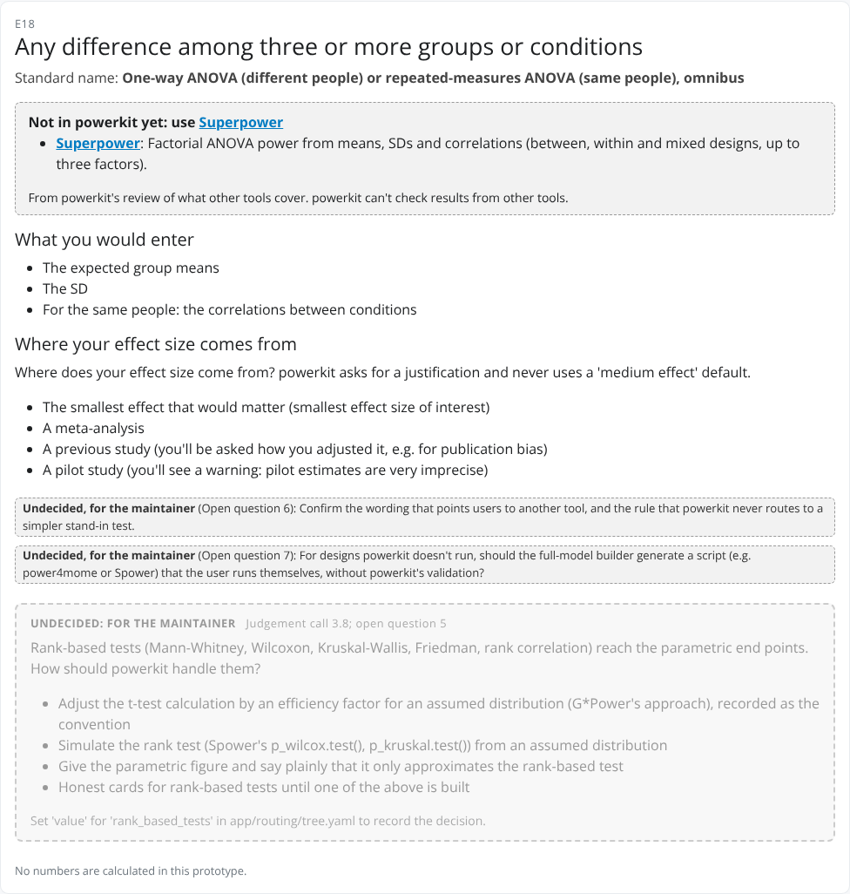 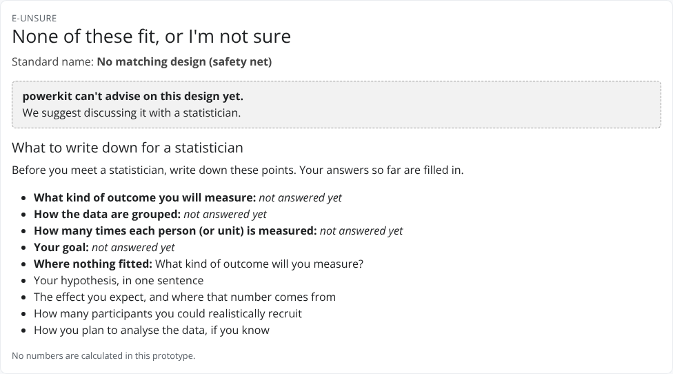

**Would the card make sense without statistics training?** **E18:** The title is clear. The standard name uses "omnibus", and "correlations between conditions" needs explaining. **E-unsure:** Clear and plain: powerkit can't advise yet; talk to a statistician. Every route treats the study as having one outcome. The closing question about several hypotheses (Q-multi) is the only hint.

**Flags:** [F6](#flags)

#### Unequal variances

> We will compare reaction times between older and younger adults, expecting the older group's times to vary much more. Each person does the task once.

**Answers given**

- **Help me choose:** *A score or scale* → *Independent people* → *Once* → *Detect an effect* → *A difference between groups or conditions* → *One* → *Two, with different people in each*
- **I know my analysis:** *A score or scale* → *Independent people* → *Once* → *Detect an effect* → list: *Compare two separate groups on a score*
- **Plan my whole study:** *A score or scale* → *Independent people* → *Once* → *Detect an effect* → variables: Main predictor (X): A condition with two groups (or two existing groups); Outcome (Y): A score or scale; Mediators (go-betweens): None; Moderator (W): None; Covariates: None → analysis ticked: *The effect of X on the outcome*

**End point:** E2 (Compare two separate groups on a score) in all three routes.

**Would the card make sense without statistics training?** **E2:** The title is clear. The inputs use Cohen's d, a pooled SD and "Student's or Welch's test" without explanation.

**Flags:** [F15](#flags)

#### Attrition or missing data

> A 12-week exercise programme will be compared with a control group on mood at the end, and we expect about one in five participants to drop out. Mood is measured once, at the end.

**Answers given**

- **Help me choose:** *A score or scale* → *Independent people* → *Once* → *Detect an effect* → *A difference between groups or conditions* → *One* → *Two, with different people in each*
- **I know my analysis:** *A score or scale* → *Independent people* → *Once* → *Detect an effect* → list: *Compare two separate groups on a score*
- **Plan my whole study:** *A score or scale* → *Independent people* → *Once* → *Detect an effect* → variables: Main predictor (X): A condition with two groups (or two existing groups); Outcome (Y): A score or scale; Mediators (go-betweens): None; Moderator (W): None; Covariates: None → analysis ticked: *The effect of X on the outcome*

**End point:** E2 (Compare two separate groups on a score) in all three routes.

**Would the card make sense without statistics training?** **E2:** The title is clear. The inputs use Cohen's d, a pooled SD and "Student's or Welch's test" without explanation.

**Flags:** [F15](#flags)

#### Curvilinear effects

> We expect an inverted-U relationship between arousal and test performance, with the best performance at moderate arousal. Each student is measured once on both.

**Answers given**

- **Help me choose:** *A score or scale* → *Independent people* → *Once* → *Detect an effect* → *A relationship between two things you measure* → *A score or scale*
- **I know my analysis:** *A score or scale* → *Independent people* → *Once* → *Detect an effect* → list: *None of these fit / I'm not sure*
- **Plan my whole study:** *A score or scale* → *Independent people* → *Once* → *Detect an effect* → variables: Main predictor (X): A measured score; Outcome (Y): A score or scale; Mediators (go-betweens): None; Moderator (W): None; Covariates: None → analysis ticked: *The effect of X on the outcome*

**End points:** Help me choose: E4 (Test whether two scores are related); I know my analysis: E-unsure (None of these fit, or I'm not sure); Plan my whole study: E4 (Test whether two scores are related). **The routes differ.**

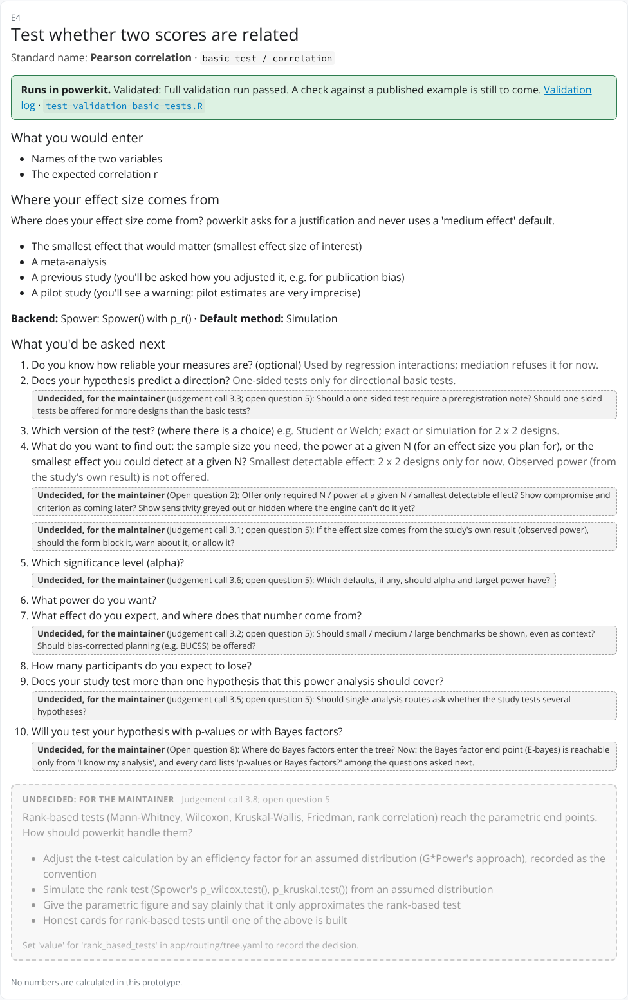 

**Would the card make sense without statistics training?** **E4:** The title is clear. "The expected correlation r" needs a little background. **E-unsure:** Clear and plain: powerkit can't advise yet; talk to a statistician. E4 is a straight-line correlation, so it doesn't fit an inverted U (audit, "What's left", item 1).

**Flags:** [F6](#flags), [F15](#flags)

#### Non-parametric tests

> We will compare pain ratings between two clinics with a Mann–Whitney test, because the ratings are very skewed. Each patient gives one rating.

**Answers given**

- **Help me choose:** *A score or scale* → *Independent people* → *Once* → *Detect an effect* → *A difference between groups or conditions* → *One* → *Two, with different people in each*
- **I know my analysis:** *A score or scale* → *Independent people* → *Once* → *Detect an effect* → list: *None of these fit / I'm not sure*
- **Plan my whole study:** *A score or scale* → *Independent people* → *Once* → *Detect an effect* → variables: Main predictor (X): A condition with two groups (or two existing groups); Outcome (Y): A score or scale; Mediators (go-betweens): None; Moderator (W): None; Covariates: None → analysis ticked: *The effect of X on the outcome*

**End points:** Help me choose: E2 (Compare two separate groups on a score); I know my analysis: E-unsure (None of these fit, or I'm not sure); Plan my whole study: E2 (Compare two separate groups on a score). **The routes differ.**

 

**Would the card make sense without statistics training?** **E2:** The title is clear. The inputs use Cohen's d, a pooled SD and "Student's or Welch's test" without explanation. **E-unsure:** Clear and plain: powerkit can't advise yet; talk to a statistician. E2 is the t-test. Judgement call 3.8's placeholder shows on the card.

**Flags:** [F6](#flags), [F15](#flags)

### Specialised

#### SEM with latent variables

> We will test whether latent perfectionism, measured by three questionnaires, predicts latent burnout, measured by three more, in 400 teachers. The analysis is a structural equation model.

**Answers given**

- **Help me choose:** *A score or scale* → *Independent people* → *Once* → *Detect an effect* → *That a model fits: a questionnaire structure, or a model with latent variables (SEM)*
- **I know my analysis:** *A score or scale* → *Independent people* → *Once* → *Detect an effect* → list: *Check that a model or questionnaire structure fits*
- **Plan my whole study:** *A score or scale* → *Independent people* → *Once* → *Detect an effect* → variables: Main predictor (X): A measured score; Outcome (Y): A score or scale; Mediators (go-betweens): None; Moderator (W): None; Covariates: None → analysis ticked: *The effect of X on the outcome*

**End points:** Help me choose: E37 (Check that a model or questionnaire structure fits); I know my analysis: E37 (Check that a model or questionnaire structure fits); Plan my whole study: E4 (Test whether two scores are related). **The routes differ.**

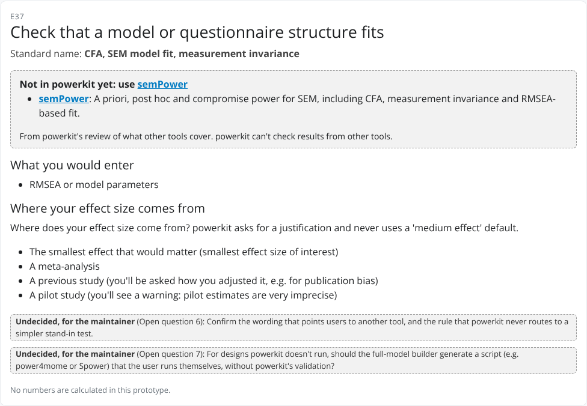 

**Would the card make sense without statistics training?** **E37:** The title is clear for someone checking a questionnaire's structure. "RMSEA" is jargon. The card doesn't mention exploratory factor analysis or IRT, which can reach it. **E4:** The title is clear. "The expected correlation r" needs a little background.

**Flags:** [F8](#flags), [F15](#flags)

#### CFA

> We will check whether a new 12-item loneliness scale has the three-factor structure we designed it to have. 300 students complete it once.

**Answers given**

- **Help me choose:** *A score or scale* → *Independent people* → *Once* → *Detect an effect* → *That a model fits: a questionnaire structure, or a model with latent variables (SEM)*
- **I know my analysis:** *A score or scale* → *Independent people* → *Once* → *Detect an effect* → list: *Check that a model or questionnaire structure fits*
- **Plan my whole study:** *A score or scale* → *Independent people* → *Once* → *Detect an effect* → variables: Main predictor (X): None of these fit / I'm not sure; Outcome (Y): A score or scale; Mediators (go-betweens): None; Moderator (W): None; Covariates: None → analysis ticked: *The effect of X on the outcome*

**End points:** Help me choose: E37 (Check that a model or questionnaire structure fits); I know my analysis: E37 (Check that a model or questionnaire structure fits); Plan my whole study: E-unsure (None of these fit, or I'm not sure). **The routes differ.**

 

**Would the card make sense without statistics training?** **E37:** The title is clear for someone checking a questionnaire's structure. "RMSEA" is jargon. The card doesn't mention exploratory factor analysis or IRT, which can reach it. **E-unsure:** Clear and plain: powerkit can't advise yet; talk to a statistician. The guided route has no option for a measurement model, so the user takes the safety net there.

#### Measurement invariance

> We will test whether a depression questionnaire measures the same thing in men and in women. Each person completes it once.

**Answers given**

- **Help me choose:** *A score or scale* → *Independent people* → *Once* → *Detect an effect* → *That a model fits: a questionnaire structure, or a model with latent variables (SEM)*
- **I know my analysis:** *A score or scale* → *Independent people* → *Once* → *Detect an effect* → list: *Check that a model or questionnaire structure fits*
- **Plan my whole study:** *A score or scale* → *Independent people* → *Once* → *Detect an effect* → variables: Main predictor (X): None of these fit / I'm not sure; Outcome (Y): A score or scale; Mediators (go-betweens): None; Moderator (W): None; Covariates: None → analysis ticked: *The effect of X on the outcome*

**End points:** Help me choose: E37 (Check that a model or questionnaire structure fits); I know my analysis: E37 (Check that a model or questionnaire structure fits); Plan my whole study: E-unsure (None of these fit, or I'm not sure). **The routes differ.**

 

**Would the card make sense without statistics training?** **E37:** The title is clear for someone checking a questionnaire's structure. "RMSEA" is jargon. The card doesn't mention exploratory factor analysis or IRT, which can reach it. **E-unsure:** Clear and plain: powerkit can't advise yet; talk to a statistician. As for CFA.

#### Reliability or ICC

> Two clinicians will each rate the symptom severity of the same 50 patients. We want the inter-rater reliability (an ICC) estimated to within plus or minus 0.1.

**Answers given**

- **Help me choose:** *A score or scale* → *Independent people* → *Twice* → *Estimate an effect precisely*
- **I know my analysis:** *A score or scale* → *Independent people* → *Twice* → *Estimate an effect precisely*
- **Plan my whole study:** *A score or scale* → *Independent people* → *Twice* → *Estimate an effect precisely*

**End point:** E46 (Estimate an effect precisely (plan for a confidence-interval width)) in all three routes.

**Would the card make sense without statistics training?** **E46:** Clear and short. As with E43, it doesn't say where to go next.

**Flags:** [F11](#flags)

#### Factor analysis (exploratory)

> We have written 30 items about climate anxiety and want to find out how many underlying factors they form. 400 adults will answer them once.

**Answers given**

- **Help me choose:** *A score or scale* → *Independent people* → *Once* → *Detect an effect* → *That a model fits: a questionnaire structure, or a model with latent variables (SEM)*
- **I know my analysis:** *A score or scale* → *Independent people* → *Once* → *Detect an effect* → list: *Check that a model or questionnaire structure fits*
- **Plan my whole study:** *A score or scale* → *Independent people* → *Once* → *Detect an effect* → variables: Main predictor (X): None of these fit / I'm not sure; Outcome (Y): A score or scale; Mediators (go-betweens): None; Moderator (W): None; Covariates: None → analysis ticked: *The effect of X on the outcome*

**End points:** Help me choose: E37 (Check that a model or questionnaire structure fits); I know my analysis: E37 (Check that a model or questionnaire structure fits); Plan my whole study: E-unsure (None of these fit, or I'm not sure). **The routes differ.**

 

**Would the card make sense without statistics training?** **E37:** The title is clear for someone checking a questionnaire's structure. "RMSEA" is jargon. The card doesn't mention exploratory factor analysis or IRT, which can reach it. **E-unsure:** Clear and plain: powerkit can't advise yet; talk to a statistician.

**Flags:** [F7](#flags)

#### IRT

> We want to calibrate a 25-item maths anxiety test with an item response theory model. About 500 pupils will take it once.

**Answers given**

- **Help me choose:** *A score or scale* → *Independent people* → *Once* → *Detect an effect* → *That a model fits: a questionnaire structure, or a model with latent variables (SEM)*
- **I know my analysis:** *A score or scale* → *Independent people* → *Once* → *Detect an effect* → list: *None of these fit / I'm not sure*
- **Plan my whole study:** *A score or scale* → *Independent people* → *Once* → *Detect an effect* → variables: Main predictor (X): None of these fit / I'm not sure; Outcome (Y): A score or scale; Mediators (go-betweens): None; Moderator (W): None; Covariates: None → analysis ticked: *The effect of X on the outcome*

**End points:** Help me choose: E37 (Check that a model or questionnaire structure fits); I know my analysis: E-unsure (None of these fit, or I'm not sure); Plan my whole study: E-unsure (None of these fit, or I'm not sure). **The routes differ.**

 

**Would the card make sense without statistics training?** **E37:** The title is clear for someone checking a questionnaire's structure. "RMSEA" is jargon. The card doesn't mention exploratory factor analysis or IRT, which can reach it. **E-unsure:** Clear and plain: powerkit can't advise yet; talk to a statistician.

**Flags:** [F7](#flags)

#### Meta-analysis

> We plan a meta-analysis of studies on mindfulness and attention and want to know how many studies we need to detect an average effect. Our data will be published effect sizes, not participants.

**Answers given**

- **Help me choose:** *None of these fit / I'm not sure*
- **I know my analysis:** *None of these fit / I'm not sure*
- **Plan my whole study:** *None of these fit / I'm not sure*

**End point:** E-unsure (None of these fit, or I'm not sure) in all three routes.

**Would the card make sense without statistics training?** **E-unsure:** Clear and plain: powerkit can't advise yet; talk to a statistician. There is no participant-level outcome, so the user stops at the first screening question.

#### Network models

> We will measure 15 depression symptoms in 600 adults and estimate a network of how the symptoms relate to each other. We want to know how many people we need for a stable network.

**Answers given**

- **Help me choose:** *A score or scale* → *Independent people* → *Once* → *Detect an effect* → *None of these fit / I'm not sure*
- **I know my analysis:** *A score or scale* → *Independent people* → *Once* → *Detect an effect* → list: *None of these fit / I'm not sure*
- **Plan my whole study:** *A score or scale* → *Independent people* → *Once* → *Detect an effect* → variables: Main predictor (X): None of these fit / I'm not sure; Outcome (Y): A score or scale; Mediators (go-betweens): None; Moderator (W): None; Covariates: None → analysis ticked: *The effect of X on the outcome*

**End point:** E-unsure (None of these fit, or I'm not sure) in all three routes.

**Would the card make sense without statistics training?** **E-unsure:** Clear and plain: powerkit can't advise yet; talk to a statistician. No route has an answer for a network model. The safety net is the honest exit.

## Part B: analyses in the UCLA OARC table

One entry per analysis in UCLA OARC's [*Choosing the Correct Statistical Test*](https://stats.oarc.ucla.edu/other/mult-pkg/whatstat/) (adapted from James D. Leeper), as listed in the audit. The examples are our own.

### One group against a fixed value

#### One-sample t-test

> We will test whether students' average score on a mindfulness scale differs from the published norm of 50. Each student completes the scale once.

**Answers given**

- **Help me choose:** *A score or scale* → *Independent people* → *Once* → *Detect an effect* → *A difference between groups or conditions* → *One* → *One group, compared with a fixed value*
- **I know my analysis:** *A score or scale* → *Independent people* → *Once* → *Detect an effect* → list: *Compare one group's average with a fixed value*
- **Plan my whole study:** *A score or scale* → *Independent people* → *Once* → *Detect an effect* → variables: Main predictor (X): None of these fit / I'm not sure; Outcome (Y): A score or scale; Mediators (go-betweens): None; Moderator (W): None; Covariates: None → analysis ticked: *The effect of X on the outcome*

**End points:** Help me choose: E1 (Compare one group's average with a fixed value); I know my analysis: E1 (Compare one group's average with a fixed value); Plan my whole study: E-unsure (None of these fit, or I'm not sure). **The routes differ.**

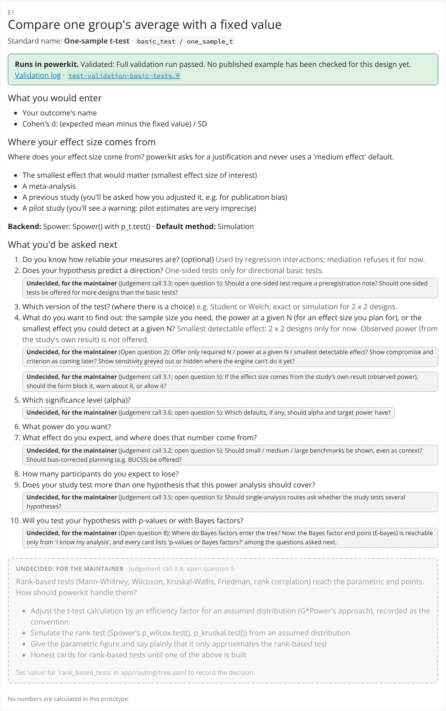 

**Would the card make sense without statistics training?** **E1:** The title is clear. "What you would enter" asks for Cohen's d and an SD without explaining them. **E-unsure:** Clear and plain: powerkit can't advise yet; talk to a statistician. The guided route can't describe a one-group design, so the user takes the safety net there. That fits the route's purpose (several analyses on shared variables).

**Flags:** [F15](#flags)

#### One-sample median

> Students' reported sleep the night before an exam is very skewed, so we will test whether the median differs from 7 hours. Each student reports once.

**Answers given**

- **Help me choose:** *A score or scale* → *Independent people* → *Once* → *Detect an effect* → *A difference between groups or conditions* → *One* → *One group, compared with a fixed value*
- **I know my analysis:** *A score or scale* → *Independent people* → *Once* → *Detect an effect* → list: *None of these fit / I'm not sure*
- **Plan my whole study:** *A score or scale* → *Independent people* → *Once* → *Detect an effect* → variables: Main predictor (X): None of these fit / I'm not sure; Outcome (Y): A score or scale; Mediators (go-betweens): None; Moderator (W): None; Covariates: None → analysis ticked: *The effect of X on the outcome*

**End points:** Help me choose: E1 (Compare one group's average with a fixed value); I know my analysis: E-unsure (None of these fit, or I'm not sure); Plan my whole study: E-unsure (None of these fit, or I'm not sure). **The routes differ.**

 

**Would the card make sense without statistics training?** **E1:** The title is clear. "What you would enter" asks for Cohen's d and an SD without explaining them. **E-unsure:** Clear and plain: powerkit can't advise yet; talk to a statistician. E1 is the t-test. Judgement call 3.8's placeholder shows on the card. The guided route can't describe a one-group design, so the user takes the safety net there.

**Flags:** [F6](#flags), [F15](#flags)

#### Binomial test

> We will test whether more than half of participants choose the fair split in an ultimatum game. Each person makes one choice.

**Answers given**

- **Help me choose:** *Yes/no, or one of several categories* → *Independent people* → *Once* → *Detect an effect* → *A difference between groups or conditions* → *One group, compared with a fixed proportion*
- **I know my analysis:** *Yes/no, or one of several categories* → *Independent people* → *Once* → *Detect an effect* → list: *Compare one group's proportion with a fixed value*
- **Plan my whole study:** *Yes/no, or one of several categories* → *Independent people* → *Once* → *Detect an effect* → variables: Main predictor (X): None of these fit / I'm not sure; Outcome (Y): Yes/no; Mediators (go-betweens): None; Moderator (W): None; Covariates: None → analysis ticked: *The effect of X on the outcome*

**End points:** Help me choose: E25 (Compare one group's proportion with a fixed value); I know my analysis: E25 (Compare one group's proportion with a fixed value); Plan my whole study: E-unsure (None of these fit, or I'm not sure). **The routes differ.**

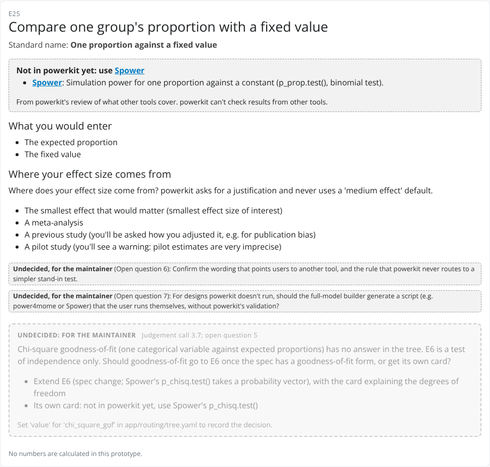 

**Would the card make sense without statistics training?** **E25:** Clear. **E-unsure:** Clear and plain: powerkit can't advise yet; talk to a statistician. As for the one-sample t-test: the guided route has no one-group option.

#### Chi-square goodness-of-fit

> We will test whether people's choices among four snacks differ from equal preference, 25% each. Each person chooses once.

**Answers given**

- **Help me choose:** *Yes/no, or one of several categories* → *Independent people* → *Once* → *Detect an effect* → *A difference between groups or conditions* → *One group, compared with a fixed proportion*
- **I know my analysis:** *Yes/no, or one of several categories* → *Independent people* → *Once* → *Detect an effect* → list: *Compare one group's proportion with a fixed value*
- **Plan my whole study:** *Yes/no, or one of several categories* → *Independent people* → *Once* → *Detect an effect* → variables: Main predictor (X): None of these fit / I'm not sure; Outcome (Y): Yes/no; Mediators (go-betweens): None; Moderator (W): None; Covariates: None → analysis ticked: *The effect of X on the outcome*

**End points:** Help me choose: E25 (Compare one group's proportion with a fixed value); I know my analysis: E25 (Compare one group's proportion with a fixed value); Plan my whole study: E-unsure (None of these fit, or I'm not sure). **The routes differ.**

 

**Would the card make sense without statistics training?** **E25:** Clear. **E-unsure:** Clear and plain: powerkit can't advise yet; talk to a statistician. E25 is a single proportion, not four categories (judgement call 3.7; its placeholder shows on E25).

### Two groups

#### Two independent samples t-test

> We will compare exam anxiety between students who did a breathing exercise and students who didn't. Each student completes the anxiety scale once.

**Answers given**

- **Help me choose:** *A score or scale* → *Independent people* → *Once* → *Detect an effect* → *A difference between groups or conditions* → *One* → *Two, with different people in each*
- **I know my analysis:** *A score or scale* → *Independent people* → *Once* → *Detect an effect* → list: *Compare two separate groups on a score*
- **Plan my whole study:** *A score or scale* → *Independent people* → *Once* → *Detect an effect* → variables: Main predictor (X): A condition with two groups (or two existing groups); Outcome (Y): A score or scale; Mediators (go-betweens): None; Moderator (W): None; Covariates: None → analysis ticked: *The effect of X on the outcome*

**End point:** E2 (Compare two separate groups on a score) in all three routes.

**Would the card make sense without statistics training?** **E2:** The title is clear. The inputs use Cohen's d, a pooled SD and "Student's or Welch's test" without explanation.

**Flags:** [F14](#flags), [F15](#flags)

#### Wilcoxon–Mann–Whitney

> Time spent on social media is very skewed, so we will compare two groups given different app settings with a Mann–Whitney test. Each person is measured once.

**Answers given**

- **Help me choose:** *A score or scale* → *Independent people* → *Once* → *Detect an effect* → *A difference between groups or conditions* → *One* → *Two, with different people in each*
- **I know my analysis:** *A score or scale* → *Independent people* → *Once* → *Detect an effect* → list: *None of these fit / I'm not sure*
- **Plan my whole study:** *A score or scale* → *Independent people* → *Once* → *Detect an effect* → variables: Main predictor (X): A condition with two groups (or two existing groups); Outcome (Y): A score or scale; Mediators (go-betweens): None; Moderator (W): None; Covariates: None → analysis ticked: *The effect of X on the outcome*

**End points:** Help me choose: E2 (Compare two separate groups on a score); I know my analysis: E-unsure (None of these fit, or I'm not sure); Plan my whole study: E2 (Compare two separate groups on a score). **The routes differ.**

 

**Would the card make sense without statistics training?** **E2:** The title is clear. The inputs use Cohen's d, a pooled SD and "Student's or Welch's test" without explanation. **E-unsure:** Clear and plain: powerkit can't advise yet; talk to a statistician.

**Flags:** [F6](#flags), [F15](#flags)

#### Chi-square test (two groups)

> People will be shown a menu with or without a 'climate-friendly' label, and we will record whether they choose the vegetarian, fish or meat dish. Each person chooses once.

**Answers given**

- **Help me choose:** *Yes/no, or one of several categories* → *Independent people* → *Once* → *Detect an effect* → *A difference between groups or conditions* → *Different people, outcome in categories*
- **I know my analysis:** *Yes/no, or one of several categories* → *Independent people* → *Once* → *Detect an effect* → list: *Test whether two sets of categories are related*
- **Plan my whole study:** *Yes/no, or one of several categories* → *Independent people* → *Once* → *Detect an effect* → variables: Main predictor (X): A condition with two groups (or two existing groups); Outcome (Y): One of several categories; Mediators (go-betweens): None; Moderator (W): None; Covariates: None → analysis ticked: *The effect of X on the outcome*

**End point:** E6 (Test whether two sets of categories are related) in all three routes.

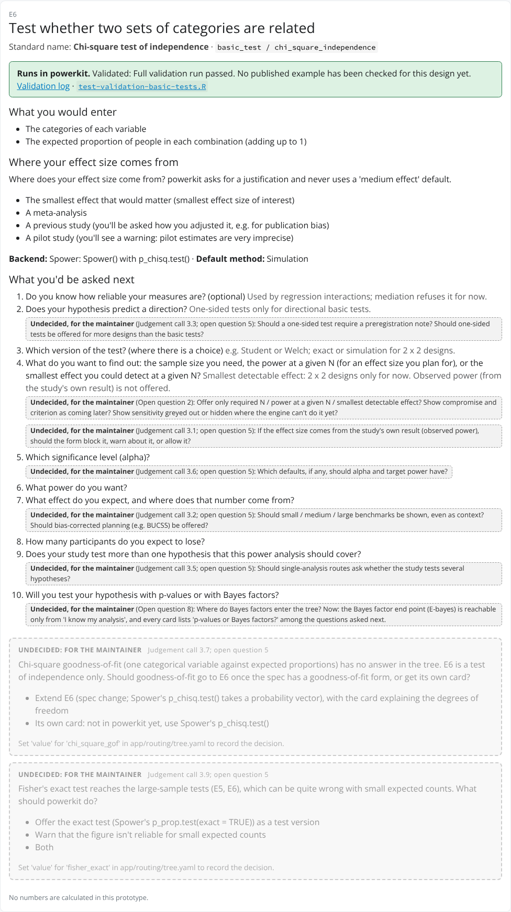

**Would the card make sense without statistics training?** **E6:** The title ("two sets of categories") and the inputs are understandable. Two maintainer placeholders (judgement calls 3.7 and 3.9) also show on this card.

**Before/after:** Plan my whole study: E5 → E6 (routing fixes after the walkthroughs, F1–F3).

**Flags:** [F2](#flags), [F15](#flags)

#### Fisher's exact test

> In a pilot with 20 patients, we will compare the proportion who improve on a new drug with the proportion on placebo, using Fisher's exact test. Each patient is classed once as improved or not.

**Answers given**

- **Help me choose:** *Yes/no, or one of several categories* → *Independent people* → *Once* → *Detect an effect* → *A difference between groups or conditions* → *Different people, two groups, yes/no outcome*
- **I know my analysis:** *Yes/no, or one of several categories* → *Independent people* → *Once* → *Detect an effect* → list: *Compare two groups on a yes/no outcome*
- **Plan my whole study:** *Yes/no, or one of several categories* → *Independent people* → *Once* → *Detect an effect* → variables: Main predictor (X): A condition with two groups (or two existing groups); Outcome (Y): Yes/no; Mediators (go-betweens): None; Moderator (W): None; Covariates: None → analysis ticked: *The effect of X on the outcome*

**End point:** E5 (Compare two groups on a yes/no outcome) in all three routes.

**Would the card make sense without statistics training?** **E5:** The title is clear. The backend line's "no continuity correction" needs training (the internal reference "Departure 5" was removed after the walkthroughs). E5 is the large-sample test. Judgement call 3.9's placeholder shows on the card.

**Flags:** [F14](#flags), [F15](#flags)

#### Paired t-test

> Participants will rate their mood before and after a 10-minute walk outdoors. We want to know whether mood improves.

**Answers given**

- **Help me choose:** *A score or scale* → *Independent people* → *Twice* → *Detect an effect* → *A difference between groups or conditions* → *One* → *Two, with the same people in both (or one group measured twice)*
- **I know my analysis:** *A score or scale* → *Independent people* → *Twice* → *Detect an effect* → list: *Compare the same people in two conditions (or before and after)*
- **Plan my whole study:** *A score or scale* → *Independent people* → *Twice* → *Detect an effect* → variables: Main predictor (X): The same people in two conditions, or before and after; Outcome (Y): A score or scale; Mediators (go-betweens): None; Moderator (W): None; Covariates: None → analysis ticked: *The effect of X on the outcome*

**End point:** E3 (Compare the same people in two conditions (or before and after)) in all three routes.

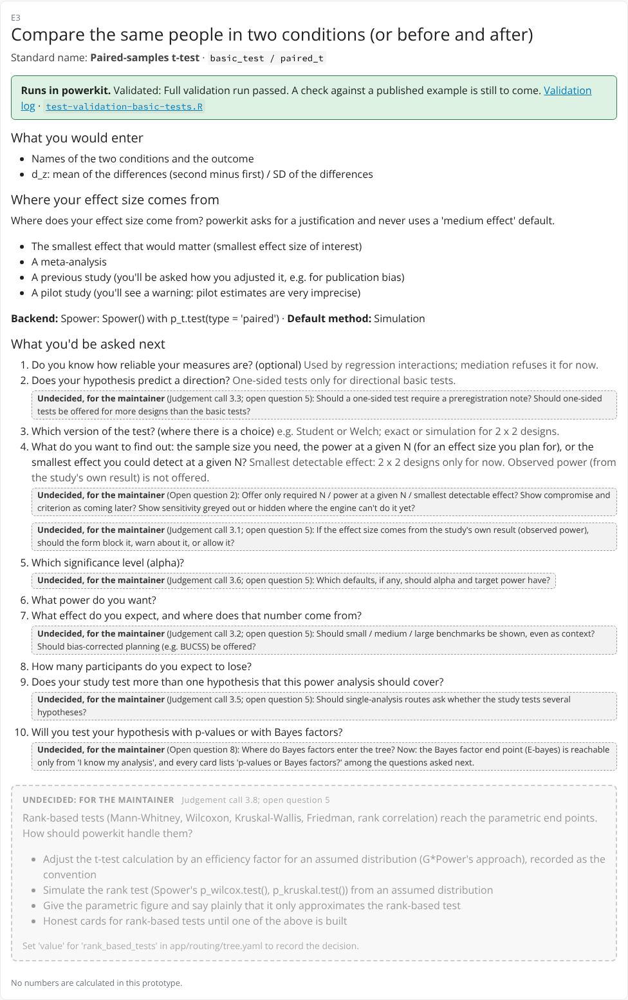

**Would the card make sense without statistics training?** **E3:** The title is clear. "d_z" and "SD of the differences" are opaque without training.

**Before/after:** Plan my whole study: E2 → E3 (routing fixes after the walkthroughs, F1–F3).

**Flags:** [F1](#flags), [F14](#flags), [F15](#flags)

#### Wilcoxon signed ranks

> Puzzle completion times are very skewed, so we will compare each person's time before and after training with a Wilcoxon signed-rank test. Everyone does both sessions.

**Answers given**

- **Help me choose:** *A score or scale* → *Independent people* → *Twice* → *Detect an effect* → *A difference between groups or conditions* → *One* → *Two, with the same people in both (or one group measured twice)*
- **I know my analysis:** *A score or scale* → *Independent people* → *Twice* → *Detect an effect* → list: *None of these fit / I'm not sure*
- **Plan my whole study:** *A score or scale* → *Independent people* → *Twice* → *Detect an effect* → variables: Main predictor (X): The same people in two conditions, or before and after; Outcome (Y): A score or scale; Mediators (go-betweens): None; Moderator (W): None; Covariates: None → analysis ticked: *The effect of X on the outcome*

**End points:** Help me choose: E3 (Compare the same people in two conditions (or before and after)); I know my analysis: E-unsure (None of these fit, or I'm not sure); Plan my whole study: E3 (Compare the same people in two conditions (or before and after)). **The routes differ.**

 

**Would the card make sense without statistics training?** **E3:** The title is clear. "d_z" and "SD of the differences" are opaque without training. **E-unsure:** Clear and plain: powerkit can't advise yet; talk to a statistician.

**Before/after:** Plan my whole study: E2 → E3 (routing fixes after the walkthroughs, F1–F3).

**Flags:** [F1](#flags), [F6](#flags), [F15](#flags)

#### McNemar

> We will ask the same people before and after a documentary whether they support a sugar tax (yes or no). We want to know whether support changes.

**Answers given**

- **Help me choose:** *Yes/no, or one of several categories* → *Independent people* → *Twice* → *Detect an effect* → *A difference between groups or conditions* → *The same people in every condition*
- **I know my analysis:** *Yes/no, or one of several categories* → *Independent people* → *Twice* → *Detect an effect* → list: *The same people, a yes/no outcome in each condition*
- **Plan my whole study:** *Yes/no, or one of several categories* → *Independent people* → *Twice* → *Detect an effect* → variables: Main predictor (X): The same people in two conditions, or before and after; Outcome (Y): Yes/no; Mediators (go-betweens): None; Moderator (W): None; Covariates: None → analysis ticked: *The effect of X on the outcome*

**End point:** E26 (The same people, a yes/no outcome in each condition) in all three routes.

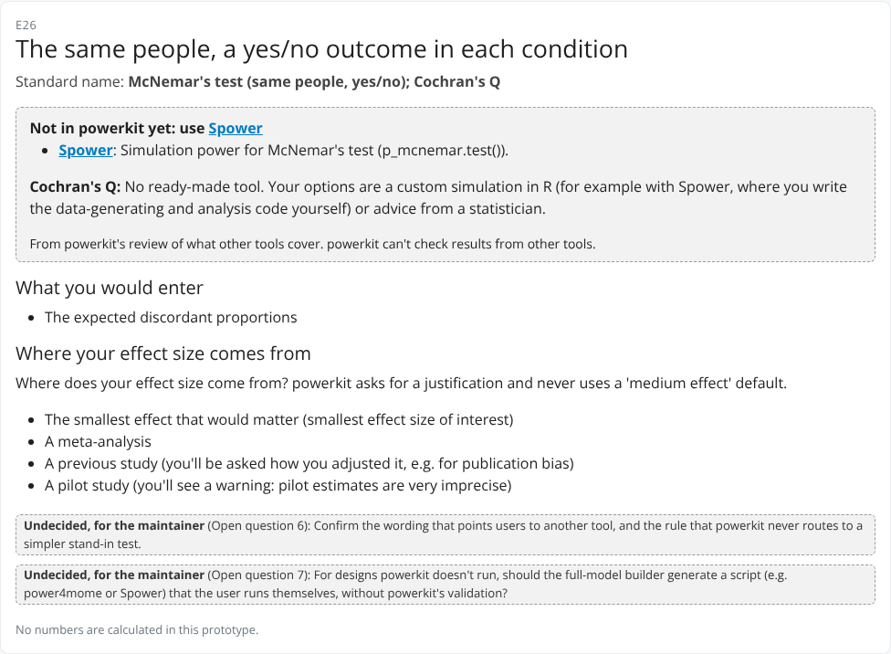

**Would the card make sense without statistics training?** **E26:** The title is clear. "Discordant proportions" is jargon a lay reader won't follow. The Cochran's Q line (no ready-made tool) is clear.

**Before/after:** Plan my whole study: E5 → E26 (routing fixes after the walkthroughs, F1–F3).

**Flags:** [F1](#flags)

### Three or more groups

#### One-way ANOVA

> We will compare memory scores among students using three study techniques: rereading, self-testing and concept mapping. Different students use each technique and are tested once.

**Answers given**

- **Help me choose:** *A score or scale* → *Independent people* → *Once* → *Detect an effect* → *A difference between groups or conditions* → *One* → *Three or more* → *Any difference among the groups*
- **I know my analysis:** *A score or scale* → *Independent people* → *Once* → *Detect an effect* → list: *Any difference among three or more groups or conditions*
- **Plan my whole study:** *A score or scale* → *Independent people* → *Once* → *Detect an effect* → variables: Main predictor (X): A condition with three or more groups; Outcome (Y): A score or scale; Mediators (go-betweens): None; Moderator (W): None; Covariates: None → analysis ticked: *The effect of X on the outcome*

**End point:** E18 (Any difference among three or more groups or conditions) in all three routes.

**Would the card make sense without statistics training?** **E18:** The title is clear. The standard name uses "omnibus", and "correlations between conditions" needs explaining.

#### Kruskal–Wallis

> Patient satisfaction ratings are very skewed, so we will compare three hospital wards with a Kruskal–Wallis test. Each patient rates once.

**Answers given**

- **Help me choose:** *A score or scale* → *Independent people* → *Once* → *Detect an effect* → *A difference between groups or conditions* → *One* → *Three or more* → *Any difference among the groups*
- **I know my analysis:** *A score or scale* → *Independent people* → *Once* → *Detect an effect* → list: *None of these fit / I'm not sure*
- **Plan my whole study:** *A score or scale* → *Independent people* → *Once* → *Detect an effect* → variables: Main predictor (X): A condition with three or more groups; Outcome (Y): A score or scale; Mediators (go-betweens): None; Moderator (W): None; Covariates: None → analysis ticked: *The effect of X on the outcome*

**End points:** Help me choose: E18 (Any difference among three or more groups or conditions); I know my analysis: E-unsure (None of these fit, or I'm not sure); Plan my whole study: E18 (Any difference among three or more groups or conditions). **The routes differ.**

 

**Would the card make sense without statistics training?** **E18:** The title is clear. The standard name uses "omnibus", and "correlations between conditions" needs explaining. **E-unsure:** Clear and plain: powerkit can't advise yet; talk to a statistician.

**Flags:** [F6](#flags)

#### Chi-square test (two or more groups)

> We will ask students from four faculties whether they prefer online, hybrid or in-person teaching. Each student gives one answer.

**Answers given**

- **Help me choose:** *Yes/no, or one of several categories* → *Independent people* → *Once* → *Detect an effect* → *A difference between groups or conditions* → *Different people, outcome in categories*
- **I know my analysis:** *Yes/no, or one of several categories* → *Independent people* → *Once* → *Detect an effect* → list: *Test whether two sets of categories are related*
- **Plan my whole study:** *Yes/no, or one of several categories* → *Independent people* → *Once* → *Detect an effect* → variables: Main predictor (X): A condition with three or more groups; Outcome (Y): One of several categories; Mediators (go-betweens): None; Moderator (W): None; Covariates: None → analysis ticked: *The effect of X on the outcome*

**End point:** E6 (Test whether two sets of categories are related) in all three routes.

**Would the card make sense without statistics training?** **E6:** The title ("two sets of categories") and the inputs are understandable. Two maintainer placeholders (judgement calls 3.7 and 3.9) also show on this card.

**Before/after:** Plan my whole study: E27 → E6 (routing fixes after the walkthroughs, F1–F3).

**Flags:** [F2](#flags), [F15](#flags)

#### One-way repeated measures ANOVA

> Each participant will do a Stroop task in silence, with low noise and with high noise. We want to know whether reaction times differ across the noise levels.

**Answers given**

- **Help me choose:** *A score or scale* → *Independent people* → *Many times* → *The same people in three or more conditions* → *Detect an effect* → *A difference between groups or conditions* → *One* → *Three or more* → *Any difference among the groups*
- **I know my analysis:** *A score or scale* → *Independent people* → *Many times* → *The same people in three or more conditions* → *Detect an effect* → list: *Any difference among three or more groups or conditions*
- **Plan my whole study:** *A score or scale* → *Independent people* → *Many times* → *The same people in three or more conditions* → *Detect an effect* → *Continue in 'Help me choose'* → *A difference between groups or conditions* → *One* → *Three or more* → *Any difference among the groups*

**End point:** E18 (Any difference among three or more groups or conditions) in all three routes.

**Would the card make sense without statistics training?** **E18:** The title is clear. The standard name uses "omnibus", and "correlations between conditions" needs explaining. The guided route sends three or more conditions per person to "Help me choose", which keeps the screening answers.

#### Friedman

> Each participant will rate how much they like three logos, and the ratings are very skewed, so we plan a Friedman test. Everyone rates all three.

**Answers given**

- **Help me choose:** *A score or scale* → *Independent people* → *Many times* → *The same people in three or more conditions* → *Detect an effect* → *A difference between groups or conditions* → *One* → *Three or more* → *Any difference among the groups*
- **I know my analysis:** *A score or scale* → *Independent people* → *Many times* → *The same people in three or more conditions* → *Detect an effect* → list: *None of these fit / I'm not sure*
- **Plan my whole study:** *A score or scale* → *Independent people* → *Many times* → *The same people in three or more conditions* → *Detect an effect* → *Continue in 'Help me choose'* → *A difference between groups or conditions* → *One* → *Three or more* → *Any difference among the groups*

**End points:** Help me choose: E18 (Any difference among three or more groups or conditions); I know my analysis: E-unsure (None of these fit, or I'm not sure); Plan my whole study: E18 (Any difference among three or more groups or conditions). **The routes differ.**

 

**Would the card make sense without statistics training?** **E18:** The title is clear. The standard name uses "omnibus", and "correlations between conditions" needs explaining. **E-unsure:** Clear and plain: powerkit can't advise yet; talk to a statistician. As for the repeated measures ANOVA. Judgement call 3.8's placeholder shows on E18.

**Flags:** [F6](#flags)

#### Repeated measures logistic regression

> Each participant will attempt one puzzle with no help, one with a hint and one with a worked example, and we record whether each is solved. We want to know whether success differs across the three conditions.

**Answers given**

- **Help me choose:** *Yes/no, or one of several categories* → *Independent people* → *Many times* → *The same people in three or more conditions* → *Detect an effect* → *A difference between groups or conditions* → *The same people in every condition*
- **I know my analysis:** *Yes/no, or one of several categories* → *Independent people* → *Many times* → *The same people in three or more conditions* → *Detect an effect* → list: *The same people, a yes/no outcome in each condition*
- **Plan my whole study:** *Yes/no, or one of several categories* → *Independent people* → *Many times* → *The same people in three or more conditions* → *Detect an effect* → *Continue in 'Help me choose'* → *A difference between groups or conditions* → *The same people in every condition*

**End point:** E26 (The same people, a yes/no outcome in each condition) in all three routes.

**Would the card make sense without statistics training?** **E26:** The title is clear. "Discordant proportions" is jargon a lay reader won't follow. The Cochran's Q line (no ready-made tool) is clear. As for the repeated measures ANOVA.

### Two or more factors

#### Factorial ANOVA

> We will cross feedback (praise or none) with task difficulty (easy or hard), with different students in each of the four groups. We want to know whether praise helps more on hard tasks.

**Answers given**

- **Help me choose:** *A score or scale* → *Independent people* → *Once* → *Detect an effect* → *A difference between groups or conditions* → *Two, crossed (every combination appears)* → *Yes: 2 x 2* → *Both factors: different people* → *Yes: the same number in every group* → *Whether the effect of one depends on the other (the interaction)* → *One effect shrinks*
- **I know my analysis:** *A score or scale* → *Independent people* → *Once* → *Detect an effect* → list: *Two factors crossed, different people in each of the four groups*
- **Plan my whole study:** *A score or scale* → *Independent people* → *Once* → *Detect an effect* → variables: Main predictor (X): A condition with two groups (or two existing groups); Outcome (Y): A score or scale; Mediators (go-betweens): None; Moderator (W): Two groups or conditions; Covariates: None → analysis ticked: *Whether the effect of X depends on the moderator (X x W)*

**End point:** E7 (Two factors crossed, different people in each of the four groups) in all three routes.

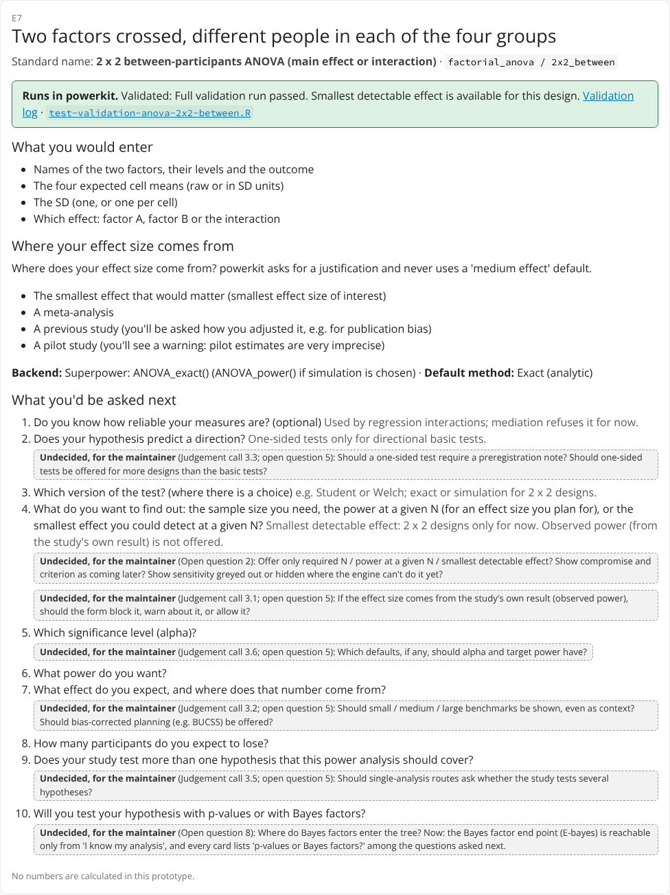

**Would the card make sense without statistics training?** **E7:** The title is clear. "Exact (analytic)" and "cell means" assume some training.

**Flags:** [F15](#flags)

#### Ordered logistic regression

> We will test whether age group and training condition predict a single confidence rating from 1 to 5, analysed as ordered categories. Each person rates once.

**Answers given**

- **Help me choose:** *Ordered categories (e.g. a single rating item)* → *As ordered categories*
- **I know my analysis:** *Ordered categories (e.g. a single rating item)* → *As ordered categories*
- **Plan my whole study:** *Ordered categories (e.g. a single rating item)* → *As ordered categories*

**End point:** E29 (An outcome in ordered categories (e.g. a single Likert item analysed as ordinal)) in all three routes.

**Would the card make sense without statistics training?** **E29:** The title is clear and has an example. "Odds ratio" and "proportional odds" need training. The screening sends ordered categories to O5a before any predictors are asked about, so the two predictors play no part. That's fine, because E29 is honest.

#### Factorial logistic regression

> We will cross message framing (gain or loss) with the messenger (a doctor or a friend) and record whether each participant books a flu jab. Different people are in each of the four groups.

**Answers given**

- **Help me choose:** *Yes/no, or one of several categories* → *Independent people* → *Once* → *Detect an effect* → *A difference between groups or conditions* → *Two or more factors (e.g. a 2 x 2 design), yes/no outcome*
- **I know my analysis:** *Yes/no, or one of several categories* → *Independent people* → *Once* → *Detect an effect* → list: *Two or more factors crossed, with a yes/no outcome*
- **Plan my whole study:** *Yes/no, or one of several categories* → *Independent people* → *Once* → *Detect an effect* → variables: Main predictor (X): A condition with two groups (or two existing groups); Outcome (Y): Yes/no; Mediators (go-betweens): None; Moderator (W): Two groups or conditions; Covariates: None → analysis ticked: *Whether the effect of X depends on the moderator (X x W)*

**End point:** E47 (Two or more factors crossed, with a yes/no outcome) in all three routes.

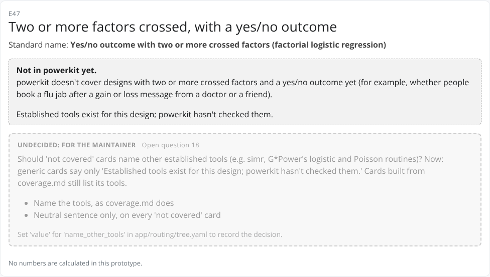

**Would the card make sense without statistics training?** **E47:** Clear, with an example. As with E43, the neutral tools sentence doesn't say where to go next (open question 18).

**Before/after:** Help me choose: E27 → E47; I know my analysis: E27 → E47; Plan my whole study: E32 → E47 (routing fixes after the walkthroughs, F1–F3).

**Flags:** [F3](#flags)

### Relationships and regression

#### Correlation

> We will test whether hours of sleep and reaction time are related in 200 adults. Each adult is measured once on both.

**Answers given**

- **Help me choose:** *A score or scale* → *Independent people* → *Once* → *Detect an effect* → *A relationship between two things you measure* → *A score or scale*
- **I know my analysis:** *A score or scale* → *Independent people* → *Once* → *Detect an effect* → list: *Test whether two scores are related*
- **Plan my whole study:** *A score or scale* → *Independent people* → *Once* → *Detect an effect* → variables: Main predictor (X): A measured score; Outcome (Y): A score or scale; Mediators (go-betweens): None; Moderator (W): None; Covariates: None → analysis ticked: *The effect of X on the outcome*

**End point:** E4 (Test whether two scores are related) in all three routes.

**Would the card make sense without statistics training?** **E4:** The title is clear. "The expected correlation r" needs a little background.

**Flags:** [F14](#flags), [F15](#flags)

#### Simple linear regression

> We will predict students' exam scores from how many hours they revised. 150 students report both once.

**Answers given**

- **Help me choose:** *A score or scale* → *Independent people* → *Once* → *Detect an effect* → *A relationship between two things you measure* → *A score or scale*
- **I know my analysis:** *A score or scale* → *Independent people* → *Once* → *Detect an effect* → list: *Test whether two scores are related*
- **Plan my whole study:** *A score or scale* → *Independent people* → *Once* → *Detect an effect* → variables: Main predictor (X): A measured score; Outcome (Y): A score or scale; Mediators (go-betweens): None; Moderator (W): None; Covariates: None → analysis ticked: *The effect of X on the outcome*

**End point:** E4 (Test whether two scores are related) in all three routes.

**Would the card make sense without statistics training?** **E4:** The title is clear. "The expected correlation r" needs a little background. E4's title ("two scores are related") fits, and the audit notes that the slope test is the same test as the test of r. Someone thinking "regression" may not recognise it.

**Flags:** [F15](#flags)

#### Non-parametric correlation

> We will test whether pupils' popularity rank and their rank in class achievement are related, using Spearman's correlation. Each pupil is ranked once on both.

**Answers given**

- **Help me choose:** *A score or scale* → *Independent people* → *Once* → *Detect an effect* → *A relationship between two things you measure* → *A score or scale*
- **I know my analysis:** *A score or scale* → *Independent people* → *Once* → *Detect an effect* → list: *None of these fit / I'm not sure*
- **Plan my whole study:** *A score or scale* → *Independent people* → *Once* → *Detect an effect* → variables: Main predictor (X): A measured score; Outcome (Y): A score or scale; Mediators (go-betweens): None; Moderator (W): None; Covariates: None → analysis ticked: *The effect of X on the outcome*

**End points:** Help me choose: E4 (Test whether two scores are related); I know my analysis: E-unsure (None of these fit, or I'm not sure); Plan my whole study: E4 (Test whether two scores are related). **The routes differ.**

 

**Would the card make sense without statistics training?** **E4:** The title is clear. "The expected correlation r" needs a little background. **E-unsure:** Clear and plain: powerkit can't advise yet; talk to a statistician.

**Flags:** [F6](#flags), [F15](#flags)

#### Simple logistic regression

> We will test whether a risk-taking questionnaire score predicts whether people choose to gamble in a lab task (yes or no). Each person is measured once.

**Answers given**

- **Help me choose:** *Yes/no, or one of several categories* → *Independent people* → *Once* → *Detect an effect* → *A relationship between two things you measure* → *Yes/no*
- **I know my analysis:** *Yes/no, or one of several categories* → *Independent people* → *Once* → *Detect an effect* → list: *Predict a yes/no outcome*
- **Plan my whole study:** *Yes/no, or one of several categories* → *Independent people* → *Once* → *Detect an effect* → variables: Main predictor (X): A measured score; Outcome (Y): Yes/no; Mediators (go-betweens): None; Moderator (W): None; Covariates: None → analysis ticked: *The effect of X on the outcome*

**End point:** E27 (Predict a yes/no outcome) in all three routes.

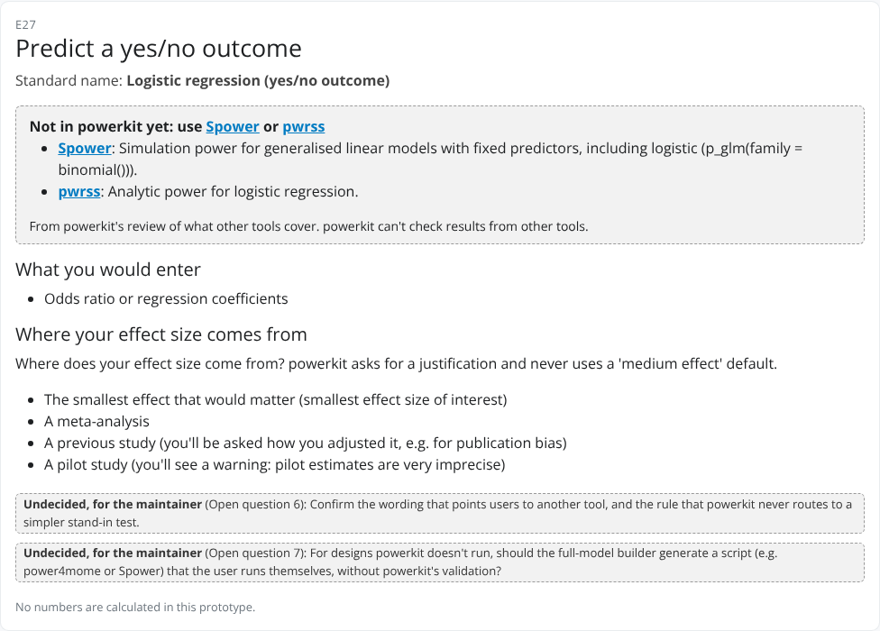

**Would the card make sense without statistics training?** **E27:** "Predict a yes/no outcome" is clear. "Odds ratio or regression coefficients" needs training.

#### Multiple regression

> We will predict life satisfaction from income, social support and health together, in 300 adults. Each is measured once.

**Answers given**

- **Help me choose:** *A score or scale* → *Independent people* → *Once* → *Detect an effect* → *A relationship between two things you measure* → *Several predictors at once, or controlling for other variables*
- **I know my analysis:** *A score or scale* → *Independent people* → *Once* → *Detect an effect* → list: *Several predictors at once, or one predictor controlling for others*
- **Plan my whole study:** *A score or scale* → *Independent people* → *Once* → *Detect an effect* → variables: Main predictor (X): A measured score; Outcome (Y): A score or scale; Mediators (go-betweens): None; Moderator (W): None; Covariates: Other covariates → analysis ticked: *The effect of X on the outcome*

**End point:** E24 (Several predictors at once, or one predictor controlling for others) in all three routes.

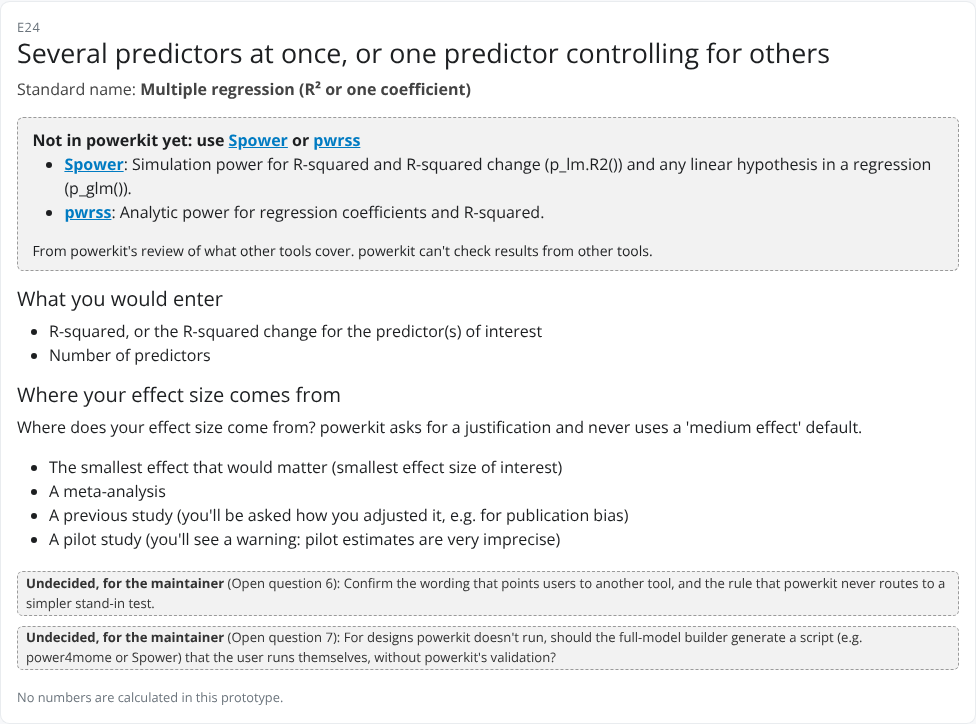

**Would the card make sense without statistics training?** **E24:** The title is clear. "R-squared change" needs explaining.

#### Analysis of covariance

> We will compare two teaching methods on final test scores, adjusting for students' prior attainment on a different test taken at the start. The final test is taken once.

**Answers given**

- **Help me choose:** *A score or scale* → *Independent people* → *Once* → *Detect an effect* → *A difference between groups or conditions* → *One* → *Two, with different people in each*
- **I know my analysis:** *A score or scale* → *Independent people* → *Once* → *Detect an effect* → list: *Compare groups adjusting for a covariate (e.g. the before score)*
- **Plan my whole study:** *A score or scale* → *Independent people* → *Once* → *Detect an effect* → variables: Main predictor (X): A condition with two groups (or two existing groups); Outcome (Y): A score or scale; Mediators (go-betweens): None; Moderator (W): None; Covariates: Other covariates → analysis ticked: *The effect of X on the outcome*

**End points:** Help me choose: E2 (Compare two separate groups on a score); I know my analysis: E23 (Compare groups adjusting for a covariate (e.g. the before score)); Plan my whole study: E23 (Compare groups adjusting for a covariate (e.g. the before score)). **The routes differ.**

 

**Would the card make sense without statistics training?** **E2:** The title is clear. The inputs use Cohen's d, a pooled SD and "Student's or Welch's test" without explanation. **E23:** The title is clear and gives an example. "R-squared" needs explaining.

**Flags:** [F4](#flags), [F15](#flags)

#### Multiple logistic regression

> We will predict whether students drop out of their course (yes or no) from first-term grades, attendance and wellbeing together. Each is measured once.

**Answers given**

- **Help me choose:** *Yes/no, or one of several categories* → *Independent people* → *Once* → *Detect an effect* → *A relationship between two things you measure* → *Yes/no*
- **I know my analysis:** *Yes/no, or one of several categories* → *Independent people* → *Once* → *Detect an effect* → list: *Predict a yes/no outcome*
- **Plan my whole study:** *Yes/no, or one of several categories* → *Independent people* → *Once* → *Detect an effect* → variables: Main predictor (X): A measured score; Outcome (Y): Yes/no; Mediators (go-betweens): None; Moderator (W): None; Covariates: Other covariates → analysis ticked: *The effect of X on the outcome*

**End point:** E27 (Predict a yes/no outcome) in all three routes.

**Would the card make sense without statistics training?** **E27:** "Predict a yes/no outcome" is clear. "Odds ratio or regression coefficients" needs training.

#### Discriminant analysis

> We want to classify patients into three diagnostic groups from their scores on five cognitive tests. Each patient is tested once.

**Answers given**

- **Help me choose:** *Yes/no, or one of several categories* → *Independent people* → *Once* → *Detect an effect* → *None of these fit / I'm not sure*
- **I know my analysis:** *Yes/no, or one of several categories* → *Independent people* → *Once* → *Detect an effect* → list: *None of these fit / I'm not sure*
- **Plan my whole study:** *Yes/no, or one of several categories* → *Independent people* → *Once* → *Detect an effect* → variables: Main predictor (X): None of these fit / I'm not sure; Outcome (Y): Yes/no; Mediators (go-betweens): None; Moderator (W): None; Covariates: None → analysis ticked: *The effect of X on the outcome*

**End point:** E-unsure (None of these fit, or I'm not sure) in all three routes.

**Would the card make sense without statistics training?** **E-unsure:** Clear and plain: powerkit can't advise yet; talk to a statistician. No route has an answer for classification. The safety net is the honest exit.

### Several outcomes, or no outcome

#### One-way MANOVA

> We will compare a mindfulness group and a control group on stress, sleep quality and concentration, analysed together. Each is measured once.

**Answers given**

- **Help me choose:** *A score or scale* → *Independent people* → *Once* → *Detect an effect* → *A difference between groups or conditions* → *One* → *Two, with different people in each*
- **I know my analysis:** *A score or scale* → *Independent people* → *Once* → *Detect an effect* → list: *None of these fit / I'm not sure*
- **Plan my whole study:** *A score or scale* → *Independent people* → *Once* → *Detect an effect* → variables: Main predictor (X): A condition with two groups (or two existing groups); Outcome (Y): A score or scale; Mediators (go-betweens): None; Moderator (W): None; Covariates: None → analysis ticked: *The effect of X on the outcome*

**End points:** Help me choose: E2 (Compare two separate groups on a score); I know my analysis: E-unsure (None of these fit, or I'm not sure); Plan my whole study: E2 (Compare two separate groups on a score). **The routes differ.**

 

**Would the card make sense without statistics training?** **E2:** The title is clear. The inputs use Cohen's d, a pooled SD and "Student's or Welch's test" without explanation. **E-unsure:** Clear and plain: powerkit can't advise yet; talk to a statistician.

**Flags:** [F6](#flags), [F15](#flags)

#### Multivariate multiple regression

> We will predict both anxiety and depression from childhood adversity and current social support. 400 adults are measured once.

**Answers given**

- **Help me choose:** *A score or scale* → *Independent people* → *Once* → *Detect an effect* → *A relationship between two things you measure* → *Several predictors at once, or controlling for other variables*
- **I know my analysis:** *A score or scale* → *Independent people* → *Once* → *Detect an effect* → list: *None of these fit / I'm not sure*
- **Plan my whole study:** *A score or scale* → *Independent people* → *Once* → *Detect an effect* → variables: Main predictor (X): A measured score; Outcome (Y): A score or scale; Mediators (go-betweens): None; Moderator (W): None; Covariates: Other covariates → analysis ticked: *The effect of X on the outcome*

**End points:** Help me choose: E24 (Several predictors at once, or one predictor controlling for others); I know my analysis: E-unsure (None of these fit, or I'm not sure); Plan my whole study: E24 (Several predictors at once, or one predictor controlling for others). **The routes differ.**

 

**Would the card make sense without statistics training?** **E24:** The title is clear. "R-squared change" needs explaining. **E-unsure:** Clear and plain: powerkit can't advise yet; talk to a statistician.

**Flags:** [F6](#flags)

#### Factor analysis

> We will find out how many factors underlie 20 items about workplace wellbeing. 350 employees answer them once.

**Answers given**

- **Help me choose:** *A score or scale* → *Independent people* → *Once* → *Detect an effect* → *That a model fits: a questionnaire structure, or a model with latent variables (SEM)*
- **I know my analysis:** *A score or scale* → *Independent people* → *Once* → *Detect an effect* → list: *Check that a model or questionnaire structure fits*
- **Plan my whole study:** *A score or scale* → *Independent people* → *Once* → *Detect an effect* → variables: Main predictor (X): None of these fit / I'm not sure; Outcome (Y): A score or scale; Mediators (go-betweens): None; Moderator (W): None; Covariates: None → analysis ticked: *The effect of X on the outcome*

**End points:** Help me choose: E37 (Check that a model or questionnaire structure fits); I know my analysis: E37 (Check that a model or questionnaire structure fits); Plan my whole study: E-unsure (None of these fit, or I'm not sure). **The routes differ.**

 

**Would the card make sense without statistics training?** **E37:** The title is clear for someone checking a questionnaire's structure. "RMSEA" is jargon. The card doesn't mention exploratory factor analysis or IRT, which can reach it. **E-unsure:** Clear and plain: powerkit can't advise yet; talk to a statistician.

**Flags:** [F7](#flags)

#### Canonical correlation

> We want to relate a set of three personality scores to a set of four job-performance ratings in 250 employees. Each is measured once.

**Answers given**

- **Help me choose:** *A score or scale* → *Independent people* → *Once* → *Detect an effect* → *A relationship between two things you measure* → *Several predictors at once, or controlling for other variables*
- **I know my analysis:** *A score or scale* → *Independent people* → *Once* → *Detect an effect* → list: *None of these fit / I'm not sure*
- **Plan my whole study:** *A score or scale* → *Independent people* → *Once* → *Detect an effect* → variables: Main predictor (X): None of these fit / I'm not sure; Outcome (Y): A score or scale; Mediators (go-betweens): None; Moderator (W): None; Covariates: None → analysis ticked: *The effect of X on the outcome*

**End points:** Help me choose: E24 (Several predictors at once, or one predictor controlling for others); I know my analysis: E-unsure (None of these fit, or I'm not sure); Plan my whole study: E-unsure (None of these fit, or I'm not sure). **The routes differ.**

 

**Would the card make sense without statistics training?** **E24:** The title is clear. "R-squared change" needs explaining. **E-unsure:** Clear and plain: powerkit can't advise yet; talk to a statistician.

**Flags:** [F6](#flags)
